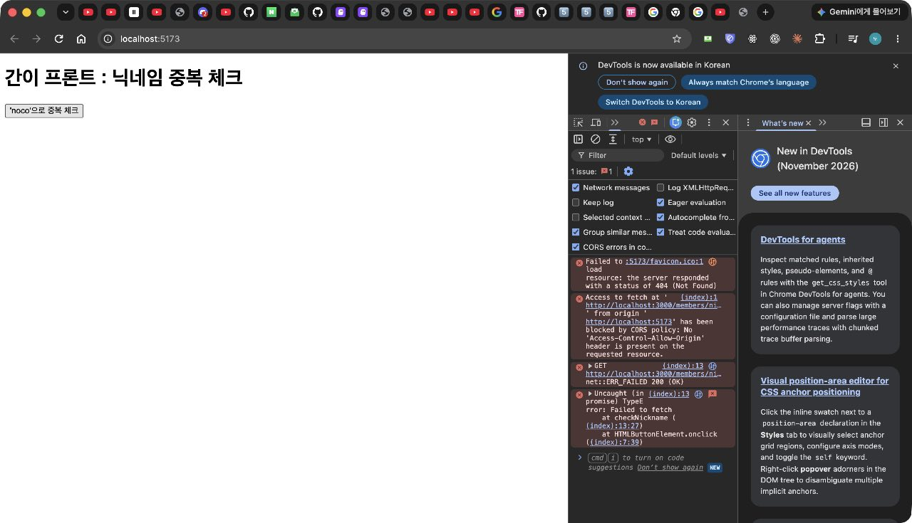
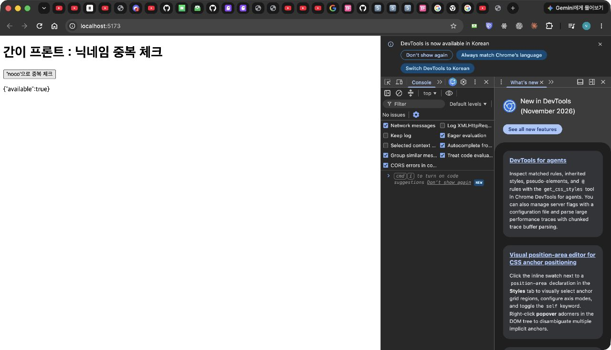
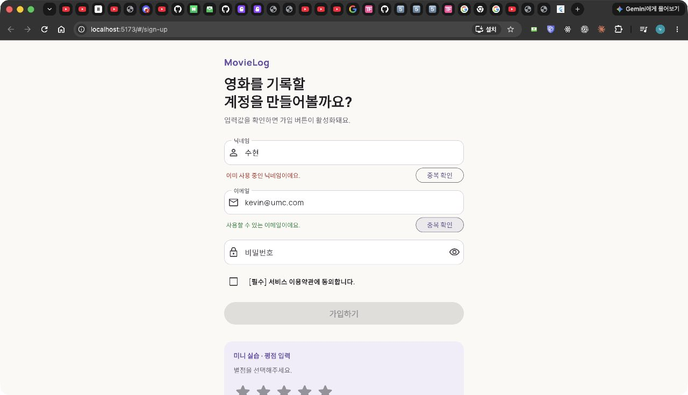
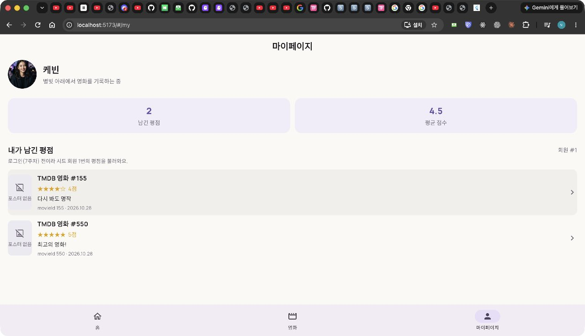

# 5주차 백엔드 미션 — 화면과 API를 처음 연결하기

- 이름 / 닉네임: 케빈
- 선택 스택: NestJS 12 + TypeORM 0.3 + MySQL
- [GitHub 실습 저장소 (`movie/` 폴더)](https://github.com/brownglasses/11th_BE_NodeJs_Practice_Mission/tree/brownglasses/week05/movie)
- Pull Request: [실습 PR #15](https://github.com/UMC-Inha/11th_BE_NodeJs_Practice_Mission/pull/15)
- [원본 워크북](https://makeus-challenge.notion.site/5-API-1-407b57f4596b807aacbff5b22cd96bc0)
- [핵심 키워드](../../../keyword/Backend/chapter05/keyword.md)

## 실습 체크리스트

- [x] 로컬 MySQL `umc_movie`에 member, rating, favorite 테이블, member/rating 시드 데이터 ([schema.sql](https://github.com/brownglasses/11th_BE_NodeJs_Practice_Mission/blob/brownglasses/week05/movie/sql/schema.sql), [seed.sql](https://github.com/brownglasses/11th_BE_NodeJs_Practice_Mission/blob/brownglasses/week05/movie/sql/seed.sql))
- [x] GET /members/nickname/{nickname}, GET /members/email/{email}이 available을 올바르게 응답
- [x] GET /members/{memberId}/ratings가 최신순으로 평점 목록 응답
- [x] CORS 설정 전, 간이 프론트 콘솔에서 CORS 에러 확인
- [x] CORS 설정 후, 같은 간이 프론트에서 정상 응답 확인

## 새 프로젝트와 설계

3~4주차 도서 프로젝트(레포 루트)는 그대로 두고 `nest new movie`로 새로 만들었다. 워크북대로 도메인 모듈 없이 레이어 폴더를 두고 `app.module.ts`가 Controller·Service·Entity를 모두 등록한다.

```
movie/src
├── controller   member.controller.ts, rating.controller.ts
├── service      member.service.ts, rating.service.ts
├── entity       base-time.entity.ts, member.entity.ts, rating.entity.ts
├── dto          check-response.dto.ts, rating-response.dto.ts, member-request.dto.ts
├── app.module.ts, app.setup.ts(CORS·ValidationPipe), main.ts
```

- `BaseTimeEntity`(@Entity 없음)가 created_at·updated_at을 물려준다.
- Member 1 : N Rating. Rating의 `movie_id`는 TMDB 영화 ID를 담는 일반 컬럼이고 FK가 아니다(우리 DB에 영화 테이블이 없음).
- rating·favorite에 `(member_id, movie_id)` 복합 UNIQUE. favorite은 8주차용으로 스키마만 만들었다.
- `synchronize: false`. 테이블은 SQL로 만들고 코드가 바꾸지 않는다.
- `TypeOrmModule.forRootAsync`로 ConfigModule이 `.env`를 읽은 뒤 접속 정보를 만든다. DB 비밀번호는 `.env`에만 있다.

## API 명세

| API | Method | URL | Request | Success Response (200) |
| --- | --- | --- | --- | --- |
| 닉네임 중복 체크 | GET | `/members/nickname/{nickname}` | Path: nickname (string, 2~12자) | `{ "available": true }` |
| 이메일 중복 체크 | GET | `/members/email/{email}` | Path: email (string, 이메일 형식) | `{ "available": true }` |
| 유저별 평점 조회 | GET | `/members/{memberId}/ratings` | Path: memberId (number), Query: page·size (선택) | `[{ ratingId, movieId, score, comment, createdAt, updatedAt }]` |

오류: 없는 회원 404 `{ "message": "존재하지 않는 유저입니다." }`, 숫자가 아닌 memberId 400, 형식이 틀린 닉네임·이메일 400.

## 핵심 코드

[Member Entity](https://github.com/brownglasses/11th_BE_NodeJs_Practice_Mission/blob/brownglasses/week05/movie/src/entity/member.entity.ts), [Rating Entity](https://github.com/brownglasses/11th_BE_NodeJs_Practice_Mission/blob/brownglasses/week05/movie/src/entity/rating.entity.ts), [DTO](https://github.com/brownglasses/11th_BE_NodeJs_Practice_Mission/tree/brownglasses/week05/movie/src/dto), [MemberService](https://github.com/brownglasses/11th_BE_NodeJs_Practice_Mission/blob/brownglasses/week05/movie/src/service/member.service.ts), [RatingService](https://github.com/brownglasses/11th_BE_NodeJs_Practice_Mission/blob/brownglasses/week05/movie/src/service/rating.service.ts), [Controller](https://github.com/brownglasses/11th_BE_NodeJs_Practice_Mission/tree/brownglasses/week05/movie/src/controller), [CORS 설정](https://github.com/brownglasses/11th_BE_NodeJs_Practice_Mission/blob/brownglasses/week05/movie/src/app.setup.ts).

```ts
// RatingService: 평점 0개(200 [])와 없는 회원(404)을 구분하려고 회원부터 확인
const exists = await this.memberRepository.exists({ where: { memberId } });
if (!exists) throw new NotFoundException('존재하지 않는 유저입니다.');
const ratings = await this.ratingRepository.find({
  where: { member: { memberId } },
  order: { ratingId: 'DESC' },
  ...(paged ? { skip: (query.page ?? 0) * size, take: size } : {}),
});
return ratings.map((rating) => RatingResponseDto.from(rating)); // password가 나가지 않는다
```

```ts
// main.ts → configureApp
app.enableCors({
  origin: parseCorsOrigins(process.env.CORS_ORIGINS), // 기본 ['http://localhost:5173']
  methods: ['GET', 'POST', 'PATCH', 'DELETE'],
});
```

## 실습 인증

### CORS 설정 전 — 간이 프론트(5173) → 서버(3000)

워크북 첨부 `index.txt`를 [`mock-frontend/index.html`](https://github.com/brownglasses/11th_BE_NodeJs_Practice_Mission/blob/brownglasses/week05/mock-frontend/index.html)로 두고 `npx serve -l 5173`으로 띄웠다. `enableCors` 없이 서버를 띄우는 [`scripts/start-without-cors.mjs`](https://github.com/brownglasses/11th_BE_NodeJs_Practice_Mission/blob/brownglasses/week05/movie/scripts/start-without-cors.mjs)로 재현했다.



`blocked by CORS policy: No 'Access-Control-Allow-Origin' header`가 뜨고, 바로 아래 줄이 `GET ... net::ERR_FAILED 200 (OK)`이다. 서버는 200으로 처리했지만 브라우저가 응답을 막았다.

### CORS 설정 후 — 같은 페이지



콘솔 에러 없이 `{"available":true}`가 찍힌다(시드 닉네임은 '수현'이라 'noco'는 사용 가능).

## 미션 인증

### (필수) 실제 화면에서 확인하기

프론트 5주차 MovieLog Flutter Web을 `5173`으로 띄워 이 서버를 불렀다. 구현한 세 API를 모두 연결했다.



닉네임 '수현' → `GET /members/nickname/수현` → "이미 사용 중인 닉네임이에요.", 이메일 `kevin@umc.com` → `GET /members/email/kevin@umc.com` → "사용할 수 있는 이메일이에요."



마이페이지 → `GET /members/1/ratings` → 평점 2건(movieId 155 4점, 550 5점), ratingId 최신순. 이 캡처는 TMDB Token을 넣기 전이라 제목 대신 movieId가 보인다. Token을 넣은 뒤에는 같은 movieId로 TMDB에서 [다크 나이트·파이트 클럽 제목과 포스터](../../Frontend/chapter05/images/10_my_ratings.png)를 함께 보여준다.

Flutter 네이티브 앱은 브라우저가 아니라 CORS 적용을 받지 않으므로, 웹 빌드로 띄워야 CORS 설정이 실제로 필요한지 확인할 수 있었다.

### Postman / 요청 기록

[Postman Collection](https://github.com/brownglasses/11th_BE_NodeJs_Practice_Mission/blob/brownglasses/week05/movie/evidence/week05.postman_collection.json)을 Newman(Postman CLI 실행기)으로 실제 서버에 보내 11개 요청·14개 assertion이 통과했다([결과](https://github.com/brownglasses/11th_BE_NodeJs_Practice_Mission/blob/brownglasses/week05/movie/evidence/week05-newman.json)). 검증 스크립트는 실제 DB에 18개 요청을 보내 요청·상태·응답·CORS 헤더를 [기록](https://github.com/brownglasses/11th_BE_NodeJs_Practice_Mission/blob/brownglasses/week05/movie/evidence/week05-api-results.json)했다.

| 요청 | 상태 | 응답 |
| --- | --- | --- |
| GET /members/nickname/수현 | 200 | `{"available":false}` |
| GET /members/nickname/케빈 | 200 | `{"available":true}` |
| GET /members/email/noco@umc.com | 200 | `{"available":false}` |
| GET /members/email/kevin@umc.com | 200 | `{"available":true}` |
| GET /members/1/ratings | 200 | ratingId [2, 1] (155 "다시 봐도 명작" 4점, 550 "최고의 영화!" 5점) |
| GET /members/999/ratings | 404 | 존재하지 않는 유저입니다. |
| GET /members/abc/ratings | 400 | Validation failed (numeric string is expected) |

> Postman 데스크톱 앱 화면 캡처는 아직 첨부하지 않았다. 같은 Collection을 앱에서 Import → Send 하면 같은 결과가 나온다.

### (선택) 닉네임/이메일 형식 유효성 검증

`@Param()`을 DTO(`NicknameParamDto`: `@Length(2, 12)`, `EmailParamDto`: `@IsEmail`)로 받고 전역 ValidationPipe를 켰다. DB를 보기 전에 400을 돌려준다.

| 요청 | 상태 | 메시지 |
| --- | --- | --- |
| /members/nickname/수 | 400 | 닉네임은 2~12자로 입력해 주세요. |
| /members/nickname/가×13 | 400 | 닉네임은 2~12자로 입력해 주세요. |
| /members/nickname/가×12 | 200 | `{"available":true}` |
| /members/email/noco-umc.com | 400 | 이메일 형식이 올바르지 않습니다. |

### (선택) 평점 목록 페이지네이션

`GET /members/{memberId}/ratings?page=0&size=10`. page·size를 둘 다 생략하면 명세대로 전체를 주고, 하나라도 주면 page 기본 0, size 기본 10으로 `skip = page × size`, `take = size`. size는 1~50, page는 0 이상 정수만 허용.

| 요청 | 결과 |
| --- | --- |
| ?page=0&size=1 | ratingId [2] |
| ?page=1&size=1 | ratingId [1] |
| ?page=5&size=10 | `[]` (200) |
| ?size=0 | 400 size는 1~50 사이 정수여야 합니다. |

### (선택) CORS 허용 범위를 좁혀보고 이유 설명하기

같은 서버를 `CORS_ORIGINS=*`(3001)와 `CORS_ORIGINS=http://localhost:5173`(3000)로 띄워 Origin만 바꿔 요청했다([기록](week05-cors-compare.txt)).

| 설정 | Origin: http://localhost:5173 | Origin: https://evil.example |
| --- | --- | --- |
| `*` | 200, `Access-Control-Allow-Origin: *` | 200, `Access-Control-Allow-Origin: *` |
| `http://localhost:5173` | 200, `Access-Control-Allow-Origin: http://localhost:5173` | 200, 허용 헤더 없음 → 브라우저가 차단 |

`*`로 열면 우리 화면뿐 아니라 아무 사이트의 스크립트도 사용자 브라우저에서 우리 API 응답을 읽을 수 있다. 특정 출처만 허용하면 위 캡처의 "CORS 설정 전"처럼 다른 출처의 화면은 응답을 읽지 못하고, 우리 MovieLog 화면(5173)만 읽는다. 지금 API는 닉네임 존재 여부와 평점 같은 회원 데이터를 돌려주고 7주차부터는 로그인 토큰을 실어 보내므로, 허용 목록을 실제 프론트 주소로 좁혀 두는 편이 안전하다. 다만 CORS는 브라우저의 응답 읽기만 막을 뿐 서버 접근 자체를 막지는 않으므로(두 경우 모두 서버는 200), 인증·권한 검사는 서버에서 따로 해야 한다.

## 검증

- `npm run build`, `npm run lint` 성공
- `npm test` 9개 통과: Service 중복 체크·404·최신순·명세 6필드·password 미포함·skip/take, CORS 출처 파싱
- `npm run test:e2e` 8개 통과: 실제 MySQL로 세 API, 404/400, 형식 검증, 페이지네이션, 허용/비허용 Origin 헤더
- 실제 DB 검증 스크립트 18개 요청, Newman 11개 요청·14개 assertion

## 트러블슈팅

### ⚡ No.1 서버 로그는 200인데 화면에는 아무것도 안 뜸

`이슈`
👉 간이 프론트 버튼을 눌러도 결과 칸이 비어 있었다. 서버는 요청을 정상 처리했다.

`문제`
👉 브라우저 콘솔에 `No 'Access-Control-Allow-Origin' header is present`, 바로 아래 `net::ERR_FAILED 200 (OK)`. 5173과 3000은 포트가 달라 다른 출처이고, 서버 응답에 허용 헤더가 없어 브라우저가 응답을 스크립트에 넘기지 않았다. curl로 같은 요청을 보내면 200과 JSON이 정상으로 오고 `Access-Control-Allow-Origin`만 없었다.

`해결`
👉 `main.ts`에서 `app.enableCors({ origin: 'http://localhost:5173' })`. 같은 페이지에서 `{"available":true}` 확인. 프론트 코드는 바꾸지 않았다.

`참고레퍼런스`
- [MDN CORS](https://developer.mozilla.org/ko/docs/Web/HTTP/CORS)
- [NestJS CORS](https://docs.nestjs.com/security/cors)

### ⚡ No.2 MovieLog 웹을 5173으로 띄웠는데 예전 간이 프론트가 보임

`이슈`
👉 간이 프론트를 끄고 MovieLog Flutter Web을 `serve -l 5173`으로 띄웠는데, 브라우저에는 여전히 "간이 프론트 : 닉네임 중복 체크"가 떴다.

`문제`
👉 간이 프론트 서버를 끌 때 다른 PID를 종료해 5173이 계속 점유돼 있었다. `serve`는 포트가 사용 중이면 오류 없이 다른 포트(이번엔 53036)로 뜬다. 그대로 53036 주소로 들어갔다면 CORS 허용 목록(5173)에 없는 출처라 모든 API가 막혔을 것이다.

`해결`
👉 `lsof -iTCP:5173 -sTCP:LISTEN`으로 실제 점유 프로세스를 확인해 종료하고, 53036으로 뜬 서버도 끈 뒤 `-l tcp://127.0.0.1:5173`으로 다시 띄웠다. 로그의 `Accepting connections at http://127.0.0.1:5173`을 확인하고 접속했다.

`참고레퍼런스`
- [serve](https://github.com/vercel/serve)

## 학습 후기

Postman으로만 확인할 때는 몰랐던 문제가 브라우저에 붙이자 바로 보였다. 서버는 200을 줬는데 화면은 비어 있었고, 원인이 프론트가 아니라 서버 응답 헤더라는 점이 가장 기억에 남는다. 같은 응답을 Flutter 네이티브 앱은 그대로 받는다는 점에서 CORS가 서버 보안이 아니라 브라우저의 규칙이라는 것도 이해했다. DTO로 응답 필드를 명세와 똑같이 맞추니 password 같은 컬럼이 실수로 나갈 일이 없고, 프론트 DTO도 그 모양 그대로 만들 수 있었다.
