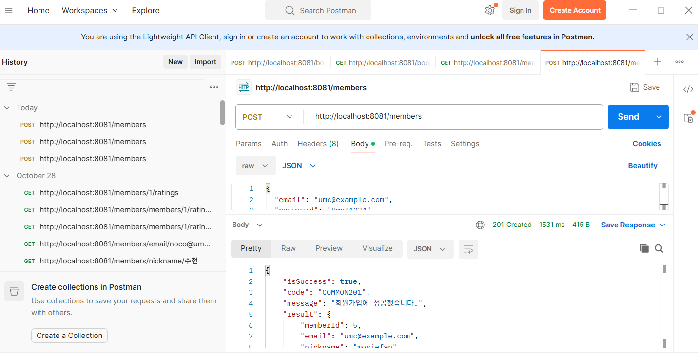
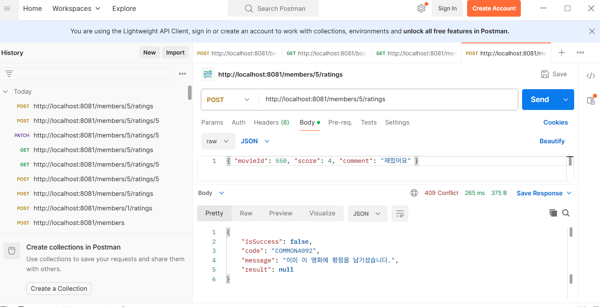
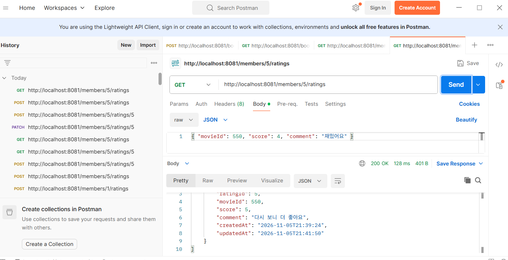
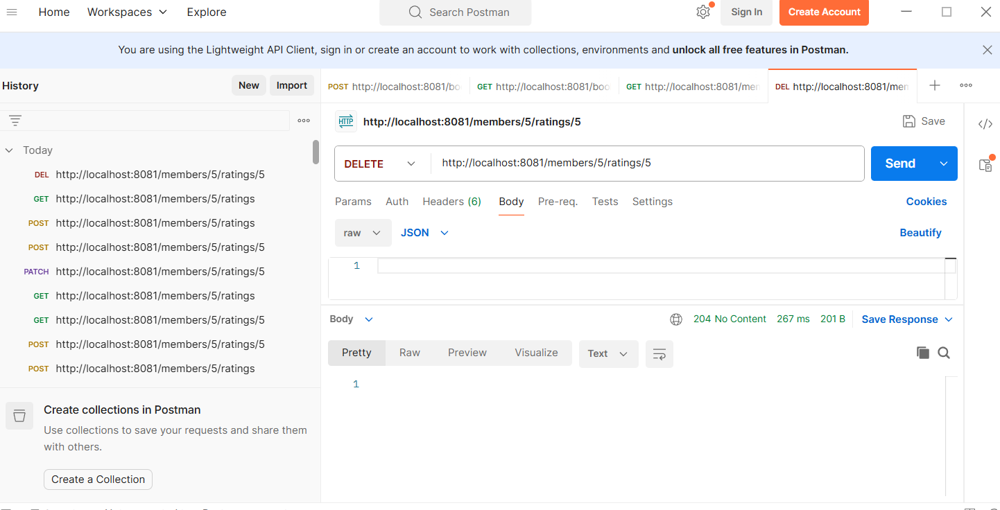

## 6주차 API 명세서 작성

### 공통 응답 형식

모든 응답은 아래 구조로 옵니다.

```json
{
  "isSuccess": true,
  "code": "COMMON201",
  "message": "응답 메시지",
  "result": {}
}
```

실패하면 isSuccess가 false, result가 null입니다.

### 공통 오류 코드

- 400 / COMMON4001: 입력값이 형식이나 범위에 맞지 않음 (DTO 검증 실패)
- 403 / COMMON403: 본인이 작성한 평점이 아님
- 404 / COMMON404: 회원이나 평점이 없음
- 409 / COMMON4092: 서비스의 중복 검사에 걸림 (이메일, 닉네임, 평점)
- 409 / COMMON4091: DB UNIQUE 제약 위반

---

### 1. 회원가입

`POST /members`

새 회원을 등록합니다. 비밀번호는 bcrypt 해시로 저장하고, 응답에는 넣지 않습니다.

**요청 값**

- email (String, 필수): 이메일 형식이어야 합니다.
- password (String, 필수): 대문자, 소문자, 숫자, 특수문자(!@#$%^&*)를 모두 포함한 8자 이상이어야 합니다.
- nickname (String, 필수): 2자 이상 12자 이하여야 합니다.

**요청 예시**

```json
{
  "email": "umc@example.com",
  "password": "Umc!1234",
  "nickname": "moviefan"
}
```

**성공 응답 (201 Created)**

```json
{
  "isSuccess": true,
  "code": "COMMON201",
  "message": "회원가입에 성공했습니다.",
  "result": {
    "memberId": 1,
    "email": "umc@example.com",
    "nickname": "moviefan"
  }
}
```

**실패 응답**

- 400 COMMON4001: "이메일을 입력해주세요." / "올바른 이메일 형식이 아닙니다."
- 400 COMMON4001: "비밀번호를 입력해주세요." / "비밀번호는 대문자/소문자/숫자/특수문자를 포함한 8자 이상이어야 합니다."
- 400 COMMON4001: "닉네임을 입력해주세요." / "닉네임은 2자 이상 12자 이하로 입력해주세요."
- 409 COMMON4092: "이미 사용 중인 이메일입니다."
- 409 COMMON4092: "이미 사용 중인 닉네임입니다."

---

### 2. 평점 등록

`POST /members/{memberId}/ratings`

회원이 영화에 평점을 남깁니다. 한 회원은 같은 영화에 평점을 한 번만 남길 수 있습니다.

**경로 값**

- memberId (Long): 평점을 남기는 회원의 ID

**요청 값**

- movieId (Long, 필수): TMDB 영화 ID이며 양수여야 합니다.
- score (Integer, 필수): 1점 이상 5점 이하입니다.
- comment (String, 선택): 500자 이하입니다.

**요청 예시**

```json
{
  "movieId": 550,
  "score": 4,
  "comment": "재밌어요"
}
```

**성공 응답 (201 Created)**

result에는 새로 생긴 평점의 ratingId가 들어 있습니다.

```json
{
  "isSuccess": true,
  "code": "COMMON201",
  "message": "평점 등록에 성공했습니다.",
  "result": 1
}
```

**실패 응답**

- 400 COMMON4001: "영화 ID를 입력해주세요." / "영화 ID는 양수여야 합니다."
- 400 COMMON4001: "별점을 입력해주세요." / "별점은 1점 이상이어야 합니다." / "별점은 5점 이하여야 합니다."
- 400 COMMON4001: "후기는 500자 이하로 입력해주세요."
- 404 COMMON404: "존재하지 않는 유저입니다."
- 409 COMMON4092: "이미 이 영화에 평점을 남기셨습니다."

---

### 3. 평점 수정

`PATCH /members/{memberId}/ratings/{ratingId}`

본인이 작성한 평점의 별점과 후기를 수정합니다.

**경로 값**

- memberId (Long): 수정을 요청한 회원의 ID
- ratingId (Long): 수정할 평점의 ID

**요청 값**

- score (Integer, 필수): 1점 이상 5점 이하입니다.
- comment (String, 선택): 500자 이하입니다.

**요청 예시**

```json
{
  "score": 5,
  "comment": "다시 보니 더 좋아요"
}
```

**성공 응답 (200 OK)**

```json
{
  "isSuccess": true,
  "code": "COMMON200",
  "message": "평점 수정에 성공했습니다.",
  "result": null
}
```

**실패 응답**

- 400 COMMON4001: "별점을 입력해주세요." / "별점은 1점 이상이어야 합니다." / "별점은 5점 이하여야 합니다."
- 400 COMMON4001: "후기는 500자 이하로 입력해주세요."
- 403 COMMON403: "본인이 작성한 평점만 수정하거나 삭제할 수 있습니다."
- 404 COMMON404: "존재하지 않는 평점입니다."

---

### 4. 평점 삭제

`DELETE /members/{memberId}/ratings/{ratingId}`

본인이 작성한 평점을 삭제합니다.

**경로 값**

- memberId (Long): 삭제를 요청한 회원의 ID
- ratingId (Long): 삭제할 평점의 ID

**요청 값**: 없음

**성공 응답 (204 No Content)**: 응답 본문 없음

**실패 응답**

- 403 COMMON403: "본인이 작성한 평점만 수정하거나 삭제할 수 있습니다."
- 404 COMMON404: "존재하지 않는 평점입니다."

---

## 트러블 슈팅 :

👉 [트러블이 생긴 상태 작성]

이슈: POST /members 요청이 404 Not Found로 응답했다.

**문제**

👉 문제: 같은 포트(8081)를 쓰는 3주차 프로젝트가 대신 실행되고 있었다.

**해결**

👉 해결: 그 서버를 끄고 movie 프로젝트의 MovieApplication을 실행했다.

---

## 실행 결과

### practice1



### mission2



### mission2-1



### mission3


