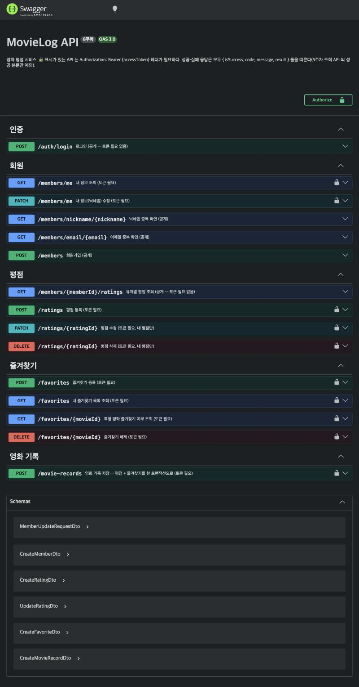
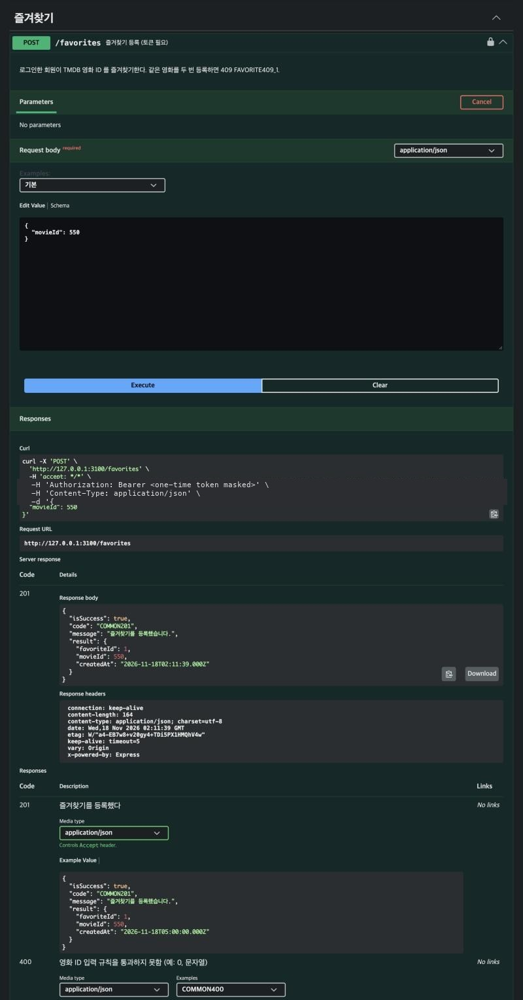

# 8주차 백엔드 미션 — 서비스의 핵심 기능 만들기

- 이름 / 닉네임: 케빈
- 선택 스택: NestJS 12 + TypeORM + MySQL + `@nestjs/jwt` + `@nestjs/swagger` (Spring Boot 대신 NestJS 한 스택으로 진행)
- [GitHub 실습 저장소 (`movie/` 폴더)](https://github.com/brownglasses/11th_BE_NodeJs_Practice_Mission/tree/brownglasses/week08/movie)
- Pull Request: BE_PR_LINK_PLACEHOLDER
- [원본 워크북](https://makeus-challenge.notion.site/41cb57f4596b802ca037cbf4eb04f7d6)
- [핵심 키워드](../../../keyword/Backend/chapter08/keyword.md)
- 같은 주 프론트엔드 미션: [프론트 8주차](../../Frontend/chapter08/mission.md)

> 요청·응답 원문과 Newman 결과, Swagger 화면은 [evidence/](evidence/)에 있다. 모든 JWT는 서명 부분을 `<signature masked>`로 가렸다.

## 실습 체크리스트

- [x] `Favorite` 엔티티가 `BaseTimeEntity`를 상속하고 `member`와 `movieId`를 저장하도록 만들었다.
- [x] `POST /favorites`에서 토큰의 회원 ID를 사용하고 요청으로 `memberId`를 받지 않았다. (몰래 넣은 `memberId`는 400 `property memberId should not exist`)
- [x] 같은 영화의 즐겨찾기 중복 요청에 409 `FAVORITE409_1`이 오는 것을 확인했다.
- [x] `GET /favorites`에서 내 즐겨찾기만 최신 등록 순서로 조회되는 것을 확인했다. (회원 두 명으로 A는 `200 → 100` 순서, B는 자기 것만, B가 A의 영화를 해제하려 하면 404)
- [x] `GET /favorites/{movieId}`에서 등록 전후의 `isFavorite` 값이 각각 `false`, `true`로 바뀌는 것을 확인했다. (등록 → true → 해제 → false)
- [x] `DELETE /favorites/{movieId}`가 200과 공통 응답 형식(`result: null`)으로 동작하는 것을 확인했다.
- [x] 평점과 즐겨찾기를 함께 저장하는 코드가 하나의 트랜잭션 안에서 동작하도록 만들었다. (`dataSource.transaction` + `manager.getRepository`)

## 이번 주에 만든 API

모두 `AuthGuard`로 보호되고, 어디에도 `memberId`를 보내지 않는다(토큰의 회원). 성공 응답은 `{ isSuccess, code, message, result }` 틀이다.

| API | Method | URL | 성공 | `result` |
| --- | --- | --- | --- | --- |
| 즐겨찾기 등록 | POST | `/favorites` (Body: `movieId`) | 201 `COMMON201` | `{ favoriteId, movieId, createdAt }` |
| 내 즐겨찾기 조회 | GET | `/favorites` | 200 | 배열(내 것만, `favoriteId` 최신순, 비어도 `[]`) |
| 즐겨찾기 여부 조회 | GET | `/favorites/{movieId}` | 200 | `{ isFavorite: true \| false }` (없어도 오류가 아니다) |
| 즐겨찾기 해제 | DELETE | `/favorites/{movieId}` | **200** | `null` (204가 아니다: 공통 응답 틀을 유지하려고) |
| 영화 기록 저장 | POST | `/movie-records` (Body: `movieId`, `score`, `comment`, `addToFavorites`) | 201 | `{ rating, favorite \| null }` |

| code | 상태 | 언제 |
| --- | --- | --- |
| `FAVORITE404_1` | 404 | 해제하려는 즐겨찾기를 찾을 수 없음(남의 것을 해제하려 해도 "내 것 중에 없음"으로 404) |
| `FAVORITE409_1` | 409 | 이미 같은 영화를 즐겨찾기함(사전 검사 또는 DB UNIQUE 위반) |
| `RATING409_1` | 409 | 영화 기록 저장 중 이미 평점이 있음(7주차 코드 그대로) |
| `AUTH401_2` / `COMMON400` | 401 / 400 | 토큰 없음 / `movieId: 0`·문자열·별점 6·모르는 필드 |

## 구현 구조

7주차 구조 위에 파일만 더했다.

```
movie/src
├── entity       favorite.entity.ts          ← BaseTimeEntity 상속, @Unique('uk_favorite_member_movie')
├── dto          create-favorite / favorite-response / favorite-status-response
│                create-movie-record / movie-record-response
├── service      favorite.service.ts, movie-record.service.ts   ← 트랜잭션
├── controller   favorite.controller.ts, movie-record.controller.ts   (@UseGuards(AuthGuard) + @LoginMember())
├── filter       all-exceptions.filter.ts    ← UNIQUE 위반(uk_favorite_member_movie) → FAVORITE409_1
├── exception    api.exception.ts            ← FAVORITE404_1 / FAVORITE409_1
└── swagger      swagger.setup.ts, api-docs.ts   ← 선택 Challenge
```

## 핵심 코드

- [`src/service/movie-record.service.ts`](https://github.com/brownglasses/11th_BE_NodeJs_Practice_Mission/blob/brownglasses/week08/movie/src/service/movie-record.service.ts) — 트랜잭션
- [`src/entity/favorite.entity.ts`](https://github.com/brownglasses/11th_BE_NodeJs_Practice_Mission/blob/brownglasses/week08/movie/src/entity/favorite.entity.ts) — 복합 UNIQUE
- [`src/service/favorite.service.ts`](https://github.com/brownglasses/11th_BE_NodeJs_Practice_Mission/blob/brownglasses/week08/movie/src/service/favorite.service.ts) — 사전 검사(친절한 409)
- [`src/filter/all-exceptions.filter.ts`](https://github.com/brownglasses/11th_BE_NodeJs_Practice_Mission/blob/brownglasses/week08/movie/src/filter/all-exceptions.filter.ts) — DB UNIQUE 위반을 409로 변환
- [`src/controller/favorite.controller.ts`](https://github.com/brownglasses/11th_BE_NodeJs_Practice_Mission/blob/brownglasses/week08/movie/src/controller/favorite.controller.ts), [`movie-record.controller.ts`](https://github.com/brownglasses/11th_BE_NodeJs_Practice_Mission/blob/brownglasses/week08/movie/src/controller/movie-record.controller.ts)
- [`src/swagger/swagger.setup.ts`](https://github.com/brownglasses/11th_BE_NodeJs_Practice_Mission/blob/brownglasses/week08/movie/src/swagger/swagger.setup.ts) — Swagger

```ts
// src/service/movie-record.service.ts (발췌)
return this.dataSource.transaction(async (manager) => {
  // 이 콜백 안에서는 manager가 만든 Repository만 사용한다.
  const memberRepository = manager.getRepository(Member);
  const ratingRepository = manager.getRepository(Rating);
  const favoriteRepository = manager.getRepository(Favorite);
  // … 회원·평점·즐겨찾기 사전 검사 (실패하면 ApiException) …
  const savedRating = await ratingRepository.save(ratingRepository.create({ member, movieId, score, comment }));
  let favoriteResponse: FavoriteResponseDto | null = null;
  if (dto.addToFavorites) {
    const savedFavorite = await favoriteRepository.save(favoriteRepository.create({ member, movieId }));
    favoriteResponse = FavoriteResponseDto.from(savedFavorite);
  }
  return MovieRecordResponseDto.of(RatingResponseDto.from(savedRating), favoriteResponse);
}); // 콜백이 끝나면 commit, 예외가 나면 rollback
```

**두 저장을 한 트랜잭션으로 묶은 이유 (한 문장)**: 평점은 저장됐는데 즐겨찾기만 실패하면 사용자가 의도한 "평점과 즐겨찾기를 함께 저장"과 다른 데이터가 남으므로, 둘 중 하나라도 실패하면 먼저 저장한 것도 되돌리려고 묶었다.

## 실습 인증

실제 서버(일회용 DB)에 회원 두 명으로 워크북 시나리오를 보낸 결과다. Postman **데스크톱 앱 캡처는 없다**. 같은 요청을 [Postman Collection](evidence/week08.postman_collection.json)으로 만들어 Newman으로 실행했고(**27개 요청 · 55개 assertion · 실패 0**, [결과](evidence/week08-newman.json)), 요청·응답 원문은 [week08-api-results.json](evidence/week08-api-results.json)에 있다(32개 확인).

### ① 즐겨찾기 등록 성공과 같은 요청의 중복 오류

```http
POST /favorites
Authorization: Bearer <토큰 A, 서명 가림>
{ "movieId": 550 }
```
```json
{ "isSuccess": true, "code": "COMMON201", "message": "즐겨찾기를 등록했습니다.",
  "result": { "favoriteId": 1, "movieId": 550, "createdAt": "2026-11-18T02:12:51.000Z" } }
```
같은 요청을 한 번 더 보내면 **409**:
```json
{ "isSuccess": false, "code": "FAVORITE409_1", "message": "이미 이 영화를 즐겨찾기하셨습니다.", "result": null }
```

### ② 목록 · 여부 · 해제

```http
GET /favorites            → 200  result: [ { "favoriteId": 1, "movieId": 550, "createdAt": "…" } ]
GET /favorites/550        → 200  result: { "isFavorite": true }
DELETE /favorites/550     → 200  { "code": "COMMON200", "message": "즐겨찾기를 해제했습니다.", "result": null }
GET /favorites/550        → 200  result: { "isFavorite": false }
GET /favorites            → 200  result: []
```

### ③ 영화 기록 저장 — `rating`과 `favorite`이 함께 있는 성공 응답

```http
POST /movie-records
Authorization: Bearer <토큰 A, 서명 가림>
{ "movieId": 238, "score": 5, "comment": "다시 보고 싶은 영화입니다.", "addToFavorites": true }
```
```json
{
  "isSuccess": true, "code": "COMMON201", "message": "영화 기록을 저장했습니다.",
  "result": {
    "rating":   { "ratingId": 4, "movieId": 238, "score": 5, "comment": "다시 보고 싶은 영화입니다.",
                  "createdAt": "2026-11-18T02:12:51.000Z", "updatedAt": "2026-11-18T02:12:51.000Z" },
    "favorite": { "favoriteId": 5, "movieId": 238, "createdAt": "2026-11-18T02:12:51.000Z" }
  }
}
```
이 직후 DB를 직접 세어 보니 `rating` 1행, `favorite` 1행이었다. **같은 요청을 다시 보내면** 409 `RATING409_1`이고 행 수는 그대로(rating 1, favorite 1)다.

### ④ 트랜잭션 코드와 이유

위 "핵심 코드"의 `dataSource.transaction(...)` 발췌와 한 문장 이유를 참고한다.

## 미션 인증

### (필수) Standard Mission

**제출물 확인**

| 제출물 | 위치 |
| --- | --- |
| 네 즐겨찾기 API의 성공 응답 | 위 ①②, `week08-api-results.json` F1·F3·F4·F5 |
| 중복 등록 시 `FAVORITE409_1` | 위 ① (F2) |
| 영화 기록 저장 성공 응답 | 위 ③ (R1) |
| 핵심 코드 링크 | 위 "핵심 코드" |

**확인 포인트**

- 요청의 URL·바디·쿼리에 `memberId`가 없고 토큰에서 회원을 식별한다. 바디에 `memberId`를 몰래 넣으면 400 `property memberId should not exist`(F10)이다. 회원 B의 토큰으로 A의 영화를 해제하려 하면 404(F14)이므로 남의 즐겨찾기를 건드릴 수 없다.
- 영화 기록 서비스에서 두 저장이 하나의 트랜잭션으로 묶였다. 아래 "트랜잭션이 지켜 주는 약속"의 실험으로 확인했다.

**실패 상황 확인 (워크북 [실습 4])**

| 상황 | 결과 |
| --- | --- |
| 토큰 없이 `POST /favorites` | 401 `AUTH401_2` |
| 같은 `movieId`를 두 번 등록 | 409 `FAVORITE409_1` |
| 즐겨찾기하지 않은 영화의 여부 조회 | 200 `isFavorite: false` |
| 존재하지 않는 즐겨찾기 해제 | 404 `FAVORITE404_1` |
| `movieId`에 0 전송 | 400 `COMMON400` ("영화 ID는 양수여야 합니다.") |
| 빈 목록 조회 | 200 `[]` |
| 영화 기록에서 별점 6 | 400, 평점·즐겨찾기 모두 저장되지 않음(행 0, 0) |

### 트랜잭션이 지켜 주는 약속 (실제 MySQL로 확인)

| 실험 | 결과 |
| --- | --- |
| `favorite`에 `BEFORE INSERT` 트리거(SQLSTATE 45000)를 걸어 **즐겨찾기 저장만 실패**하게 하고 `POST /movie-records` | 500, **rating 0행 · favorite 0행** — 평점 INSERT가 이미 성공한 뒤인데도 되돌아갔다(rollback) |
| 같은 상황에서 트랜잭션 없이 두 서비스를 연달아 부르는 순진한 구현 | **rating 1행이 남음** — "평점만 저장되고 즐겨찾기는 실패"한 상태 |
| 평점이 저장되는 순간 다른 요청이 같은 즐겨찾기를 먼저 넣는 경쟁(트리거로 재현) | 409 `FAVORITE409_1`, 평점·즐겨찾기 모두 취소(0행) |
| 같은 즐겨찾기를 **동시에 8번** (8개가 모두 사전 검사를 통과하도록 배리어로 맞춤) | **201 1개 + 409 7개**, DB 1행 — DB UNIQUE 하나만으로 막음 |
| 서비스를 거치지 않고 SQL로 같은 `(member_id, movie_id)`를 한 번 더 INSERT | DB UNIQUE가 거부 |

### (선택) Challenge Mission — Swagger 문서화

`@nestjs/swagger`로 `/api-docs`(UI)와 `/api-docs-json`(OpenAPI)을 만들었다. 즐겨찾기·영화 기록뿐 아니라 **15개 API 전부**(인증 1 · 회원 5 · 평점 4 · 즐겨찾기 4 · 영화 기록 1)를 문서화했다.





- **토큰이 필요한 API와 공개 API를 구분했다**: 자물쇠가 보호 API 10개(`/members/me` GET·PATCH, `/ratings` 3개, `/favorites` 4개, `/movie-records`)에만 있고, 공개 5개(`/auth/login`, `/members` POST, 닉네임·이메일 중복 확인, `/members/{memberId}/ratings`)에는 없다. 상단 Authorize에 토큰만 붙여 넣으면 `Authorization: Bearer {token}`이 붙는다.
- **실패 응답의 code와 상태 코드를 같이 적었다**: 응답 코드별로 400 / 401(`AUTH401_2·3·4`) / 404 / 409 예시에 `code`·`message`를 함께 적었다. 영화 기록은 요청 예시가 2개("평점 + 즐겨찾기" / "평점만")다.
- Swagger 문서의 예시가 실제 응답과 어긋나지 않도록 e2e(26개)가 **문서 예시와 실제 응답을 비교**하고, 문서화 때문에 검증·응답 틀이 바뀌지 않았는지도 확인한다.
- 두 번째 화면은 Authorize 뒤 `Try it out`으로 `POST /favorites`를 실행해 **201**을 받은 것이다. 일회용 서버·DB·무작위 JWT 키에서 찍었고, curl 줄의 Authorization 값은 가렸다.

## 미션 기록

### 진행 과정

1. 워크북을 읽고 7주차 코드와 비교했다. 7주차에 `AuthGuard`·`@LoginMember()`·`ApiException`·전역 필터가 이미 있어서 이번 주에는 `favorite` 엔티티와 서비스·컨트롤러, 트랜잭션 서비스만 얹으면 됐다. 워크북의 `@Req() request` + `request['memberId']`는 7주차에 컴파일되지 않아서 풀어 둔 것을 그대로 `@LoginMember()`로 썼다.
2. `Favorite` 엔티티를 만들고 `sql/schema.sql`의 favorite 테이블과 제약 이름(`uk_favorite_member_movie`)을 맞췄다.
3. 즐겨찾기 CRUD → 영화 기록(트랜잭션) 순서로 만들었다. 즐겨찾기는 서버의 사전 검사로 친절한 409를 만들고 DB UNIQUE는 마지막 안전망으로 남겼다.
4. "트랜잭션이 정말 되돌리는가"를 mock이 아니라 **실제 DB**로 보이려고, `favorite` 테이블에 INSERT를 실패시키는 트리거를 걸어 rollback을 확인했다. 트랜잭션 없는 구현과 같은 조건에서 비교했다.
5. 동시 요청 8개 실험은 처음에는 사전 검사가 대부분을 막아 DB UNIQUE의 증거가 되지 못해서, 배리어로 8개가 모두 사전 검사를 통과하게 만들어 다시 확인했다(트러블슈팅 No.4).
6. 선택 Challenge로 Swagger를 적용하고 15개 API를 문서화했다.
7. 단위 143개, e2e 119개, 실제 서버 검증 32개, Newman 27개 요청·55개 assertion으로 확인했다. 일부러 코드를 망가뜨려 테스트가 잡는지도 확인했다(아래 "검증").

### 워크북과 다르게 한 부분

- **컨트롤러의 회원 ID 꺼내기**: 워크북 코드는 `@Req() request` + `request['memberId']`다. 이 프로젝트에서는 `TS7053`으로 컴파일되지 않아(7주차 트러블슈팅 No.1) `@LoginMember()` 데코레이터를 썼다.
- **즐겨찾기 해제에서 남의 것**: 워크북에는 없는 경우다. "내 즐겨찾기 중에 그 영화가 없다"로 보고 404 `FAVORITE404_1`을 돌려준다(남의 것이라는 사실을 알려 주지 않는다).
- **입력 검증**: 영화 기록의 `comment`는 500자 이하, 모르는 필드(`memberId` 포함)는 400이다. `ValidationPipe`의 `forbidNonWhitelisted`는 7주차 그대로다.
- **Swagger 범위**: 워크북은 즐겨찾기·영화 기록 API를 문서화하라고 했지만, 문서가 반쪽이 되지 않도록 기존 API까지 15개 전부를 문서화했다.

### 검증

| 항목 | 결과 |
| --- | --- |
| `npm run build` / `npm run lint` | 통과 / 경고·오류 0 |
| `npm test` (단위) | 143개 통과 (7주차 114개) |
| `npm run test:e2e` | 119개 통과 (7주차 66개, 신규: 즐겨찾기 14 · 영화 기록 13 · Swagger 26) |
| 실제 서버 검증 `verify:week08` | 32개 확인 ([결과](evidence/week08-api-results.json)) |
| Newman `newman:week08` | 27개 요청 · 55개 assertion · 실패 0 ([결과](evidence/week08-newman.json)) |
| 5·7주차 회귀 | `verify:week05` 18개 요청, `verify:week07` 31개 확인, `newman:week07` 20개 요청·46개 assertion 모두 통과 |

- **변이 검사**(일부러 코드를 망가뜨려 테스트가 잡는지): ① 트랜잭션 래퍼 제거 → 단위 9개·e2e 2개 실패 ② `FavoriteController`의 `@UseGuards` 제거 → e2e 18개 실패 ③ 필터의 UNIQUE 변환 제거 → 단위 1개·e2e 3개 실패 ④ `@ApiBearerAuth` 제거(자물쇠 사라짐) → Swagger e2e 4개 실패 ⑤ 영화 기록의 평점 사전 검사 제거 → 단위 1개·e2e 1개 실패 ⑥ 삭제에서 `memberId` 조건 제거(남의 것 삭제) → 단위 1개·e2e 1개 실패 ⑦ 즐겨찾기 사전 검사 제거 → **단위 1개만** 실패, e2e는 통과. 모두 원복했다.
- ⑦은 한계가 아니라 설계의 결과다. 사전 검사가 없어도 DB UNIQUE가 막고 필터가 같은 `FAVORITE409_1`로 바꿔 주므로 응답만으로는 두 경우를 구분할 수 없다. 그래서 이 변이는 단위 테스트가 잡는다.
- 쓰기 테스트는 매번 새로 만드는 일회용 DB에서만 돌렸다. 개발 DB `umc_movie`는 작업 전후 회원 2 · 평점 3 · 즐겨찾기 0 그대로였고, 변경 파일 전체에서 DB 비밀번호·실제 `JWT_SECRET`·서명이 가려지지 않은 JWT를 검색해 한 건도 없었다.

### 확인하지 못한 것

- Postman **데스크톱 앱 화면 캡처**는 없다(Newman으로 대신).
- **낙관적 잠금**은 구현하거나 실험하지 않았다(개념 설명만 [키워드](../../../keyword/Backend/chapter08/keyword.md)에).
- 격리 수준을 바꿔 가며 이상 현상(dirty read 등)을 일으켜 보지 않았다. 이 MySQL의 기본 격리 수준(`REPEATABLE-READ`)과 autocommit이 켜져 있다는 것까지만 확인했다. 데드락은 관찰하지 못했다.
- 즐겨찾기를 Flutter 화면과 연결하지 않았다. 8주차 프론트 워크북에 즐겨찾기 화면이 없고, 상세 화면의 즐겨찾기 버튼은 아직 로컬 토글이다.
- 7주차 선택 과제 `verify:expiry`(65초)는 다시 돌리지 않았다(7주차 코드 경로는 바뀌지 않았고 `verify:week07`·`newman:week07`은 통과).

## 트러블슈팅

### ⚡ No.1 동시 요청 e2e가 supertest에서 터짐

- **이슈**: 같은 시점에 요청 여러 개를 한꺼번에 보내는 e2e에서 `Cannot read properties of null (reading 'address')`가 났다.
- **문제**: supertest 요청 객체를 `Promise.all` 전에 한꺼번에 만들면 각 요청이 임시 서버를 동시에 열고 닫으려 해서, 서버 주소(`address()`)가 이미 `null`인 순간에 읽혔다. 요청 객체를 만드는 시점과 실제로 보내는 시점이 달랐다.
- **해결**: 요청을 "호출할 때 만드는 함수"로 감싸 지연 생성하고, 만든 직후 바로 실행하도록 시작했다. 이후 동시성 spec을 5회, 배리어 spec을 3회 반복해 모두 통과했다.

### ⚡ No.2 필수 값 누락·문자열 입력의 검증 메시지가 엉뚱하게 나옴

- **이슈**: `movieId`가 문자열 `"550"`이거나 빠졌을 때 "필수 값" 계열이 아니라 "양수여야 합니다" 메시지가 첫 번째로 나왔다.
- **문제**: class-validator 데코레이터는 **아래에서 위로** 평가된다. `@IsNotEmpty()`를 맨 위에 두었더니 가장 마지막에 실행돼, 먼저 실행된 `@IsPositive`의 메시지가 첫 오류가 됐다.
- **해결**: `CreateFavoriteDto`·`CreateMovieRecordDto` 모두 데코레이터 순서를 바꿔 `@IsNotEmpty()`가 맨 아래(가장 먼저 평가)에 오게 했고, 테스트의 기대 메시지도 맞췄다. 별점은 `Max → Min → IsInt → IsNotEmpty` 순이다.

### ⚡ No.3 lint `unbound-method`

- **이슈**: `oxlint --type-aware`가 `expect(Logger.prototype.error)` 같은 줄에서 `unbound-method` 위반을 냈다.
- **문제**: 클래스 메서드를 `this` 없이 값으로 꺼내 쓰는 패턴이라서다.
- **해결**: `const errorLog = vi.spyOn(Logger.prototype, 'error')`처럼 spy를 변수로 잡고 그 변수로 `expect`하게 바꿨다. 최종 lint 오류 0이다.

### ⚡ No.4 자연스러운 "동시 8요청" 테스트가 DB UNIQUE를 증명하지 못함

- **이슈**: 같은 즐겨찾기를 동시에 8번 보내는 테스트는 통과했지만, 서버 경고 로그를 보면 대부분의 409가 사전 검사(`FAVORITE409_1`)에서 나온 것이어서 DB UNIQUE가 일했다는 증거가 되지 못했다.
- **문제**: 사전 검사가 먼저 대부분을 막아 `ER_DUP_ENTRY`까지 가는 요청이 거의 없었다. "통과"가 곧 "DB 제약이 동작했다"는 뜻은 아니었다.
- **해결**: 배리어 테스트를 추가했다. `favorites.exists`를 모킹해 8개 요청이 모두 도착할 때까지 기다렸다가 전부 "없음"으로 통과시키면 8개가 사전 검사를 넘고, DB UNIQUE가 7개를 막는다(서버 경고 로그 7건으로 확인). 이 테스트 덕분에 필터의 UNIQUE 변환을 지우는 변이도 e2e가 잡게 됐다.

### ⚡ No.5 변이 검사가 처음엔 전부 "잡힘"으로 잘못 나옴

- **이슈**: 변이 스크립트가 e2e 변이를 모두 "잡힘"으로 판정했지만 실제로는 테스트가 돈 것이 아니었다. vitest가 `CACError`로 끝났다.
- **문제**: zsh가 변수(`$E`)에 담은 여러 옵션을 인자로 쪼개지 않아서, vitest가 하나의 이상한 옵션 문자열을 받았다. "실패했다"를 "테스트가 잡았다"로 읽은 것이다.
- **해결**: 옵션을 `--config=./vitest.config.e2e.ts`처럼 하나씩 따로 넘기도록 고쳐 다시 돌렸고, 위 "검증"의 변이 결과는 그 재실행 결과다.

## 학습 후기

**1. 트랜잭션이 없을 때 평점만 저장되고 즐겨찾기가 저장되지 않으면 왜 문제일까?**
사용자는 "5점을 주고 즐겨찾기에도 넣기"라는 하나의 행동을 했는데 서버에는 평점만 남기 때문에, 의도한 기록과 다른 데이터가 쌓인다. 이번에 `favorite` 테이블에 INSERT를 실패시키는 트리거를 걸고 확인해 보니, 트랜잭션 없이 두 서비스를 연달아 부른 구현은 평점 행이 1개 남았고 트랜잭션으로 묶은 구현은 0개였다. 같은 요청을 다시 보내면 평점이 이미 있다는 검사에 걸려 409가 날 테니 사용자가 스스로 바로잡기도 어렵다(이 부분은 직접 실행해 본 것이 아니라 코드를 따라가 본 추론이다). 원자성이 "오류를 없애는 것"이 아니라 "오류가 났을 때 어중간한 데이터가 남지 않게 하는 것"이라는 설명이 실험을 하고 나서야 와닿았다.

**2. 서버의 중복 검사와 DB의 UNIQUE 제약을 둘 다 두는 이유는?**
서버의 사전 검사는 `FAVORITE409_1` 같은 친절한 메시지를 주고 실패할 INSERT를 줄이기 위한 것이고, DB UNIQUE는 동시 요청까지 포함해 데이터 자체를 지키는 마지막 안전망이다. 처음에는 같은 즐겨찾기를 동시에 8번 보내는 테스트가 통과해서 둘 다 잘 동작한다고 생각했는데, 서버 로그를 보니 대부분의 409가 사전 검사에서 나온 것이라 DB UNIQUE가 일했다는 증거가 못 됐다. 8개가 모두 사전 검사를 통과하도록 배리어를 걸고 나서야 201 1개 + 409 7개, DB 1행이라는 결과로 UNIQUE 하나만으로도 막는다는 것을 확인했다. 반대로 사전 검사를 지워도 e2e는 그대로 통과하고 단위 테스트만 실패해서, 두 장치가 응답만으로는 구분되지 않는 같은 409를 낸다는 점도 알게 됐다.

**이번 주에 이해가 가장 잘 된 흐름**: `dataSource.transaction` 콜백 안에서 `manager.getRepository`만 쓰고, 콜백이 끝나면 commit·예외가 나면 rollback이라는 흐름이다. mock이 아니라 실제 DB에서 rollback이 일어나는 것을 행 수로 직접 센 것이 가장 확실한 이해의 근거가 됐다. 또 테스트가 "통과"했다는 사실과 "내가 증명하려던 것을 증명했다"는 사실이 다르다는 것을 동시성 테스트와 변이 검사 스크립트(zsh가 옵션을 쪼개지 않아 전부 '잡힘'으로 잘못 판정했던 일)에서 두 번 겪었다.

**아직 낯선 개념**: 낙관적 잠금은 구현도 실험도 하지 못했고 개념으로만 정리했다. 격리 수준도 이 MySQL의 기본값이 `REPEATABLE-READ`라는 것까지만 확인했고, 격리 수준을 바꿔 가며 dirty read 같은 이상 현상을 일으켜 보지는 못했다. 데드락도 이번 실험에서는 만나지 못했다. 지속성(Durability)은 개념 설명 말고는 아직 확인한 것이 없다. Spring의 `@Transactional`과 TypeORM의 `dataSource.transaction`도 표로만 비교했을 뿐 Spring은 직접 써 보지 못했다.
