# 9주차 백엔드 미션 — 함께 테스트하고 다듬기

- 이름 / 닉네임: 케빈
- 선택 스택: NestJS 12 + TypeORM + MySQL + `@nestjs/jwt` + `@nestjs/swagger` + vitest (Spring Boot 대신 NestJS 한 스택으로 진행. 워크북의 Jest 대신 이 프로젝트가 쓰는 vitest로 테스트했다)
- [GitHub 실습 저장소 (`movie/` 폴더)](https://github.com/brownglasses/11th_BE_NodeJs_Practice_Mission/tree/brownglasses/week09/movie)
- Pull Request: {{BE_PR}}
- [원본 워크북](https://makeus-challenge.notion.site/be6b57f4596b833db3d481fae8bc4e51)
- [핵심 키워드](../../../keyword/Backend/chapter09/keyword.md)
- 같은 주 프론트엔드 미션: [프론트 9주차](../../Frontend/chapter09/mission.md)

> 화면 캡처와 테스트 출력 원본은 [evidence/](evidence/)에 있다. Swagger 화면은 이번 주 촬영용으로 띄운 **일회용 서버**(일회용 DB·무작위 JWT 키)에서 찍었고, 촬영 뒤 서버와 DB를 지웠다. 화면의 curl 줄에는 토큰의 앞부분(header, payload 일부)만 보이고 서명 부분은 화면 오른쪽 끝에서 잘려 보이지 않는다. 테스트 화면(`week09-test-*.png`)은 실제 터미널 캡처가 아니라, 실제로 돌린 출력 텍스트([week09-tests/](evidence/week09-tests/))를 터미널 모양으로 그린 것이다(개인 폴더 경로만 `~/movie`로 줄였다).

## 실습 체크리스트

- [x] Swagger를 설치하고 브라우저에서 API 문서 화면을 열었다. (설치는 8주차에 했고, 9주차에는 문서를 끝까지 채우고 `/api-docs`에서 15개 API를 확인했다)
- [x] 토큰이 필요한 API에 자물쇠 표시가 뜨고, 공개 API에는 뜨지 않는 것을 확인했다. (아래 실습 인증 ①)
- [x] Swagger의 Authorize 버튼에 토큰을 넣고 즐겨찾기 등록을 성공시켰다. (201)
- [x] 같은 요청을 반복해 문서에 적어둔 409 응답이 실제로 나오는 것을 확인했다. (`FAVORITE409_1`, 이어서 Logout 후 401 `AUTH401_2`도 확인)
- [x] 가짜 Repository를 사용한 단위 테스트를 통과시켰다. (`FavoriteService` 단위 테스트는 8주차에 이미 작성했고 이번 주 전체 143개와 함께 다시 통과시켰다. 워크북은 2개를 요구하지만 우리는 `favorite.service.spec.ts`에 10개가 있다)
- [x] 통합 테스트를 통과시켰다. (즐겨찾기 4가지 흐름은 `favorites.e2e-spec.ts` 14개 안에 있다. **워크북의 "메모리 DB"는 쓰지 않고** 테스트마다 만들었다 지우는 일회용 MySQL DB를 썼다 — 아래 "워크북과 다르게 한 부분")
- [x] 중복 검사 코드를 일부러 지워 테스트가 실패하는 것을 확인하고 되돌렸다. (단위 1개 실패, 통합은 통과 → 두 방어선을 모두 지우면 통합 5개 실패. 아래 실습 인증 ④)

## 이번 주에 한 일

새 API는 없다. **서비스 로직은 바꾸지 않았고**(`src/service/` 변경 없음) 문서 데코레이터와 테스트, 증거만 늘었다.

| 구분 | 내용 |
| --- | --- |
| 문서 | 평점 4개 · 내 정보 2개 · 회원가입 · 중복 확인 2개, 총 9개 API에 설명·요청/성공 예시·실패 응답(상태 코드 + `code`)을 채웠다. 8주차에 빠졌던 400 두 개(`POST /auth/login`, `DELETE /favorites/{movieId}`)도 채웠다 |
| 문서 검증 | `swagger.e2e-spec.ts`에 "필수 API의 요약·설명·응답 상태 코드 목록"과 "문서의 실패 예시 == 실제 서버 응답" 비교를 추가했다(8주차 26 → 50개) |
| 평점 통합 테스트 | `test/ratings.e2e-spec.ts` 2개 신규: 토큰 없이 401(DB 0행) / 토큰으로 201(DB 1행) |
| 평점 단위 테스트 | 워크북이 요구하는 2개(409 `RATING409_1`, 403 `RATING403_1`)는 6~7주차에 이미 있었다. 새로 쓰지 않고 **정말 잡는지**만 확인했다 |
| 일부러 깨뜨리기 | 즐겨찾기·평점·트랜잭션·문서를 모두 10가지 방법으로 망가뜨려 보았다 → 아래 미션 기록의 "검증" |
| 전체 | 단위 11파일 **143개**, 통합 7파일 **145개** 통과, `npm run build`·`npm run lint` 오류 없음 |

## 실습 인증

### ① Swagger 문서 화면 전체 목록과 즐겨찾기 등록 API를 펼친 화면

전체 15개 API, 태그(인증·회원·평점·즐겨찾기·영화 기록), 오른쪽 위 Authorize 버튼, 토큰이 필요한 API의 자물쇠(공개 API에는 자물쇠가 없다).

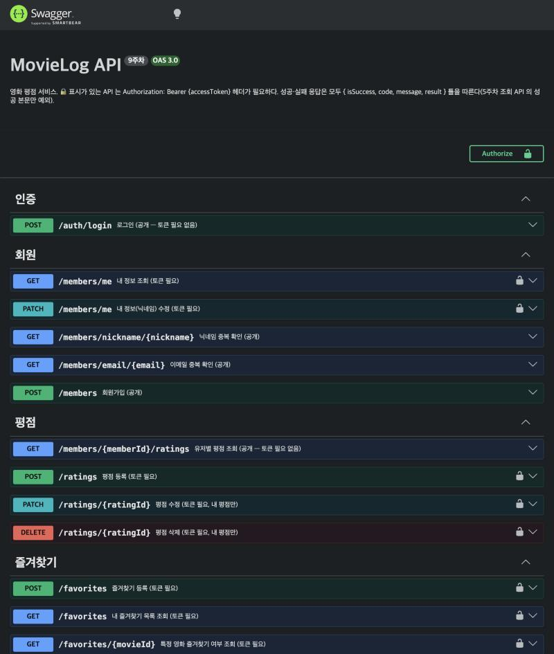
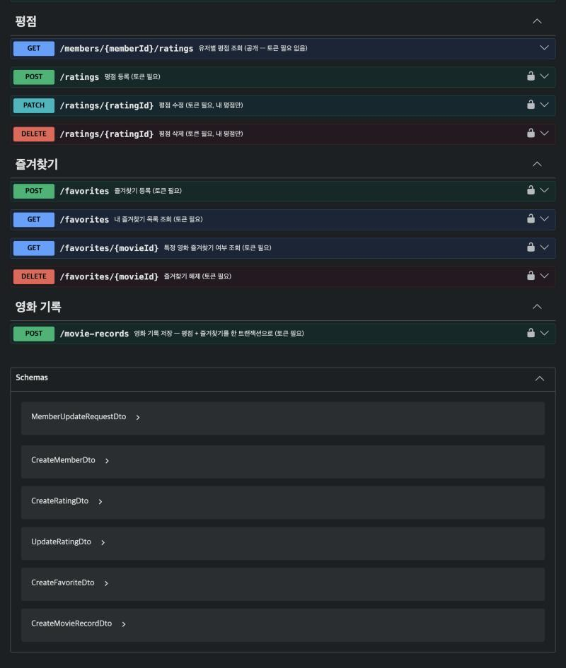

`POST /favorites`를 펼친 화면: 설명, 요청 예시, 응답 코드별 예시(201·400·401 …).

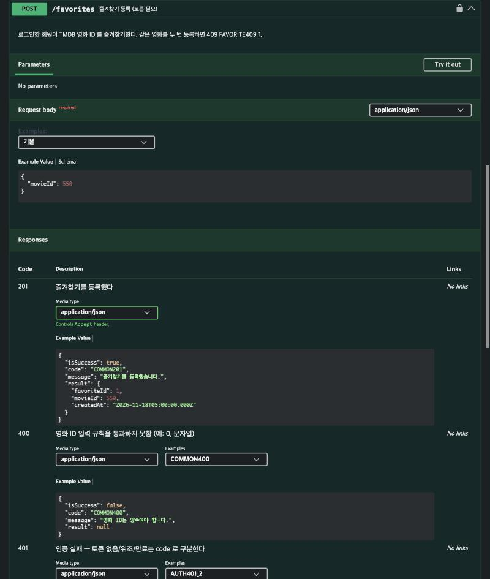

### ② Authorize → 201 → 같은 요청 한 번 더 → 409 → Logout → 401

Authorize에 토큰을 넣은 상태에서 `POST /favorites`(`movieId: 550`)를 Try it out으로 보냈다.

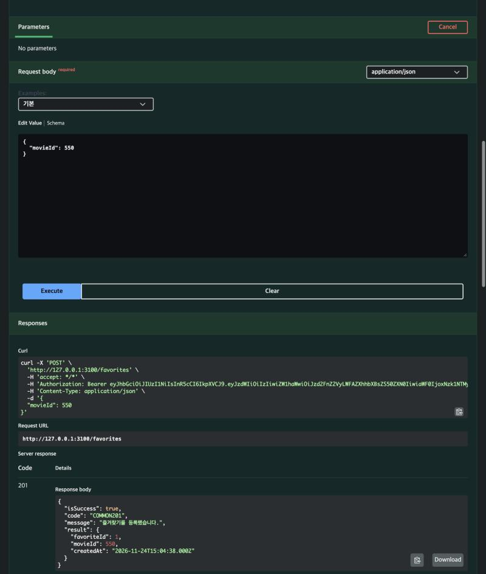

같은 요청을 한 번 더 보내자 문서에 적어 둔 그대로 409 `FAVORITE409_1`이 왔다.

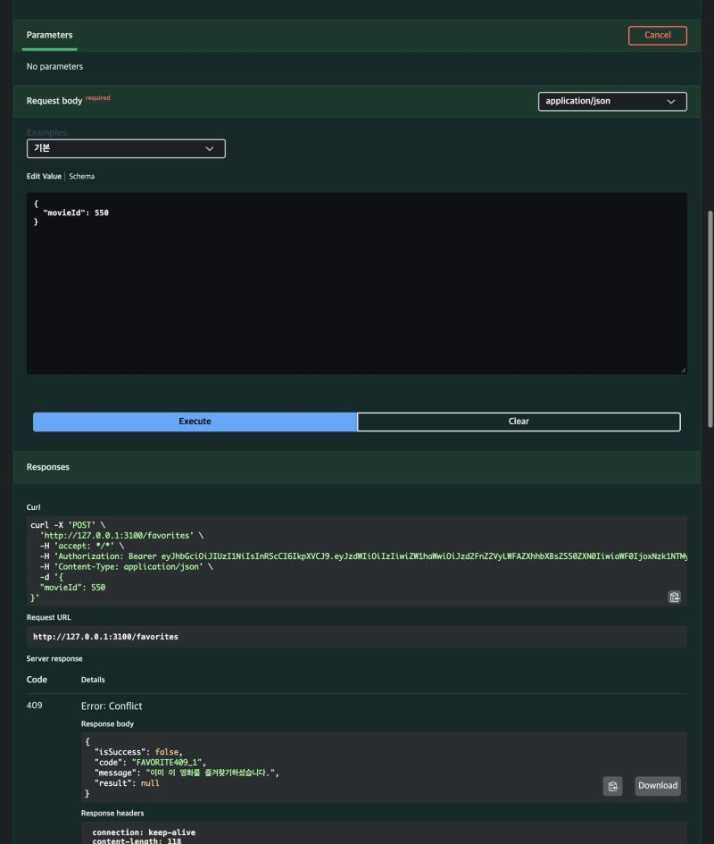

Authorize 창에서 Logout한 뒤 다시 보내면 요청에 `Authorization` 헤더가 없고 401 `AUTH401_2`가 온다.

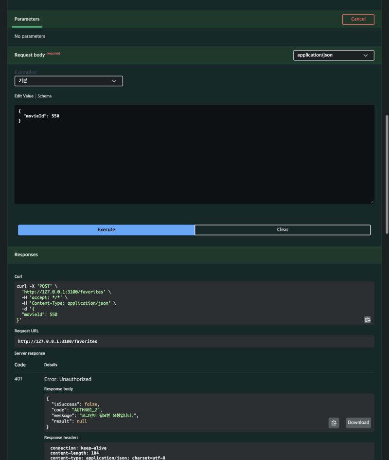

### ③ 단위 테스트와 통합 테스트가 모두 통과한 화면

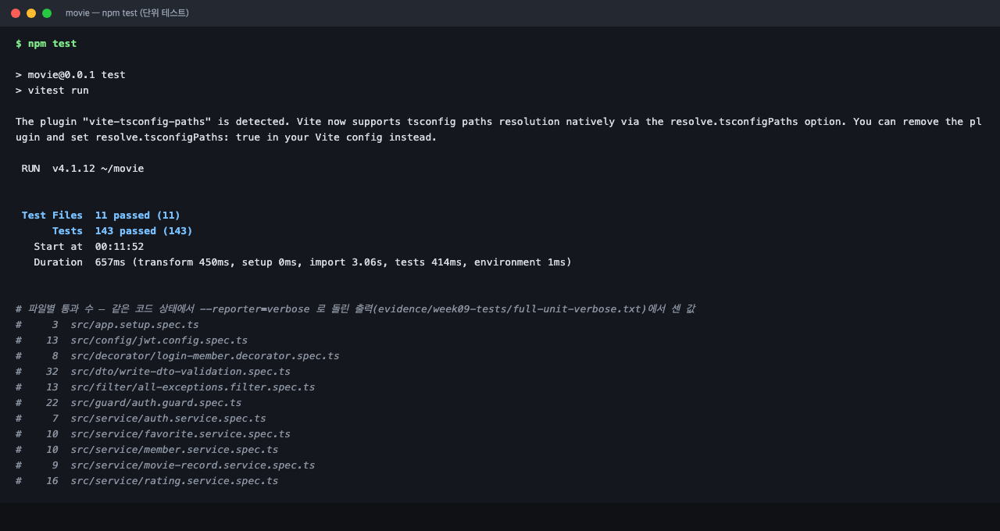
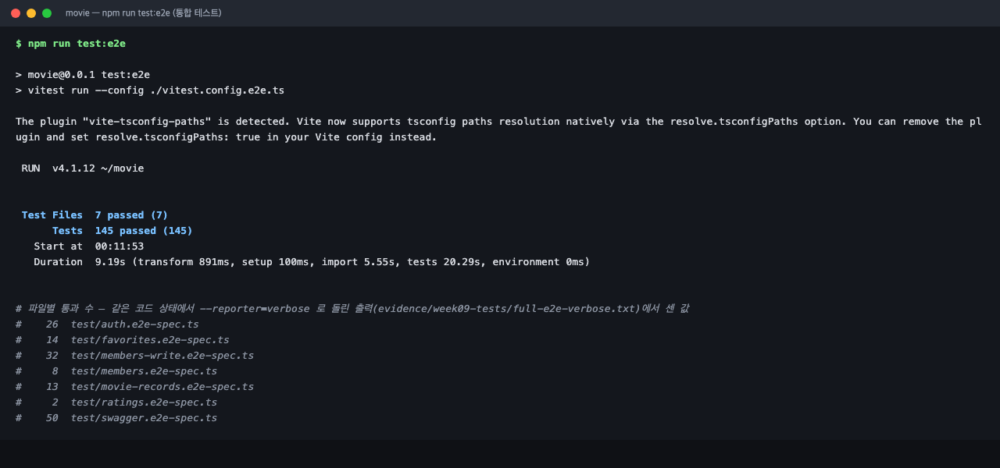

### ④ 중복 검사를 지웠을 때 실패한 테스트

`FavoriteService`에서 중복 검사(`FAVORITE409_1`을 던지는 `if` 블록)를 통째로 주석 처리하고 단위 테스트를 돌렸다.

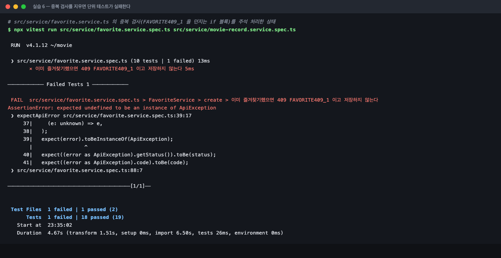

**한 문장**: `favorite.service.spec.ts`의 "이미 즐겨찾기했으면 409 FAVORITE409_1 이고 저장하지 않는다"가 실패했다 — "이미 있다"고 답하는 가짜 Repository를 줬는데 검사 코드가 없어 예외가 던져지지 않고(`expected undefined to be an instance of ApiException`) 그대로 저장으로 넘어갔기 때문이다.

**워크북 설명과 다르게 나온 부분**: 워크북은 "단위 테스트와 통합 테스트 양쪽에서 중복 테스트가 빨간불로 바뀐다"고 하는데, 우리 코드에서는 **통합 테스트가 통과했다.**

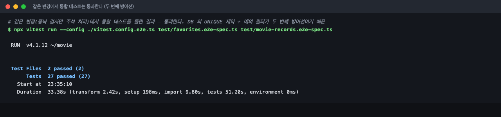

사전 검사 뒤에 DB의 복합 UNIQUE 제약과, 그 위반을 같은 `FAVORITE409_1`로 바꾸는 예외 필터가 두 번째 방어선으로 있어서, 사용자에게 가는 응답이 똑같기 때문이다. **두 방어선을 모두 지우면** 통합 테스트도 실패한다(5개).

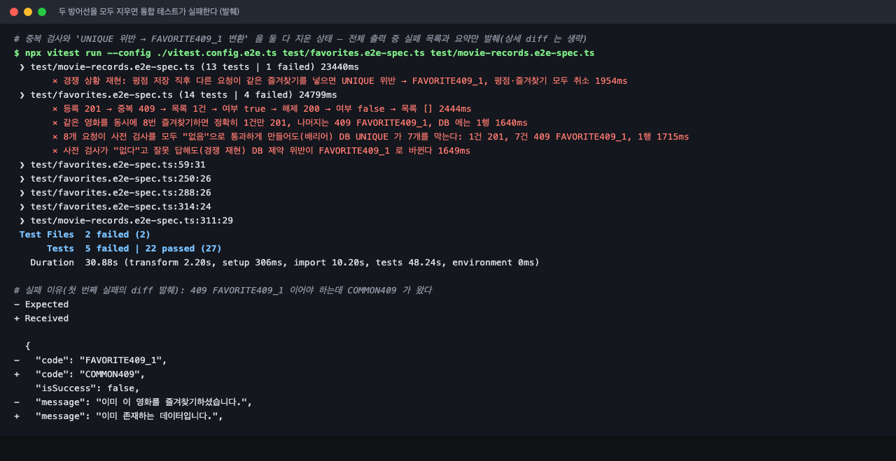

## 미션 인증

### (필수) 문서 채우고 평점 API 테스트하기

#### 문서화한 Swagger 화면

최소 요구(평점 등록/수정/삭제, 유저별 평점 조회, 내 정보 조회/수정, 내 즐겨찾기 조회, 즐겨찾기 여부 조회, 즐겨찾기 해제)에 "한 줄 설명 + 토큰 필요 여부"가 있고, 실패 응답은 **상태 코드와 `code`를 함께** 적었다.

| API | 토큰 | 문서에 적은 실패 응답 |
| --- | --- | --- |
| `POST /ratings` | 필요 | 400 `COMMON400`(별점 범위·영화 ID·memberId를 몰래 보냄) · 401 `AUTH401_2/3/4` · 404 `MEMBER404_1` · 409 `RATING409_1` |
| `PATCH /ratings/{ratingId}` | 필요(내 평점만) | 400 · 401 · 403 `RATING403_1` · 404 `RATING404_1` |
| `DELETE /ratings/{ratingId}` | 필요(내 평점만) | 400 · 401 · 403 `RATING403_1` · 404 `RATING404_1` |
| `GET /members/{memberId}/ratings` | 공개 | 400 · 404 `MEMBER404_1` (성공 본문은 5주차 명세대로 공통 틀로 감싸지 않은 배열) |
| `GET /members/me` | 필요 | 401 · 404 `MEMBER404_1` |
| `PATCH /members/me` | 필요 | 400 · 401 · 404 · 409 `MEMBER409_1` |
| `GET /favorites` · `GET /favorites/{movieId}` · `DELETE /favorites/{movieId}` | 필요 | 401 · (`GET`/`DELETE` 경로 변수) 400 · (`DELETE`) 404 `FAVORITE404_1` |

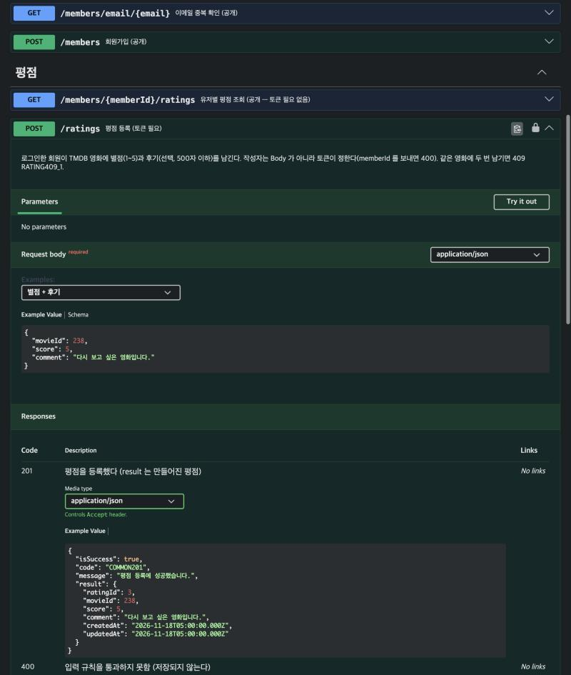
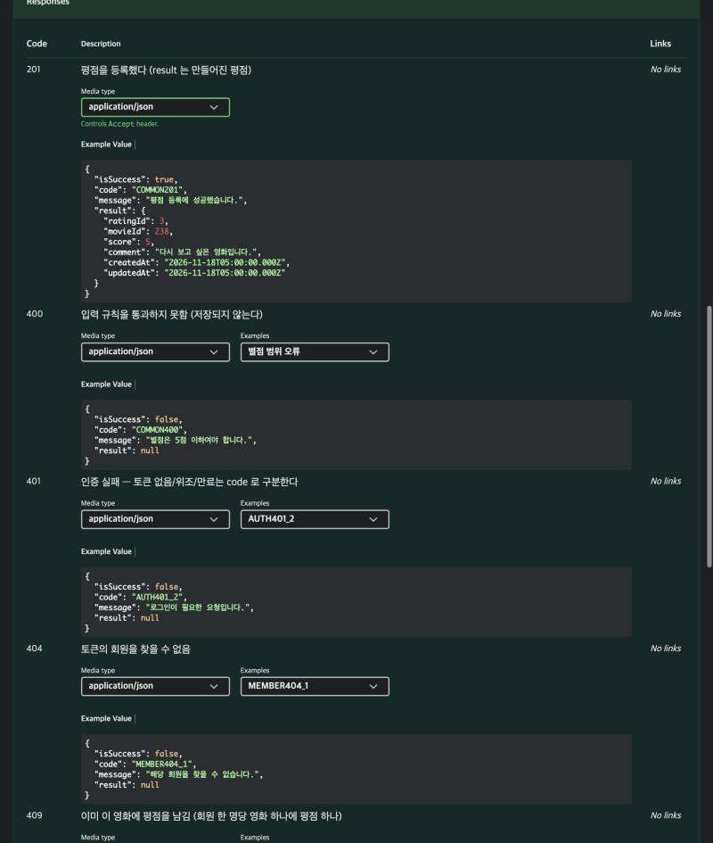
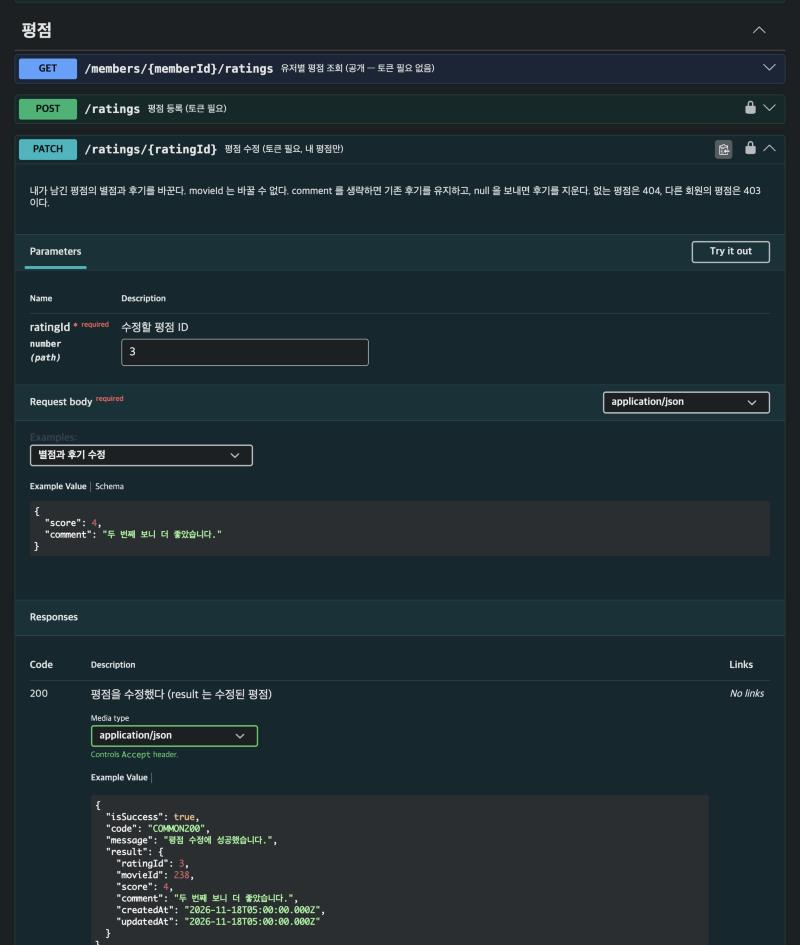

문서가 실제와 같은지 직접도 눌러 보았다. `POST /ratings`를 Try it out으로 보내 201, 같은 요청을 한 번 더 보내 409 `RATING409_1`, 다른 회원의 평점(`ratingId 4`)을 내 토큰으로 `PATCH`해 403 `RATING403_1`.

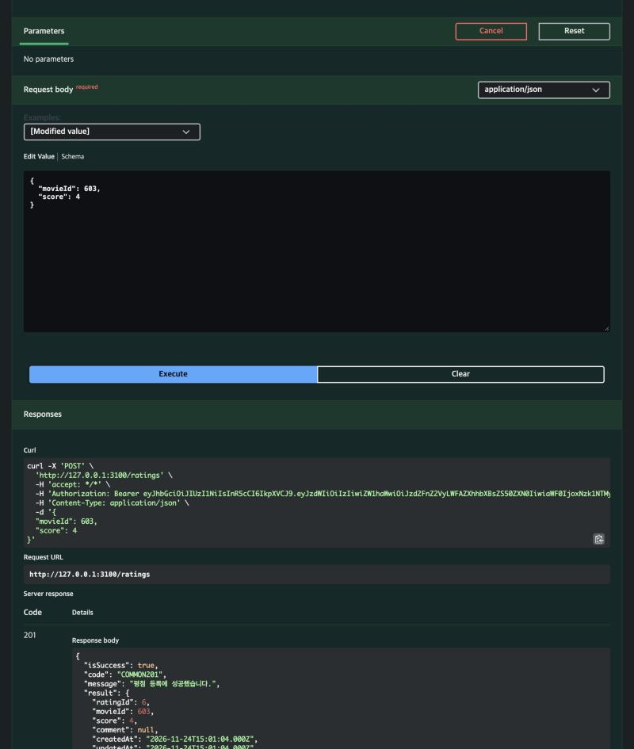
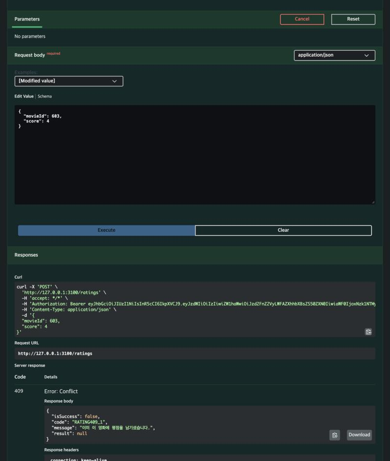
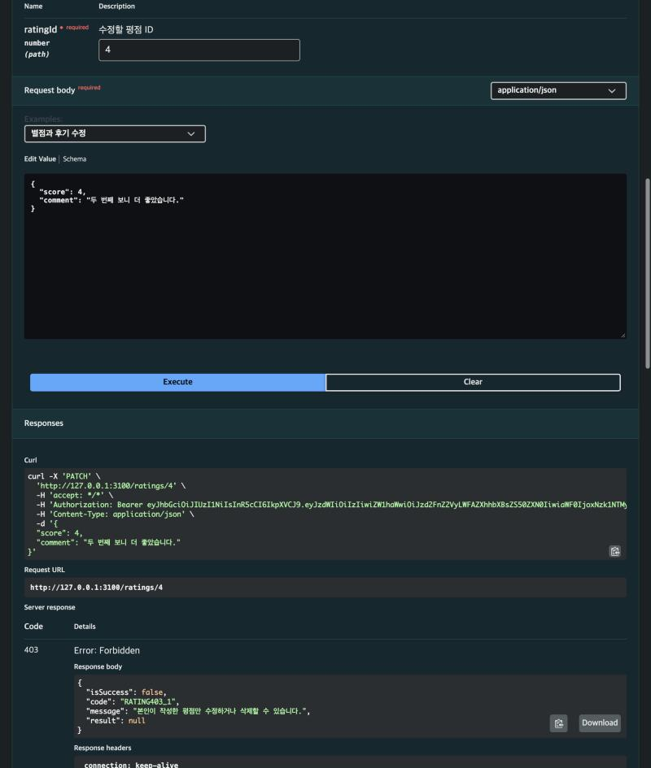

#### 평점 테스트 코드

| 요구 | 테스트 | 상태 |
| --- | --- | --- |
| 단위: 같은 영화에 평점 중복 → `RATING409_1` | [`rating.service.spec.ts`](https://github.com/brownglasses/11th_BE_NodeJs_Practice_Mission/blob/brownglasses/week09/movie/src/service/rating.service.spec.ts) › create › "같은 회원·같은 영화면 409 RATING409_1 이고 저장하지 않는다" | **6~7주차에 이미 있던 테스트.** 이번 주에 새로 쓰지 않았다 |
| 단위: 남의 평점 수정 → `RATING403_1` | 같은 파일 › update › "다른 회원의 평점이면 403 RATING403_1 이고 바꾸지 않는다" | 위와 같음 |
| 통합: 토큰 없이 `POST /ratings` → 401 | [`ratings.e2e-spec.ts`](https://github.com/brownglasses/11th_BE_NodeJs_Practice_Mission/blob/brownglasses/week09/movie/test/ratings.e2e-spec.ts) › "토큰 없이 POST /ratings 를 부르면 401 AUTH401_2 이고 평점은 저장되지 않는다" | **9주차 새로 작성** |
| 통합: 토큰을 담아 `POST /ratings` → 201 | 같은 파일 › "토큰을 담아 POST /ratings 를 부르면 201 이고 result 에 만들어진 평점이 있으며 DB 에 한 행이 저장된다" | **9주차 새로 작성** |

```ts
// test/ratings.e2e-spec.ts (일부) — given / when / then
it('토큰 없이 POST /ratings 를 부르면 401 AUTH401_2 이고 평점은 저장되지 않는다', async () => {
  // given: 로그인한 회원이 있지만, 이 요청에는 Authorization 헤더를 붙이지 않는다
  const member = await f.signUpAndLogin();

  // when
  const res = await request(f.server())
    .post('/ratings')
    .send({ movieId: 238, score: 5, comment: '토큰 없이 보낸 요청' });

  // then: 401 이고, 같은 401 이라도 "토큰 없음" 을 뜻하는 code 다
  expect(res.status).toBe(401);
  expect(res.body).toEqual(f.failure('AUTH401_2', '로그인이 필요한 요청입니다.'));
  // 실패한 요청이 흔적을 남기지 않았다 (DB 를 직접 센다)
  expect(await f.ratings.count({ where: { member: { memberId: member.memberId } } })).toBe(0);
});
```

#### 테스트 전체 통과 화면

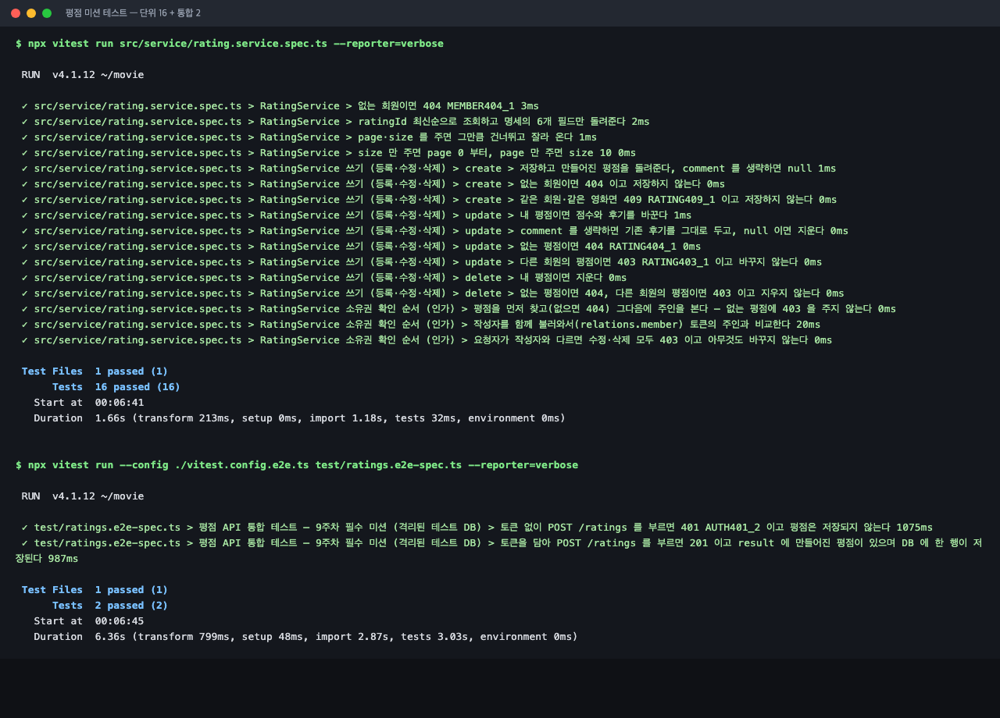

전체 통과 화면은 위 실습 인증 ③이다.

**확인 포인트**: ① 실패 응답은 상태 코드와 `code`를 함께 적었다. ② 테스트 이름은 "무엇을 하면 무엇이 나온다"는 문장이다. ③ 이 테스트들이 정말 잡는지 일부러 깨뜨려 확인했다:

| 지운 것 | 단위 | 통합 |
| --- | --- | --- |
| 평점 중복 사전 검사 | 1개 실패 | **0개 실패** (DB UNIQUE + 필터가 두 번째 방어선) |
| 평점 소유권(403) 검사 | 3개 실패 | 4개 실패 |
| `POST /ratings`의 `AuthGuard` | **0개 실패** | 18개 실패(새 401 테스트 포함. 가드가 없으면 `@LoginMember()`가 오류를 던져 `POST /ratings`를 쓰는 모든 통합 테스트가 500이 된다) |
| `POST /ratings`가 201 대신 200 | — | 16개 실패(새 201 테스트 포함) |

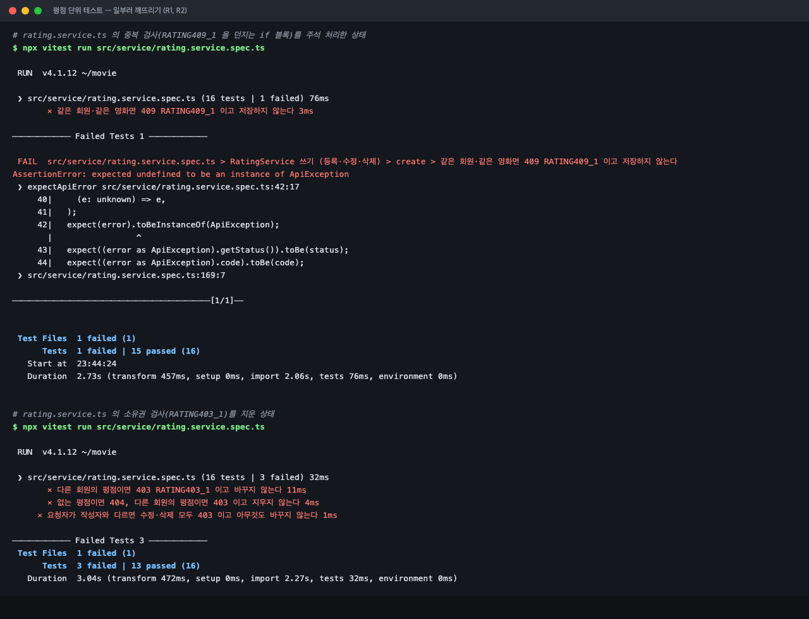
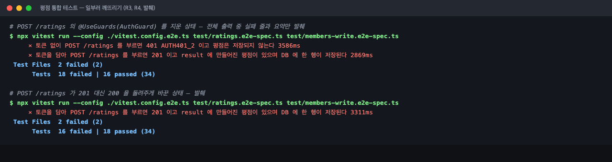

### (선택) 트랜잭션이 진짜 되돌리는지 테스트로 증명하기

8주차의 `POST /movie-records`가 평점과 즐겨찾기를 한 트랜잭션으로 저장하는 것을 이번에 **테스트로 증명할 수 있는지** 따져 보았다. 테스트 코드는 8주차에 만든 [`movie-records.e2e-spec.ts`](https://github.com/brownglasses/11th_BE_NodeJs_Practice_Mission/blob/brownglasses/week09/movie/test/movie-records.e2e-spec.ts)이고, 이번 주에는 그 테스트들이 **정말 트랜잭션을 증명하는지**를 변이로 확인했다.

| 테스트 | 트랜잭션을 걷어 내면? |
| --- | --- |
| **워크북 시나리오**: 이미 즐겨찾기한 영화에 `addToFavorites: true` → 409 `FAVORITE409_1`, 평점 개수 그대로 | **통과한다.** 사전 검사가 평점을 저장하기 *전에* 막아서, 롤백할 것이 애초에 없다 |
| **트리거 기반 rollback 테스트**: 평점 INSERT가 성공한 뒤 즐겨찾기 INSERT가 DB에서 실패하게(`BEFORE INSERT` 트리거) 만들고 두 테이블이 0행인지 센다 | **실패한다** (`expected { rating: 1, favorite: +0 } to deeply equal { rating: +0, favorite: +0 }`) |
| **경쟁 상황 테스트**: 평점 저장 직후 다른 요청이 같은 즐겨찾기를 먼저 넣는다 | **실패한다** (`{ rating: 1, favorite: 1 }`) |

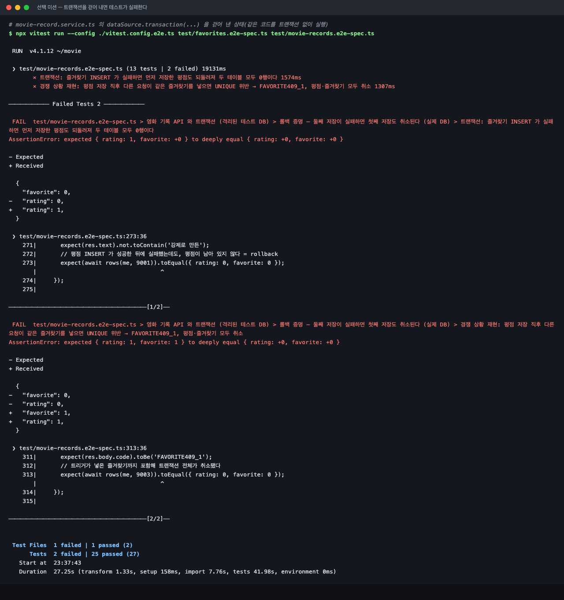

> 워크북이 시킨 "요청 후 평점 개수가 그대로인지" 테스트만으로는 트랜잭션이 필요한지 알 수 없다는 점이 이번 주 가장 큰 발견이었다. 그 테스트는 사전 검사 덕분에 초록불이고, 트랜잭션을 걷어 내도 초록불이다. 그래서 그 테스트 이름에 "(사전 검사가 먼저 막으므로 트랜잭션이 없어도 통과한다)"고 적어 두고, 트랜잭션을 증명하는 것은 위 두 번째·세 번째 테스트라고 주석으로 밝혔다. 이 실험의 단위 테스트 쪽은 9개가 실패했지만, 그 9개는 "트랜잭션 모양으로 호출한다"는 확인이지 "정말 되돌린다"는 증명이 아니다.

## 미션 기록

### 진행 과정

1. 워크북을 읽고 8주차 코드와 비교했다. 실습 1~3(Swagger 설치·공개 API·인증 API 문서화)은 8주차에 이미 했고, 실습 4~5(`FavoriteService` 단위 2개, 통합 4개)도 이미 있었다. 이번 주 필수 미션은 "아직 설명이 비어 있는 API를 문서화"하는 것이었다.
2. **그 "비어 있는 API"가 생각보다 많았다.** `/api-docs-json`을 표로 뽑아 보니 8주차에 "15개 API를 문서화했다"고 적은 것과 달리, 평점·내 정보·회원가입·중복 확인 9개 API는 설명이 0자였고 실패 응답도 401뿐이었다(트러블슈팅 No.1). 8주차 README의 해당 문장도 고쳤다.
3. 문서의 실패 예시를 손으로 적지 않고 **실제 예외를 만드는 함수에서 뽑는** 도우미(`api-docs.ts`)를 만들어 9개를 채웠다.
4. "문서를 채웠다"가 아니라 "문서가 맞다"를 확인하려고 **문서 예시와 실제 응답을 비교하는 테스트**를 짰다. 처음 짠 비교 도우미는 예시가 없어도 통과하는 구조라 고쳤다(No.2).
5. 평점 통합 테스트 2개를 새로 쓰고, 단위 테스트 2개는 이미 있다는 것을 확인했다.
6. 워크북 실습 6(일부러 깨뜨리기)을 즐겨찾기만이 아니라 평점·트랜잭션·문서로 확장했다. 사전 검사를 지워도 통합 테스트가 통과하는 것, 워크북의 선택 미션 테스트가 트랜잭션을 증명하지 못하는 것을 이 과정에서 발견했다.
7. Swagger 화면을 일회용 서버에서 직접 눌러 촬영했다. 테스트 출력은 실제 출력 텍스트를 터미널 모양 이미지로 만들었다. 8주차 BE 피드백에 "실습 인증에 이미지가 없습니다"가 떴기 때문에 이번에는 모든 인증 항목에 화면을 넣었다.

### 워크북과 다르게 한 부분

- **통합 테스트의 DB**: 워크북은 메모리 DB(H2, NestJS는 sql.js)를 쓰라고 한다. 이 프로젝트는 5주차부터 **테스트마다 만들었다 지우는 일회용 MySQL DB**(`umc_movie_test_*`)를 썼고 이번에도 그대로 두었다. UNIQUE 제약·트랜잭션 rollback·동시 요청처럼 진짜 MySQL에서만 드러나는 동작을 확인해야 했기 때문이다. 대가는 로컬 MySQL이 있어야 하고 느리다는 점이다(약 20~40초). 그래서 "sql.js 설치·`transformIgnorePatterns` 설정" 같은 워크북 단계는 하지 않았다(vitest라 해당되지 않는다).
- **Jest 대신 vitest**: 이 프로젝트의 테스트 러너다. `describe`/`it`/`expect`와 given-when-then 구조는 같다.
- **필수 미션의 단위 테스트 2개**: 새로 쓰지 않았다. 이미 같은 이름·같은 검증의 테스트가 있어서 중복해서 만들지 않고, 그 테스트가 **정말 잡는지**를 일부러 깨뜨려 확인했다(R1·R2).
- **즐겨찾기 단위 2개·통합 4개(실습 4·5)**: 8주차에 이미 만든 것이 워크북보다 많다(단위 10개, 통합 14개). 새로 줄이거나 맞추지 않았다.

### 검증

| 항목 | 결과 |
| --- | --- |
| `npm run build` / `npm run lint` | 통과 / 오류 0 ([build-lint.txt](evidence/week09-tests/build-lint.txt)) |
| `npm test` (단위) | 11파일 **143개 통과** ([full-unit-verbose.txt](evidence/week09-tests/full-unit-verbose.txt)) |
| `npm run test:e2e` (통합) | 7파일 **145개 통과** (8주차 문서의 119개에서 신규 `ratings` 2개, `swagger` 26 → 50개 [원본](evidence/week09-tests/full-e2e-verbose.txt)) |
| Swagger 문서 vs 실제 응답 | 비교 테스트가 9주차 필수 API의 400·403·404·409 예시와 로그인·즐겨찾기 해제의 400을 실제 응답과 맞춘다 |

**일부러 깨뜨려 본 결과 (10가지, 모두 원복)** — 한 번에 하나씩, 바꾸고 → 테스트 → 되돌렸다.

| 변이 | 단위 | 통합 |
| --- | --- | --- |
| MA 즐겨찾기 중복 사전 검사 | 1개 실패 | 0개 실패 |
| MC MA + DB UNIQUE→`FAVORITE409_1` 변환 | 1개 실패 | 5개 실패 |
| MB 영화 기록의 트랜잭션 | 9개 실패 | 2개 실패 |
| R1 평점 중복 사전 검사 | 1개 실패 | 0개 실패 |
| R2 평점 소유권(403) 검사 | 3개 실패 | 4개 실패 |
| R3 `POST /ratings`의 `AuthGuard` | 0개 실패 | 18개 실패 |
| R4 `POST /ratings`의 상태 코드 201→200 | — | 16개 실패 |
| D1 문서의 예시 문구를 틀리게 | — | swagger 1개 실패 (당시 49개 중) |
| D2 `PATCH /ratings` 문서에서 403 제거 | — | swagger 3개 실패 |
| D3 `DELETE /ratings` 문서에서 자물쇠 제거 | — | swagger 2개 실패 |

(R4의 단위 결과는 따로 돌리지 않았다. 변이 스크립트는 [`scripts/mutations-week09-*.sh`](https://github.com/brownglasses/11th_BE_NodeJs_Practice_Mission/tree/brownglasses/week09/movie/scripts)이고 문서 변이 D1~D3은 컨트롤러의 문서 데코레이터를 손으로 고쳐 돌렸다.)

- 쓰기 테스트는 매번 새로 만드는 일회용 DB에서만 돌렸다. 개발 DB `umc_movie`는 건드리지 않았다. 변경·신규 파일 전체에서 `.env`의 `JWT_SECRET`과 서명이 붙은 JWT를 검색해 한 건도 없었다.

### 확인하지 못한 것

- Postman 데스크톱 앱이나 Newman 시나리오는 이번 주에 새로 만들지 않았다(8주차 것은 그대로).
- 브라우저에서만 나타나는 **CORS**는 이번 주에 새로 확인하지 않았다(테스트가 못 잡는 영역이라고 워크북도 말한다). 8주차까지의 preflight 테스트만 그대로 통과한다.
- 진짜 터미널 화면을 캡처한 것이 아니라 출력 텍스트를 이미지로 그렸다. 원본 텍스트는 `evidence/week09-tests/`에 있다.
- R4의 단위 결과, 변이 R3·R4의 통합 출력 원본은 파일로 두지 않았다(그림에 실패 줄만 발췌).
- 이번 변경이 서비스 로직을 바꾸지 않았다는 것은 `git diff`(`src/service/` 변경 없음)와 기존 테스트 전체 통과로 확인했다. 실서버에서 5~8주차 시나리오 스크립트(`verify:week0N`)를 이번 주에 다시 돌리지는 않았다.

## 트러블슈팅

### ⚡ No.1 8주차에 "문서화했다"고 적은 API가 실제로는 비어 있었다

- **이슈**: Swagger UI에서 `POST /ratings`를 펼치니 한 줄 요약만 있고 설명, 요청 예시, 성공·실패 응답 예시가 없었다. 8주차 README에는 "15개 API 모두 요청 예시와 응답 코드별 예시를 문서로 남겼다"고 적혀 있었다.
- **문제**: 8주차에 즐겨찾기·영화 기록·로그인만 예시를 채우고, 기존 API(평점·내 정보·회원가입·중복 확인)에는 요약과 자물쇠만 달았는데 "15개 모두"라고 정리했다. 문서가 있다는 사실만 확인하고 **문서의 내용이 채워졌는지는 열어 보지 않았다.**
- **해결**: `/api-docs-json`을 표로 뽑아 "설명 길이·성공/실패 응답 코드·`code` 예시"를 API별로 세어 비어 있는 9개를 찾아 채웠다. 8주차 README의 문장도 고쳤고, 같은 일이 생기지 않게 "필수 API의 요약·설명·응답 상태 코드 목록"을 검사하는 테스트를 추가했다.

### ⚡ No.2 문서 비교 테스트가 문서에 예시가 없어도 통과했다

- **이슈**: "문서의 실패 예시가 실제 응답과 같다"는 테스트를 짜고, 문서 예시를 일부러 지워 보니 **테스트가 그대로 통과**했다.
- **문제**: 비교 도우미가 `예시 ?? {}`처럼 없으면 빈 객체로 바꿨고, `toMatchObject({})`는 어떤 값이든 통과한다. 문서에서 예시가 사라지면 그 항목은 아예 검사되지 않았다.
- **해결**: 예시가 문서에 없으면 `expect(found).toBeDefined()`로 바로 실패하게 고쳤다(메시지에 어느 API의 어느 예시가 없는지 나온다). 문서를 일부러 틀리게 만든 D1~D3으로 다시 확인했다.

### ⚡ No.3 `@ApiParam` 한 줄이 7주차 소스 검사 테스트를 깼다

- **이슈**: 경로 변수 설명을 위해 `@ApiParam({ name: 'memberId', … })`를 붙이자 단위 테스트 1개가 실패했다.
- **문제**: 7주차에 "컨트롤러가 요청의 `memberId`를 직접 꺼내지 않는다"를 확인하려고 컨트롤러 소스에서 `'memberId'` 문자열이 나오는 줄을 세는 테스트를 만들었다. 문서용 `@ApiParam`의 `'memberId'`도 같이 잡힌 것이다. `@ApiParam`은 문서만 만들고 요청 값을 읽지 않는다.
- **해결**: 테스트가 `@ApiParam(`으로 시작하는 줄을 건너뛰게 했다(이유는 주석에 적었다). `request['memberId']`나 `@Req(`를 금지하는 7주차의 다른 검사는 그대로 둔다.

### ⚡ No.4 변이 실험 중 통합 테스트 1개가 한 번 시간 초과로 실패했다 (원인 미확정)

- **이슈**: 여러 변이를 연달아 돌리던 중 "두 회원의 목록…" 통합 테스트 1개가 5000ms 제한을 넘겨 실패했다. 변이와 관계가 없는 테스트였다.
- **문제**: 변이 실험이 MySQL을 많이 쓰는 다른 작업과 겹쳐서 느려졌다고 **추정**한다. 확정하지 못했다.
- **해결**: 같은 변이를 다시 돌렸을 때는 재현되지 않았고(예상한 2개만 실패), 이후 전체 통합 테스트는 모두 통과했다. 원인을 밝히지는 못했다.

### ⚡ No.5 Swagger Try it out에서 Body를 고치다 JSON이 깨지면 400이 온다

- **이슈**: Try it out의 요청 Body 창에서 예시를 지우지 않고 새 JSON을 이어 붙이자 `400 COMMON400`, 메시지 `Unexpected non-whitespace character after JSON at position 66`이 왔다.
- **문제**: 예시 JSON 뒤에 또 다른 JSON을 이어 붙여 하나의 문서로 해석할 수 없는 본문이 됐다. 서버의 JSON 파서가 잘못된 본문을 거부했고, 그 오류도 5주차부터의 공통 응답 틀(`isSuccess: false`, `code: COMMON400`)로 돌아왔다.
- **해결**: Body 창에서 예시를 지우고 새 값으로 바꾸거나 Reset 버튼으로 예시를 되살린 뒤 고쳤다. 요청 형식이 틀린 경우에도 응답 틀이 유지된다는 것을 덤으로 확인했다.

## 학습 후기

**1. 단위 테스트와 통합 테스트가 각각 무엇을 확인하는지 설명할 수 있나?**
단위 테스트는 Service 하나의 판단을 가짜 Repository로 빠르게 확인하고(143개가 약 2초), 통합 테스트는 요청이 인증·검증·Service·DB를 진짜로 지나가는지 확인한다(145개가 약 20~40초). 이번에 `POST /ratings`의 `@UseGuards(AuthGuard)`를 지워 보니 단위 143개는 하나도 실패하지 않고 통합 18개가 실패했다. 표로만 보던 "로직이 틀렸다 vs 연결이 틀렸다"를 눈으로 본 셈이다. 반대로 중복 사전 검사를 지우면 단위만 실패하고 통합은 통과했다. 어느 쪽도 혼자서는 다 잡지 못한다.

**2. 테스트가 통과한다는 것은 무엇을 보장하나?**
처음에는 초록불이면 안전하다고 생각했는데, 이번 주에 세 번 어긋났다. ① 문서 비교 테스트가 문서에 예시가 없어도 통과했다. ② 워크북의 선택 미션 테스트는 트랜잭션을 걷어 내도 통과했다. ③ 사전 검사를 지워도 통합 테스트는 통과했다. 모두 "테스트가 통과했다"와 "테스트가 지키려던 것을 지킨다"가 다르다는 뜻이다. 그래서 테스트를 쓴 다음에는 **그 코드를 일부러 깨뜨려 빨간불이 켜지는지** 한 번 봐야 한다는 것을 배웠다. 10가지만 해 보았으니 모든 테스트가 믿을 만하다는 뜻은 아니다.

**3. 손으로 쓴 문서와 코드가 만든 문서**
코드가 문서를 만들어 준다고 해서 문서가 저절로 채워지는 것은 아니었다. 라이브러리는 URL·Method·DTO 필드까지만 읽어 주고, 설명·예시·실패 응답은 사람이 적어야 한다. 8주차에 15개를 다 했다고 믿었다가 9개가 비어 있었던 것이 그 증거다. 그래서 문서의 예시도 실제 응답과 비교하는 테스트로 지키게 했다.

**이번 주에 이해가 가장 잘 된 흐름**: "일부러 깨뜨려 보기"다. 코드를 한 줄 지우고 어떤 테스트가 몇 개 실패하는지 숫자로 보면, 그 테스트가 무엇을 지키는지(또는 지키지 않는지)가 분명해진다.

**아직 낯선 개념**: Mock/Stub/Spy/Fake의 경계는 우리 코드에서 `vi.fn()` 하나가 Stub이면서 Mock이라서 아직 헷갈린다(키워드 문서에 정리했지만 Fake는 직접 써 보지 않았다). 테스트 커버리지 수치는 이번에 쓰지 않았고, TDD(테스트를 먼저 쓰기)도 해 보지 못했다. 이번 주 테스트는 모두 코드를 먼저 만든 뒤에 붙였다.
