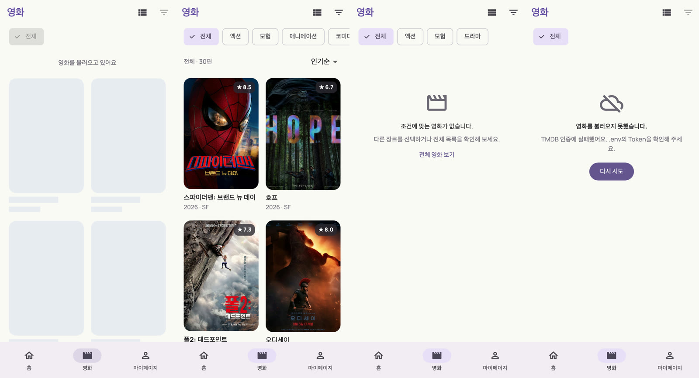

# 5주차 프론트엔드 미션 — TMDB 영화 API와 MVVM·Provider

- 이름 / 닉네임: 케빈
- [GitHub 실습 저장소](https://github.com/brownglasses/11th_PE_Mobile_Flutter_Practice_Mission/tree/brownglasses/week05)
- Pull Request: [실습 PR #11](https://github.com/UMC-Inha/11th_PE_Mobile_Flutter_Practice_Mission/pull/11)
- [원본 워크북](https://makeus-challenge.notion.site/5-TMDB-API-MVVM-Provider-1-407b57f4596b809592c8e4bc1178d962)
- [핵심 개념 정리](../../../keyword/Frontend/chapter05/keyword.md)

## 구현 결과

4주차 Mock Future를 실제 TMDB API로 바꾸고 화면 코드와 데이터 코드를 나눴다. Widget은 ViewModel의 상태를 그리고 입력을 넘기기만 하며, API 호출·JSON 해석·"5개/30개" 같은 정책은 Service와 ViewModel이 맡는다.



왼쪽부터 Loading, Success(실제 Discover 30개), Empty, Error(실제 TMDB 401)다.

| 계층 | 파일 | 하는 일 |
| --- | --- | --- |
| Config | `core/config/tmdb_config.dart` | `.env`의 Token·서버 주소 읽기 |
| Network | `core/network/tmdb_client.dart`, `movielog_api_client.dart` | TMDB용·자체 API용 Dio를 따로 만든다. TMDB에만 Bearer Token |
| Network | `core/network/tmdb_logging_interceptor.dart` | 요청·응답·오류 로그, `Authorization`은 `Bearer ***`, debug에서만 등록 |
| Data | `data/models/*`, `data/services/*` | DTO 변환, HTTP 호출만. 상태 없음 |
| UI | `view_models/*` | 화면마다 하나. Loading/Empty/Error/Success와 화면 정책 |
| UI | `features/*/presentation`, `widgets/tmdb_poster_image.dart` | View, 포스터 URL 조합·placeholder |

`MovieLogApp`의 `MultiProvider`가 `MaterialApp.router` 바깥에서 `TmdbMovieService`·`MovieLogApiService`를 공유하고, 각 GoRoute의 `ChangeNotifierProvider`가 화면별 ViewModel을 만든다. 화면을 벗어나면 ViewModel은 dispose된다.

## 제출 양식

| 항목 | 내용 |
| --- | --- |
| PR 링크 | [실습 PR #11](https://github.com/UMC-Inha/11th_PE_Mobile_Flutter_Practice_Mission/pull/11) |
| TMDB Token 비노출 확인 | `.env`는 `.gitignore`에 있고 `git ls-files`에 없다. 커밋 대상 238개 파일을 Token·API Key 문자열로 검사해 0건. 로그는 `Bearer ***`. `.env.example`에는 키 이름만 |
| Popular 5개 화면 | [홈](images/01_home_popular5.png). 실제 1위~5위: 스파이더맨: 브랜드 뉴 데이, 호프, 폴2: 데드포인트, 오디세이, 클레이페이스 |
| Discover 최대 30개 화면과 실제 개수 | [전체 30편](images/03_discover_30.png). page 1·2(각 20편)를 받아 id 기준으로 30개에서 멈춤 |
| Genre API 및 with_genres 요청 증거 | [액션 Chip](images/04_genre_action.png) → `with_genres=28`, [다중 선택](images/05_genre_sheet.png) → [`with_genres=28\|12`](images/06_multi_genre.png), [요청 패널 영상](videos/week05-genre-network.mp4), [실제 요청 로그](https://github.com/brownglasses/11th_PE_Mobile_Flutter_Practice_Mission/blob/brownglasses/week05/movielog/evidence/week05/network-log.txt) |
| Loading / Empty / Error / Success | 위 네 상태 그림. Error는 실제 401([화면](images/11_error_401.png)), Empty는 가짜 응답 |
| 포스터 null·실패 처리 | [poster_path null·로드 실패 둘 다 "포스터 없음"](images/13_poster_placeholder_fixture.png), 받는 중엔 회색 자리 |
| movie.id 전달 위치 | 카드 → `context.push('/movies/${movie.id}', extra: movie)` → `MovieDetailViewModel(movieId)` → 평점 Dialog 결과 `CreateRatingRequest(movieId: TMDB id, score)`. [상세 화면](images/09_detail_movie_id.png) 아래 `TMDB 영화 ID 1058424` |
| 트러블슈팅 | 아래 No.1~No.4 |
| 미검증 항목 | iOS/Android 실기기 실행(이 맥은 Xcode가 없음), 기기 네트워크를 실제로 끄고 켜는 시나리오(연결 오류는 테스트에서 재현), release 빌드 콘솔을 직접 열어 본 확인(로그 미등록은 `enableLogging=false` 테스트로 확인) |

## Required Mission 체크리스트

- [x] Genre API(`language=ko`)로 장르 Chip 구성, 이름을 손으로 쓰지 않음
- [x] Discover를 page 1부터 호출, `total_pages`·빈 결과에서 멈춤
- [x] TMDB `id`를 Map key로 써서 중복 없이 최대 30개
- [x] Loading / Empty / Error / Success
- [x] 장르 선택 시 `with_genres`로 page 1부터 다시, 로컬 `where` 아님
- [x] "전체"는 `with_genres`를 보내지 않음
- [x] Discover 요청 중에는 Chip·필터 버튼 비활성, ViewModel도 `canChangeGenre`로 한 번 더 막음
- [x] 상세·평점 Dialog로 `TmdbMovieDto.id` 전달

## Challenge Mission

- [x] **Pull to Refresh**: `RefreshIndicator`. 현재 장르 ID 목록을 유지해 page 1부터 다시, 끝날 때까지 기존 목록을 남기고 위쪽에 얇은 진행 막대. `notificationPredicate`로 Loading·새로고침 중엔 제스처 무시
- [x] **장르 다중 선택**: 3주차 BottomSheet를 TMDB 장르로 재사용, 상태 타입 `List<int>`, `withGenresQuery([28, 12]) == "28|12"`. 선택 없이 확인하면 `with_genres` 없이 전체
- [x] **요청 실패 재시도 Dialog**: 최근 성공 목록이 있으면 비우지 않고 [Dialog](images/07_retry_dialog.png). 다시 시도 → 마지막 장르로 page 1부터 30개 전체 재로딩 → [최신 목록으로 교체](images/08_retry_success.png). 취소 → 화면 목록과 장르 선택을 맞춤
- [x] **네트워크 로그 요청 실패 재현**: 실제 TMDB에 잘못된 Token → 401. [로그](network-failure-log.txt)에 실패 URL·`status=401`·`Invalid API key`가 남고 Token 원문 없음. release 조건(Interceptor 미등록)에서는 0줄

## 자체 백엔드 연결 (백엔드 5주차와 같이)

같은 주 백엔드 API를 MovieLog에 붙였다. TMDB Client와 섞지 않으려고 `createMovieLogApiClient`를 따로 두었다.

- 회원가입: 닉네임(2~12자)·이메일 칸 아래 `중복 확인` → `GET /members/nickname/{nickname}`, `GET /members/email/{email}`. 확인한 값 그대로일 때만 가입 버튼이 켜지고, 입력을 고치면 다시 확인해야 한다.
- 마이페이지: `GET /members/1/ratings`(로그인 전이라 시드 회원 1번) 결과의 `movieId`로 TMDB Movie Details를 불러 [제목·포스터를 함께 표시](images/10_my_ratings.png). TMDB가 실패해도 평점 목록은 남는다.

## 진행 과정과 검증

1. 4주차 코드에서 Mock Service와 화면 상태를 확인하고, 노션의 디렉터리 원칙대로 `core/config`, `core/network`, `data`, `view_models`를 추가했다. 화면은 기존 `features/*/presentation`에 둔다.
2. DTO부터 만들고 null·빈 문자열·정수로 온 `vote_average`, 상세 응답의 `genres` 모양까지 단위 테스트로 고정했다.
3. Service는 Dio 요청과 변환만 하도록 두고, Dio 어댑터를 바꿔 끼워 실제 Query(`language`, `sort_by`, `include_adult`, `with_genres`)와 Header를 검사했다.
4. ViewModel에 30개 수집, 장르 재요청, request version, 새로고침, 재시도 Dialog 신호를 넣고 가짜 Service로 19개 테스트를 썼다.
5. 화면을 Consumer로 바꾸고 위젯 테스트 15개로 흐름(회원가입 중복 확인, 홈 5개, 상세 movieId, 장르·다중 선택, Empty·Error·재시도 Dialog, 마이페이지)을 확인했다.
6. 실제 Token으로 `MOVIELOG_LIVE=1 flutter test test/live`를 돌려 실제 응답으로 인증 화면·영상·로그를 만들고, Flutter Web 빌드를 크롬에서 열어 실제 백엔드 연결을 확인했다.

결과: `flutter analyze` No issues found, `flutter test` 48개 통과, 실제 TMDB 테스트 3개 통과.

## 트러블슈팅

### No.1 위젯 테스트에서 실제 TMDB 응답이 오지 않음

```
상황과 재현 순서: 실제 Token으로 MovieLogApp을 testWidgets 안에서 띄우고 pump
호출 API: Popular / Genre / Discover
Query parameter(Token 제외): language=ko-KR&page=1
기대한 상태와 결과 개수: Success, 인기 5개
실제 status / 응답 모양: 응답 없음. 10분 동안 테스트가 끝나지 않음
ViewModel 상태: loading에서 멈춤
원인: testWidgets는 가짜 시계(FakeAsync) 안에서 돈다. 소켓 응답과 파일 쓰기 같은 실제 I/O는 tester.runAsync 밖에서는 완료되지 않는다.
       단계별 출력을 넣어 보니 실제 호출은 끝났고, 그 뒤 runAsync 밖의 File.writeAsString에서 멈춰 있었다.
수정: 1단계(runAsync)에서 실제 TMDB를 부르고 응답을 기록, 2단계에서 같은 응답으로 화면을 그리는 CachingTmdbService를 만들었다. 파일 쓰기도 runAsync 안으로 옮겼다.
재검증: 실제 TMDB 테스트 통과, 화면 14장·프레임 123장 생성
```

### No.2 요청 실패 로그 재현 (Challenge)

```
상황과 재현 순서: Token을 'wrong-token-for-week05-test'로 바꿔 Discover(액션|모험) 요청
호출 API: Discover
Query parameter(Token 제외): language=ko-KR&page=1&sort_by=popularity.desc&include_adult=false&include_video=false&with_genres=28|12
기대한 상태와 결과 개수: Error, 0개
실제 status / 응답 모양: 401 {status_code: 7, status_message: Invalid API key: You must be granted a valid key., success: false}
ViewModel 상태: error, message "TMDB 인증에 실패했어요. .env의 Token을 확인해 주세요."
원인: 잘못된 Bearer Token (의도한 실패)
수정: 401일 때 화면 문구를 따로 두고, 로그 Interceptor가 Authorization 이름을 대소문자 상관없이 가리게 했다.
재검증: 로그에 [TMDB 오류] URL과 status=401이 남고 Token 원문은 없다. enableLogging=false(release)에서는 0줄.
```

### No.3 다중 장르로 걸렀는데 카드에 "SF"가 보임

```
상황과 재현 순서: BottomSheet에서 액션+모험 선택 → 확인
호출 API: Discover with_genres=28|12
기대한 상태와 결과 개수: Success 30개, 카드에 고른 장르가 보임
실제 status / 응답 모양: 200, 30개. 카드 아래 "2026 · SF"
ViewModel 상태: success
원인: 카드 장르를 영화의 genre_ids 첫 값으로만 골랐다. TMDB는 [878, 28, 12]처럼 SF를 먼저 줄 수 있다.
수정: 고른 장르 중 영화가 가진 것을 먼저 보여주고, 없으면 첫 장르. 테스트 추가
재검증: 액션|모험 화면에서 고른 장르 이름이 보인다.
```

### No.4 상세 큰 포스터 자리가 빈 칸으로 보임

```
상황과 재현 순서: 목록 카드 → 상세. 큰 포스터(w500)는 아직 받지 않은 상태
호출 API: image.tmdb.org/t/p/w500/...
기대한 상태와 결과 개수: 받는 동안 회색 자리
실제 status / 응답 모양: 회색 자리 없이 배경색 빈 칸
ViewModel 상태: success (이미지는 ViewModel 밖)
원인: Image.network의 loadingBuilder는 첫 응답 조각이 오기 전에는 progress가 null이라 빈 child를 그린다.
수정: frameBuilder로 "첫 프레임이 그려졌는가"를 보고 그 전에는 회색 자리를 둔다.
재검증: "포스터를 받는 중에는 빈 칸 대신 회색 자리를 둔다" 위젯 테스트 통과
```

## 5주차 회고

API를 붙이니 "몇 개를 보여줄지", "어떤 장르로 다시 부를지"가 화면 코드에 섞이기 쉬웠는데, Service는 HTTP와 변환만, ViewModel은 정책과 상태만 갖게 나누자 테스트가 쉬워졌다. 가짜 Service를 끼우면 Token 없이도 30개 수집·장르 재요청·재시도 흐름을 전부 검증할 수 있었다. 늦게 도착한 응답이 최신 선택을 덮는 문제는 request version 한 줄로 막을 수 있었다. Token은 `.env`로 Git에서는 빠지지만 Flutter Web 빌드에는 asset으로 들어가므로, 실제 서비스라면 백엔드 Proxy가 필요하다는 점도 확인했다.
