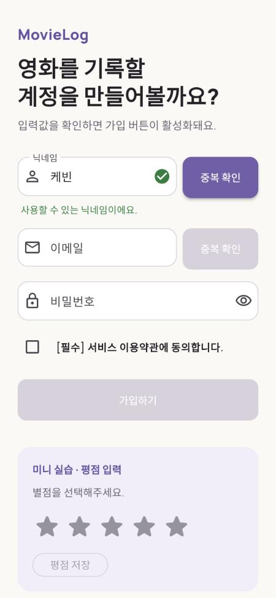
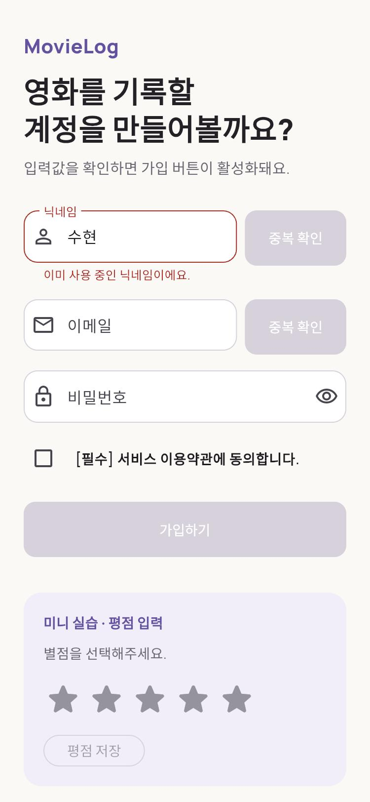
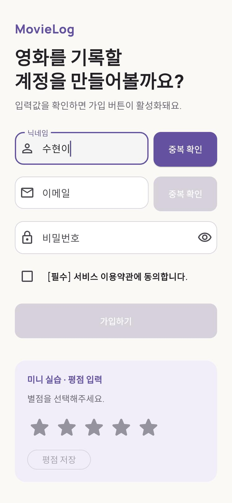
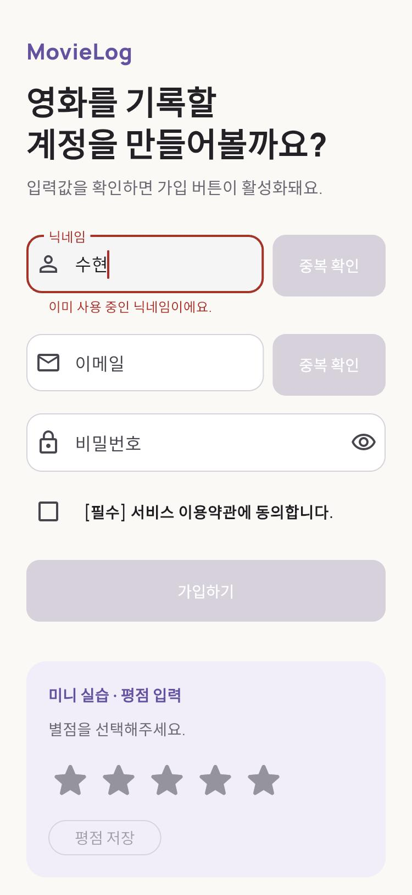
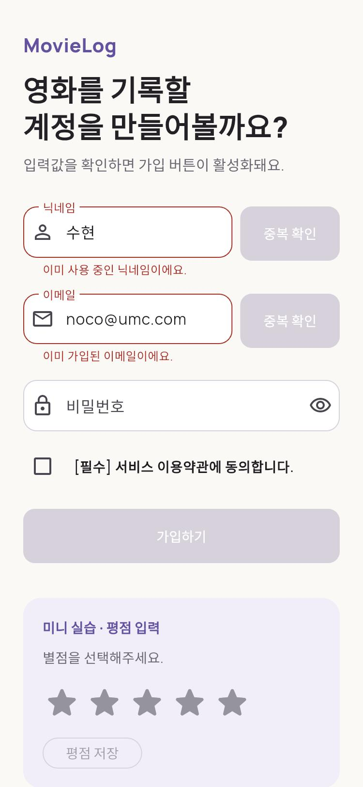
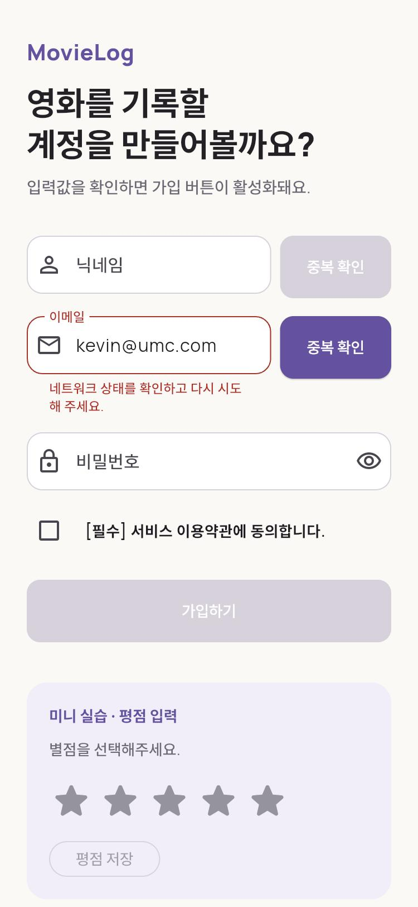
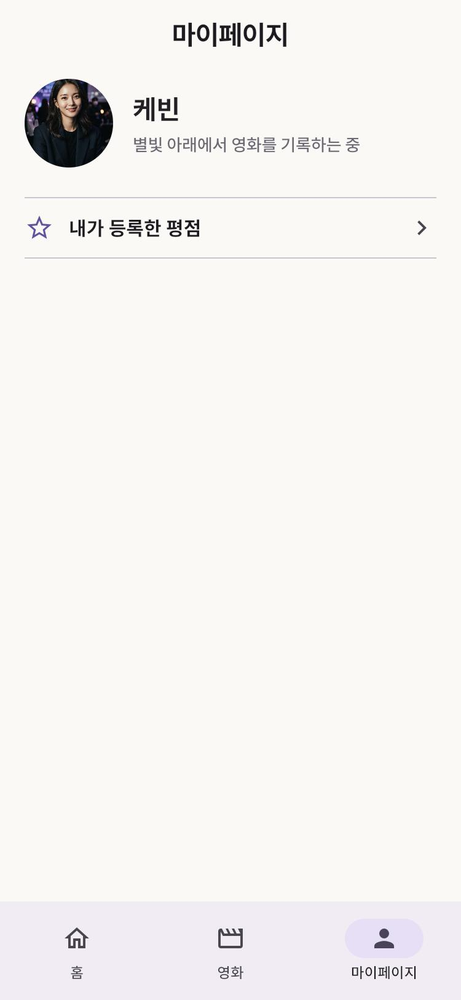
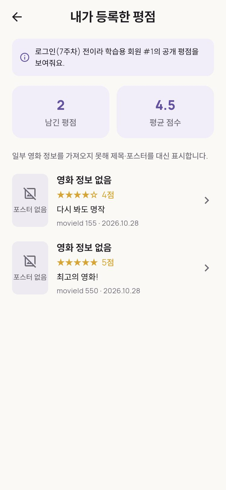

# 6주차 프론트엔드 미션 — 중복 확인 연동과 평점 조회하기

- 이름 / 닉네임: 케빈
- [GitHub 실습 저장소](https://github.com/brownglasses/11th_PE_Mobile_Flutter_Practice_Mission/tree/brownglasses/week06)
- [Pull Request #13](https://github.com/UMC-Inha/11th_PE_Mobile_Flutter_Practice_Mission/pull/13)
- [원본 워크북](https://makeus-challenge.notion.site/6-1-40fb57f4596b8025a428fa1758a5970c)
- [핵심 개념 정리](../../../keyword/Frontend/chapter06/keyword.md)
- 같은 주 백엔드 미션: [백엔드 6주차](../../Backend/chapter06/mission.md)

## 구현 결과

5주차 MovieLog 위에 두 가지를 더했다.

1. 공용 `MovieLogButton`을 만들어 회원가입의 닉네임·이메일 `중복 확인` 버튼을 입력창 바깥 오른쪽에 붙이고, 서버 결과를 Form의 `errorText`와 연결했다(Challenge 포함).
2. 마이페이지에 `내가 등록한 평점` 행을 추가하고, 자식 화면 `/my/ratings`에서 `GET /members/1/ratings` 결과에 TMDB 제목·포스터를 묶어 Loading / Empty / Error / Success로 보여준다.

| 계층 | 파일 | 6주차 변경 |
| --- | --- | --- |
| 공용 Widget | `widgets/movielog_button.dart` | 기본·통신 중·비활성 세 상태, `width` null / `double.infinity` / 고정 값 (새 파일) |
| ViewModel | `view_models/sign_up_view_model.dart` | `CheckStatus {idle, checking, available, duplicated, error}`를 닉네임·이메일에 따로 가짐, 입력 무효화, 중복이었던 값 기억 |
| View | `features/sign_up/presentation/widgets/duplicate_check_field.dart` | 입력창 + 오른쪽 8px `MovieLogButton`, `errorText` 연결, 입력창 안쪽 체크 표시 |
| Model | `data/models/rating_with_movie.dart` | 평점 + TMDB 영화 한 쌍. 못 찾으면 `movie == null` (새 파일) |
| Service | `data/services/tmdb_movie_service.dart` | `findMovieById`: TMDB 404 → null, 그 밖의 오류는 던짐 |
| ViewModel | `view_models/my_ratings_view_model.dart` | `sampleMemberId = 1`, 영화 캐시, 400·404·통신 실패 문구 분리 |
| View | `features/my_page/presentation/my_ratings_screen.dart` | "내가 등록한 평점" 화면 (새 파일) |
| View | `features/my_page/presentation/my_page_screen.dart` | 평점 목록을 빼고 진입 행만 둠 |
| Router | `app/app_router.dart` | `/my/ratings` + `parentNavigatorKey`로 root Navigator에 열어 NavigationBar를 가림 |

워크북 예시와 다르게 둔 부분: 5주차에 이미 자체 NestJS 백엔드를 쓰고 있어서 `workbook.devnoco.com/v5` 대신 `MovieLogApiService`(주소 `MOVIELOG_API_BASE_URL`, 경로 `/members/...`)를 그대로 썼다. 이름도 워크북의 `RatingDto`·`MemberCheckService`·`RatingApiService` 대신 기존 `MemberRatingDto`·`MovieLogApiService`를 유지했다.

## 화면 (실제 NestJS 서버에 연결한 Flutter Web, Chrome 390x844)

| 상태 | 화면 |
| --- | --- |
| 사용 가능 |  |
| 중복 |  |
| 입력을 고치면 해제 |  |
| 지운 중복 값을 다시 입력 → 즉시 에러 |  |
| 이메일도 같은 규칙, 닉네임과 독립 |  |
| 서버가 꺼졌을 때(통신 실패) |  |
| 마이페이지 진입 행 |  |
| 내가 등록한 평점 |  |

- 중복 확인 버튼은 입력창 오른쪽에 8px 띄워 나란히 있고, 가입하기 버튼은 Form 전체 너비다. 체크 표시는 입력창 안쪽에만 있다.
- 서버(`localhost:3000`)가 실제로 응답한 값이다. 요청 기록: [network-duplicate-check.txt](network-duplicate-check.txt). `케빈` 1건, `수현` 1건만 나갔고 `수현이`로 고칠 때와 `수현`으로 되돌릴 때는 요청이 없다.
- 내가 등록한 평점 화면에는 하단 NavigationBar가 없고 BackButton으로 마이페이지로 돌아온다. 평점 2개·평균 4.5는 실제 MySQL(시드) 값이다.
- Flutter Web에서 `context.push('/my/ratings')`로 열어도 주소창은 `#/my` 그대로다(`push`는 주소를 바꾸지 않는 go_router의 기본 동작). 주소로 `/my/ratings`를 직접 열면 같은 화면이 열리는 것은 위젯 테스트로 확인했다.
- 이 맥에는 TMDB Token이 없어서 영화 제목·포스터는 받지 못했다(실제 TMDB가 401). 그래서 이 화면은 "TMDB 조회가 실패해도 평점은 남고 제목·포스터만 placeholder" 상태다. 콘솔에는 `movie/155`, `movie/550`이 한 번씩만 요청됐고 `Authorization: Bearer ***`로 가려졌다.

## 제출 양식

| 항목 | 내용 |
| --- | --- |
| 닉네임·이메일 확인 전 / 통신 중 / 사용 가능 / 중복 화면 | 확인 전·사용 가능·중복은 위 [01](images/01_nickname_available.jpg)·[02](images/02_nickname_duplicated.jpg), 통신 중은 실제 브라우저에서는 응답이 너무 빨라 캡처하지 못해 위젯 테스트(`sign_up_duplicate_check_test.dart` "네 상태")로 확인: 버튼 안에 `CircularProgressIndicator`만 있고 label 없음, `onPressed == null` |
| 입력을 바꾸면 이전 확인 결과가 사라지는 화면 | [03](images/03_nickname_edit_cleared.jpg), 사용 가능 뒤 입력을 바꾸면 체크·문구가 사라지는 것도 위젯 테스트 |
| 중복된 문구를 다시 입력했을 때 즉시 에러 | [04](images/04_nickname_duplicate_restored.jpg) + [요청 기록](network-duplicate-check.txt) |
| `MovieLogButton`을 너비 다르게 배치한 화면 | 중복 확인 버튼(null) · 가입하기 버튼(`double.infinity`), 위 화면과 `movielog_button_test.dart`(고정 값 96 포함) |
| 마이페이지 → 내가 등록한 평점(memberId 1) 진입 | [08](images/08_mypage_entry.jpg) → [09](images/09_my_ratings_tmdb_unavailable.jpg) |
| 내가 등록한 평점의 Loading / Empty / Error / Success | Success는 [09](images/09_my_ratings_tmdb_unavailable.jpg)(실제 서버). Loading·Empty·Error(404·400·통신 실패)는 `my_ratings_screen_test.dart`·`my_ratings_view_model_test.dart`의 가짜 Service로 확인. memberId가 상수 1이라 실제 서버로 Empty·404를 만들려면 DB를 바꿔야 해서 하지 않았다 |
| `flutter analyze` 결과 | [flutter-analyze.txt](flutter-analyze.txt): No issues found |
| 수동 검증 결과 | 아래 "진행 과정과 검증" |
| 테스트 | [flutter-test.txt](flutter-test.txt): 100개 통과(실제 TMDB를 쓰는 3개는 Token이 없어 건너뜀). 5주차 48개에서 늘었다 |
| 미검증 항목 | iOS/Android 실기기 실행, 실제 TMDB 영화 제목·포스터가 평점 카드에 붙은 화면(Token 없음), `/my/ratings`를 브라우저 주소창 뒤로가기로 오가는 동작, 통신 중 상태의 실제 브라우저 캡처 |

## Guided Practice

### A. 닉네임 중복 확인 버튼

- [x] `MemberCheckService.checkNickname`에 해당하는 `MovieLogApiService.checkNickname`으로 실제 서버 응답을 확인: `{"available":false}` / `{"available":true}`
- [x] `MovieLogButton`에 `isLoading`, `onPressed`, `width`를 각각 넘겨 모양이 바뀌는지 확인(`movielog_button_test.dart` 10개)
- [x] `SignUpViewModel`에 `nicknameCheckStatus`·`checkNickname`
- [x] `TextFormField`의 `errorText`에 `nicknameErrorText` 연결
- [x] 닉네임을 바꾸면 `onNicknameChanged`가 이전 결과를 `idle`로 되돌림
- [x] 이메일에도 같은 구조(`emailCheckStatus`, `checkEmail`, `emailErrorText`)
- [x] 통신 실패(`DioException`)와 정상 중복 응답(`available: false`) 문구를 다르게: `이미 사용 중인 닉네임이에요.` / `네트워크 상태를 확인하고 다시 시도해 주세요.`
- [x] Guided Practice 종료 지점: 확인 전 · 통신 중 · 사용 가능 · 중복 네 상태가 모두 화면에서 구분된다

### B. 내가 등록한 평점 화면

- [x] `MemberRatingDto.fromJson`을 `comment: null` 포함해 검증(`tmdb_data_test.dart`)
- [x] `fetchMemberRatings(1)`로 고정된 memberId 1 조회
- [x] `MyRatingsViewModel`의 idle/loading → success/empty/error
- [x] Success/Empty/Error를 Provider로 연결해 화면에 그림
- [x] 마이페이지에 "내가 등록한 평점" 진입 항목
- [x] 평점 목록의 movieId를 TMDB 영화 정보와 연결해 표시(TMDB 실패 시 placeholder)
- [x] 공용 `MovieLogButton`을 화면 전용 폴더가 아닌 `lib/widgets/`에 둠

## Required Mission

- [x] 닉네임 또는 이메일을 수정하면 이전 확인 결과가 즉시 무효화된다
- [x] 통신 실패와 정상 중복 응답을 서로 다른 문구로 구분한다
- [x] 마이페이지에 "내가 등록한 평점" 진입 항목
- [x] `MyRatingsViewModel`이 memberId 1을 조회하며 Loading / Empty / Error / Success를 모두 표현한다
- [x] 평점 목록의 movieId를 TMDB 영화 정보와 연결해 표시한다

## Challenge Mission — 중복이었던 값 기억

- [x] 서버가 "중복"이라고 응답한 즉시 중복 확인 버튼이 비활성화된다 → [02](images/02_nickname_duplicated.jpg)
- [x] 입력값을 다른 문자열로 수정하면 Form이 에러 아님으로 돌아오고 버튼이 다시 눌린다 → [03](images/03_nickname_edit_cleared.jpg)
- [x] 방금 지운 값과 같은 문자열을 다시 입력하면 서버에 다시 묻지 않고 즉시 버튼이 비활성화되고 에러 상태로 돌아온다 → [04](images/04_nickname_duplicate_restored.jpg), 요청 기록

구현: "마지막으로 확인한 값"이 아니라 "마지막으로 중복이었던 값"(`_duplicated`)을 따로 기억한다. `수현`(중복) → `케빈`(사용 가능) → `수현` 순서에서도 `수현`이 즉시 에러가 되는 것을 단위 테스트로 고정했다. 이 기억은 학습용 최적화이고, 그 사이 서버 상태가 바뀔 수 있어 실제 가입 POST의 409가 최종 기준이다.

## 최종 체크리스트

- [x] `MovieLogButton`이 기본 · 통신 중 · 비활성 세 상태를 모두 표현한다
- [x] `MovieLogButton`의 width가 null, `double.infinity`, 고정 값에서 서로 다르게 동작한다(`double.infinity`를 제약 없는 Row에 넣으면 `BoxConstraints forces an infinite width` 예외가 나는 것도 테스트로 재현)
- [x] 공용 Button이 화면 전용 폴더가 아닌 공용 Widget 위치에 있다
- [x] 닉네임·이메일 확인 결과가 Form의 errorText와 실제로 연결되어 있다
- [x] 입력 변경 시 이전 확인 결과가 무효화된다
- [x] 중복이었던 문자열을 다시 입력하면 재요청 없이 즉시 에러 상태가 된다
- [x] 통신 실패와 정상 중복 응답을 다른 문구로 구분한다
- [x] 마이페이지에서 내가 등록한 평점(memberId 1) 화면으로 이동할 수 있다
- [x] 평점 목록이 Loading / Empty / Error / Success를 모두 표현한다(Empty·Error는 가짜 Service 테스트)
- [x] 평점의 movieId가 TMDB 영화 정보와 연결되어 표시된다(Token이 있을 때. 이 맥에서는 TMDB 401로 placeholder 경로만 실제로 확인)
- [x] `flutter analyze`와 테스트를 확인했다

## 진행 과정과 검증

1. 워크북과 5주차 코드(`features/*`, `MovieLogApiService`, `MyRatingsViewModel`)를 비교했다. 5주차에 이미 중복 확인·평점 조회가 화면에 붙어 있어서, 워크북 구조(`CheckStatus`, `RatingWithMovie`, `findMovieById`, 자식 화면, `MovieLogButton`)에 맞게 다시 나눴다.
2. `MovieLogButton`부터 만들고 세 상태·세 너비를 위젯 테스트로 고정했다.
3. `SignUpViewModel`을 닉네임·이메일에 따로 두되 한 칸의 규칙은 `_FieldCheck` 하나에 모았다. `idle → checking → available/duplicated/error`, 입력 무효화, 늦게 온 응답 버리기, 중복 값 기억, dispose를 단위 테스트 18개로 확인했다.
4. 평점 조회는 `MyRatingsViewModel`에 영화 캐시(404는 캐시, 일시 실패는 재시도)와 오류 원인 분리를 넣고 12개 테스트를 썼다.
5. 화면·라우터를 연결하고 위젯 테스트 16개(회원가입 8 + 평점 화면 8)로 흐름을 확인했다. 기존 테스트 중 옛 API를 쓰던 것은 새 구조에 맞게 고쳤다.
6. 백엔드(같은 주 NestJS)를 실제로 띄우고 Flutter Web을 Chrome에서 직접 눌러 확인했다. 이 과정에서 아래 No.1 버그를 찾았다.

결과: `flutter analyze` No issues found, `flutter test` 100개 통과(건너뜀 3), `flutter build web` 성공.

## 트러블슈팅

### No.1 서버가 꺼졌을 때 통신 실패 문구가 "다시 …"로 잘림

```
작업: 이메일 중복 확인
요청 Method·Path: GET /members/email/kevin%40umc.com
입력값(민감 정보 제거): kevin@umc.com (백엔드 서버를 일부러 끈 상태)
기대한 상태: error, "네트워크 상태를 확인하고 다시 시도해 주세요."가 끝까지 보임
실제 상태 및 응답: net::ERR_CONNECTION_REFUSED → error 상태는 맞지만 화면 문구가 "네트워크 상태를 확인하고 다시 …"로 잘림 (images/07_bug_before_error_truncated.jpg)
원인: InputDecoration의 errorMaxLines 기본값이 1이다. 입력창 옆에 버튼이 붙어 입력창 폭이 줄어든 상태에서 2줄이 필요한 문구가 말줄임 처리됐다.
수정: MovieLogTextFormField에 errorMaxLines: 3. 먼저 위젯 테스트에서 RenderParagraph.didExceedMaxLines가 true인 것으로 재현한 뒤 고쳤다.
재검증: 같은 테스트가 통과, 실제 브라우저에서 두 줄로 끝까지 보임 (images/06_network_error_not_truncated.jpg)
```

### No.2 위젯 테스트에서 "포스터 없음"이 모든 타일에 나타남

```
작업: 내가 등록한 평점 — TMDB 404인 영화만 placeholder인지 확인
기대한 상태: 못 찾은 영화(movieId 155) 타일 하나에만 포스터 placeholder
실제 상태 및 응답: find.byKey(posterPlaceholderKey)가 2개, 후기 없는 타일의 Text가 4개
원인: 테스트 환경에서는 Image.network가 항상 실패해 errorBuilder의 "포스터 없음"이 모든 타일에 그려진다. 제품 버그가 아니라 테스트의 가정 문제.
수정: 전체가 아니라 해당 타일(Key('ratingTile-2')) 안에서만 찾고, "포스터 없음" 문구는 세는 대상에서 뺐다.
재검증: 100개 통과
```

### No.3 브라우저 검증 중 옛 빌드가 계속 보임

```
작업: 수정한 빌드를 Chrome에서 다시 확인
상황: 같은 주소에서 해시(#/sign-up)만 다시 열면 페이지가 새로고침되지 않아 수정 전 JS가 그대로 돌았다. 좌표 클릭이 "스크린샷 먼저" 오류로 실행되지 않은 것도 겹쳐 수정이 안 먹은 것처럼 보였다.
원인: 해시 이동은 문서를 다시 읽지 않는다.
수정: 쿼리(?fresh=2)를 바꿔 완전히 다시 로드한 뒤 확인했다.
재검증: 새 빌드에서 문구가 두 줄로 나옴
```

### No.4 이 브라우저에서 한글이 네모로 보임

```
작업: 화면 증거 캡처
상황: Flutter Web(CanvasKit)은 시스템 글꼴을 쓰지 못하고 한글 대체 글꼴을 네트워크에서 받는데, 이 환경에서는 받아지지 않아 한글이 네모(두부)로 나왔다. 레이아웃·동작과는 무관.
수정: 프로젝트 코드는 그대로 두고, 임시 복사본에만 이 맥에 있는 Pretendard를 `fontFamilyFallback`에 추가해 따로 빌드한 것으로 캡처했다. 저장소의 `pubspec.yaml`·`app_theme.dart`에는 글꼴 변경이 없다.
```

## 6주차 회고

"버튼이 눌리는가"와 "Form이 에러인가"가 둘 다 하나의 상태값(`CheckStatus`)에서 나오게 하니, 중복 응답과 통신 실패를 구분하는 것이 문구가 아니라 상태의 차이가 됐다. "마지막으로 확인한 값"과 "마지막으로 중복이었던 값"이 다르다는 것은 `수현 → 케빈 → 수현` 순서를 테스트로 써 보고서야 분명해졌다. 가장 인상 깊은 것은 실제 서버를 띄워 눌러 보기 전까지 `errorText`가 잘리는 문제를 몰랐다는 점이다. 위젯 테스트는 문구가 "있는지"만 봤고 "끝까지 보이는지"는 보지 않았다.
