# 9주차 프론트엔드 미션 — 즐겨찾기 연동과 검색, 페이지네이션

- 이름 / 닉네임: 케빈
- [GitHub 실습 저장소](https://github.com/brownglasses/11th_PE_Mobile_Flutter_Practice_Mission/tree/brownglasses/week09)
- Pull Request: {{FE_PR}}
- [원본 워크북](https://makeus-challenge.notion.site/e41b57f4596b83d4ba54810816d0694e)
- [핵심 개념 정리](../../../keyword/Frontend/chapter09/keyword.md)
- 같은 주 백엔드 미션: [백엔드 9주차](../../Backend/chapter09/mission.md)

> 이 문서에서 **"실서버·실제 화면에서 확인"** 은 Chrome(Flutter Web 390x844)이 실제 NestJS 서버(7~9주차에 만든 `movie`, 일회용 DB)를 호출한 것이고, **"테스트로 확인"** 은 가짜 서버(Fake)를 쓴 위젯·ViewModel 테스트에서 본 것이다.
> **TMDB는 진짜가 아니다.** 이 맥에는 TMDB 토큰이 없어서 `/discover/movie`·`/search/movie`·`/movie/{id}`를 흉내 내는 **로컬 가짜 TMDB 서버**를 썼다(영화 200편은 `예시 영화 1001`처럼 합성한 것이고, 포스터 이미지만 실제 TMDB 이미지 서버에서 받는다). 느린 응답·실패·마지막 page 같은 상황은 이 가짜 서버와 로컬 프록시로 **일부러 만들었다**. 실제 TMDB 응답으로 확인한 것은 없다.
> iOS Keychain·Android Keystore, 실기기·시뮬레이터는 확인하지 못했다(이 맥에는 Xcode·Android SDK가 없다). **영상은 없고** 정지 화면과 요청 기록만 있다.

## 먼저 알아 둘 것: 이 주차의 서버 계약

- 워크북 API는 `/v8/…`지만 우리 서버(NestJS)에는 `/v7`·`/v8` 접두사가 없다. 그래서 `POST·GET /favorites`, `GET·DELETE /favorites/{movieId}`, `POST /movie-records`를 그대로 썼다.
- 즐겨찾기 응답에는 `favoriteId · movieId · createdAt`만 있고 제목·포스터가 없다. 제목·포스터는 `movieId`로 TMDB `GET /movie/{id}`를 불러 채운다.
- 해제(`DELETE /favorites/{movieId}`)는 **200 + `result: null`** 이다(7주차 평점 삭제의 204와 다르다). 응답 본문을 DTO로 파싱하지 않고 `DioException`이 없으면 성공으로 본다.
- 사용자는 JWT로 구분한다. `memberId`를 직접 보내지 않고 JWT 안의 값을 추측하지도 않는다.

| 원천 | 주는 것 | 쓰는 곳 |
| --- | --- | --- |
| TMDB (가짜 서버로 대신) | 영화 ID·제목·포스터, 목록(page)·검색 | 영화 카드, 영화 목록·검색, 내 즐겨찾기의 제목·포스터 |
| MovieLog 서버 (JWT 필요) | `favoriteId · movieId · createdAt`, `isFavorite` | 즐겨찾기 버튼, 내 즐겨찾기 목록 |
| `movieId`로 결합 | 제목·포스터 + 즐겨찾기 정보 | 내 즐겨찾기 카드 한 장 |

## 구현 결과

4개의 커밋이다(기준은 8주차 마지막 커밋 `00131ca`).

| 커밋 | 내용 |
| --- | --- |
| `cf5d970` Required | 즐겨찾기 연동, 내 즐겨찾기, 영화 목록 더 보기, 영화 검색, 세션·보안 |
| `c0ace78` Challenge A | 검색 debounce(500ms) |
| `fd7cf1f` Challenge B | 영화 목록 무한 스크롤 |
| `a8af17a` Challenge C | 평점 Dialog의 평점·즐겨찾기 통합 저장 + 변이 검사 뒤 보강한 테스트와 `evidence/week09` |

| 위치 | 하는 일 |
| --- | --- |
| `data/models/favorite_*.dart` · `data/services/favorite_api_service.dart` | 등록(201)·해제(200, `result: null`)·여부 조회(`isFavorite`)·내 목록. 보호용 Client만 쓴다 |
| `core/network/auth_interceptor.dart` | 보호 경로에 `/favorites`·`/movie-records`와 접두사 `/favorites/` 추가. TMDB·외부 URL에는 Bearer를 붙이지 않는다 |
| `core/session/session_guard.dart` · `auth_session_bridge.dart` | "지금 도착한 응답이 **현재 로그인 세션**의 것인가"를 판정. 같은 이메일로 다시 로그인해도 새 세션이다 |
| `core/utils/map_bounded.dart` · `safe_notify.dart` · `view_models/load_phase.dart` | 동시에 5개까지만 처리 · dispose 뒤 알림 방지 mixin · 화면 상태 enum |
| `view_models/favorite_detail_view_model.dart` | 상세의 북마크 상태. 서버가 확인한 뒤에만 바뀐다(optimistic 금지), 409·404는 GET으로 맞춤, timeout에서 POST 자동 재시도 금지 |
| `view_models/favorites_view_model.dart` | 내 즐겨찾기: 목록 조회 → TMDB 영화 정보 보충(최대 5개 동시) → 한 건 실패는 그 카드만 placeholder, 그 카드만 재조회 |
| `view_models/paged_movies_view_model.dart` | 영화 목록·검색이 **각자 인스턴스**로 쓰는 page 모델: 교체/append, 성공 때만 `nextPage`+1, `movieId` 중복 제거, 요청 generation, page 상한 500 |
| `widgets/member_session_gate.dart` | 사용자별 화면을 열기 전에 "내 정보가 준비됐고 세션과 일치"하는지 확인(로딩·오류·다시 시도). 사용자별 ViewModel은 `ValueKey('email:generation')`로 만든다 |
| `features/movies/…/movie_search_screen.dart` · `movie_page_footer.dart` | 검색 화면(idle·결과·결과 없음·오류), 더 보기 footer(더 보기·로딩·오류+재시도·끝) |
| `features/movies/…/movie_list_screen.dart` | 첫 page만 표시 + 무한 스크롤(`extentAfter ≤ 300`), AppBar의 검색 아이콘 |
| `features/my_page/…/favorites_screen.dart` · `my_page_screen.dart` | "내 즐겨찾기" 행(내가 등록한 평점 아래)과 `/my/favorites`(하단 NavigationBar 없음) |
| `data/services/movie_record_api_service.dart` · `movie_rating_dialog.dart` | Challenge C: `POST /movie-records`, "즐겨찾기에도 추가" 체크박스 |

**5주차 동작이 바뀐 곳** (워크북 지시에 따른 변경이지만 기록해 둔다)

- 영화 목록이 "Discover를 여러 번 불러 최대 30개 모으기"에서 **page당 20편 + 이어 붙이기**로 바뀌었다. 첫 page 실패는 전체 화면 오류 + "다시 시도"다.
- 5주차의 `RetryDialog`(실패 안내 Dialog)와 `retryNoticeCount`를 없앴다(`retry_dialog.dart` 삭제). 새 화면 오류·footer 오류가 그 역할을 한다.
- 장르 칩은 로딩 중에도 눌린다. 늦게 온 이전 장르의 응답은 generation 비교로 버린다.
- 5주차 증거 생성기 `test/live/live_evidence_test`는 영구 skip으로 바꿨다(실서버·TMDB가 필요한 테스트라 일반 `flutter test`에서는 어차피 건너뛴다).
- 홈 화면의 인기 영화 5개 API는 그대로다.

## 화면 (실제 NestJS에 연결한 Flutter Web, Chrome 390x844)

### 무엇이 진짜이고 무엇이 대역인가

| | 진짜 | 대역·주입 |
| --- | --- | --- |
| MovieLog 서버 | 7~9주차에 만든 NestJS(`brownglasses/week09` 브랜치) + MySQL **일회용 DB**, 로그인·JWT·즐겨찾기·평점·`/movie-records` 모두 실제 처리 | 서버 앞에 **로컬 프록시**를 둬서 요청을 기록하고, 필요할 때만 5xx·지연을 끼웠다 |
| TMDB | 포스터 이미지 | 목록·검색·상세는 **로컬 가짜 서버**. 느린 응답·실패·마지막 page(`total_pages` 상한)는 이 서버로 만들었다 |
| 계정 | 테스트용으로 만든 두 계정 A·B(이 실행에서만 쓴 무작위 비밀번호, 화면·기록에 남기지 않았다) | |

화면 캡처를 찍을 때의 로컬 커밋은 `3a51c9b`이고, 여기에 테스트 4개 파일과 증거 파일을 더해 다시 만든(amend) 것이 최종 커밋 `a8af17a`다. 두 커밋의 `lib/`·`pubspec`은 **같다**(`git diff --stat`으로 확인, 차이는 테스트 4개 파일과 증거 파일 추가뿐). `3a51c9b`는 push되지 않아 저장소에서는 찾을 수 없다. 요청 기록 전체는 [logs/proxy-requests.ndjson](logs/proxy-requests.ndjson)·[logs/tmdb-requests.ndjson](logs/tmdb-requests.ndjson)에 있고(토큰·비밀번호·본문은 기록하지 않는다), 요청 종류별 횟수는 [logs/proxy-summary.txt](logs/proxy-summary.txt)에 있다.

### 영화 상세의 즐겨찾기 버튼

| ① 즐겨찾기한 영화(채워진 북마크) | ② 해제 — Snackbar | ③ 다시 등록 — Snackbar |
| --- | --- | --- |
| 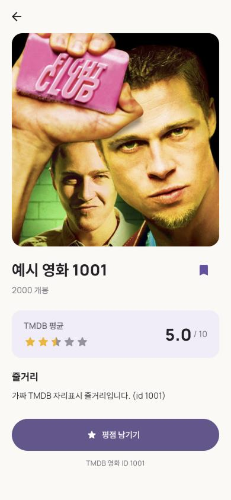 | 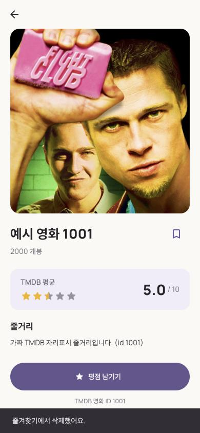 | 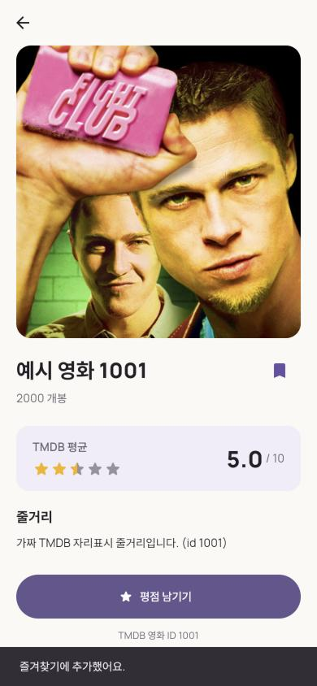 |

상세에 들어오면 `GET /favorites/{movieId}`로 서버의 현재 여부를 받아 북마크에 반영한다. 누르면 `DELETE`(200) / `POST`(201)를 보내고, **서버가 성공을 알려 준 뒤에** 아이콘과 Snackbar가 바뀐다.

### 마이페이지 → 내 즐겨찾기

| ④ 최신 등록 순(방금 다시 등록한 1001이 맨 위) | ⑤ 영화 정보 한 건만 실패 | ⑥ 그 카드만 다시 조회 |
| --- | --- | --- |
|  | 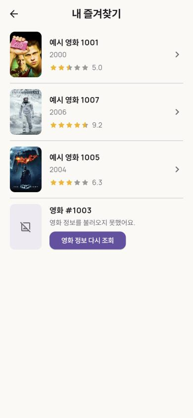 | 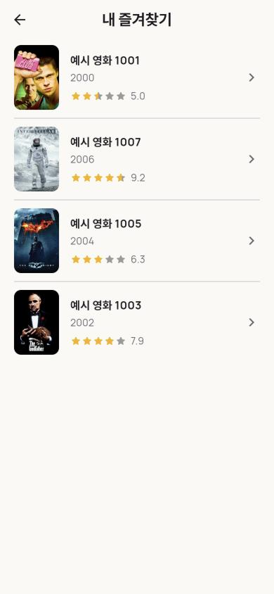 |

- ④: 즐겨찾기 4건의 TMDB 정보 4건이 한꺼번에 나갔다([logs/tmdb-requests.ndjson](logs/tmdb-requests.ndjson)).
- ⑤: 가짜 TMDB가 `GET /movie/1003`만 500으로 응답하게 했다(**일부러 만든 실패**). 다른 세 카드는 정상이고 그 카드만 "영화 #1003 · 영화 정보를 불러오지 못했어요 · 영화 정보 다시 조회"가 된다.
- ⑥: 다시 조회 버튼을 누르면 `GET /movie/1003` **한 건만** 나갔고 카드가 채워졌다.

| ⑦ 상세에서 해제 → 뒤로가기 → 목록 갱신(빈 목록) | ⑧ 목록 조회 자체가 실패(403 주입) | ⑨ 계정 B로 로그인하면 B의 목록만 |
| --- | --- | --- |
| 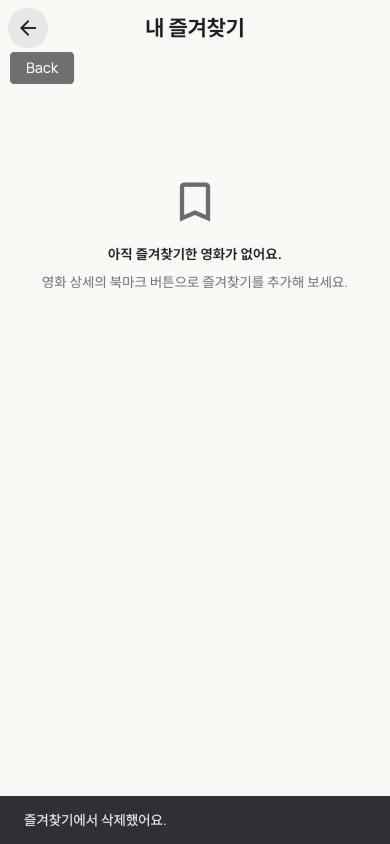 | 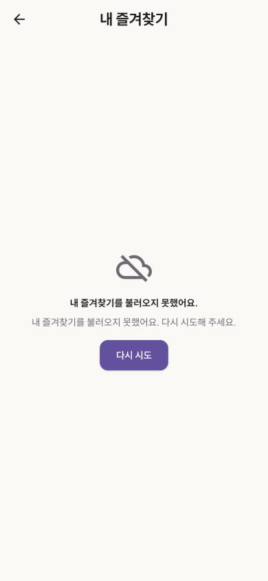 | 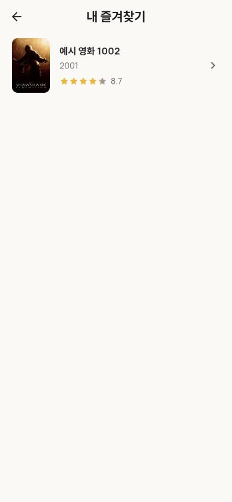 |

- ⑦: 계정 B의 목록(1건, [13번](images/13-account-B-favorites-only-1002.jpg))에서 카드를 눌러 상세([39번](images/39-B-detail-1002-from-favorites.jpg)) → 북마크 해제 → 뒤로가기하니 `GET /favorites`를 다시 받아 "아직 즐겨찾기한 영화가 없어요."가 됐다. 해제 Snackbar가 뒤로 와서도 남아 있다.
- ⑧: `GET /favorites`를 403으로 한 번 막았다(**일부러 만든 실패**). 전체 오류 화면 + 다시 시도가 뜨고 **로그아웃되지 않았다**. 다시 시도하면 목록이 나왔다([17번](images/17-favorites-after-drop-retry-ok.jpg)).
- ⑨: 로그아웃 → 계정 B 로그인 → 내 즐겨찾기를 열면 B의 1건(1002)만 나온다. 계정 A의 4건이 한 프레임도 비치지 않았다.

### 영화 목록 — 더 보기(Required)

| ⑩ 첫 page 20편 + 더 보기 | ⑪ 다음 page 실패(503 주입) — 기존 20편 유지 | ⑫ 같은 page 재시도 → 40편 |
| --- | --- | --- |
| 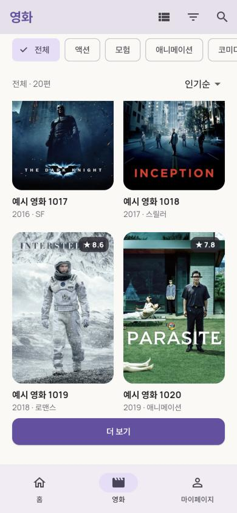 | 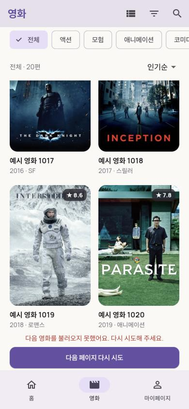 | 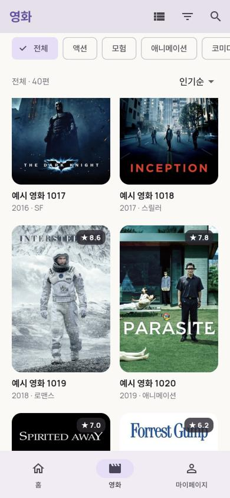 |

- ⑪: `GET /discover/movie?page=2`를 503으로 한 번 막았다. 상단의 "전체 · 20편"과 카드는 그대로이고 footer에 오류와 "다음 페이지 다시 시도"만 나왔다. 재시도하니 **같은 page 2**가 이어 붙었다(⑫, "전체 · 40편"). 요청 기록: page 1 → page 2(503) → page 2(200)로 page가 건너뛰지 않았다.
- 마지막 page: 가짜 서버의 `total_pages`를 3으로 줄여 page 3까지 불러오자 "전체 · 60편"과 **"더 이상 불러올 영화가 없어요."** 만 남고 더 보기 버튼이 사라졌다([10번](images/10-movies-last-page-end-message.jpg)).

| ⑬ "액션" 응답을 4초 늦추고 "액션"→"모험"을 연달아 누름 | ⑭ 4초 뒤 "액션" 응답이 도착한 뒤에도 "모험" 그대로 |
| --- | --- |
|  | 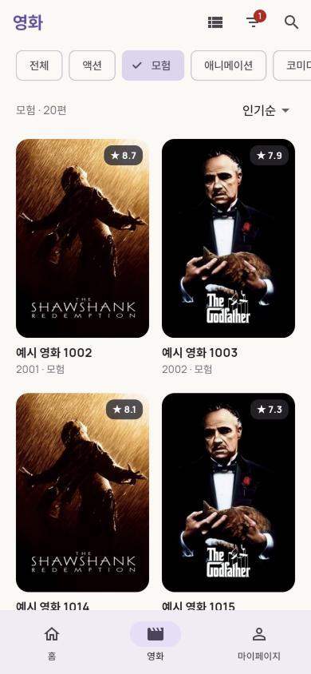 |

요청 기록: `with_genres=12`(모험)가 0ms로 먼저 끝나고, `with_genres=28`(액션)이 **4002ms 뒤에** 끝났다. 화면은 계속 "모험 · 20편"이다(늦은 응답을 generation 비교로 버렸다).

### 영화 검색(Required)

| ⑮ 결과 없음 | ⑯ 검색 실패(500 주입) + 다시 시도 | ⑰ 재시도 → 결과 | ⑱ 결과 카드 → 영화 상세 |
| --- | --- | --- | --- |
| 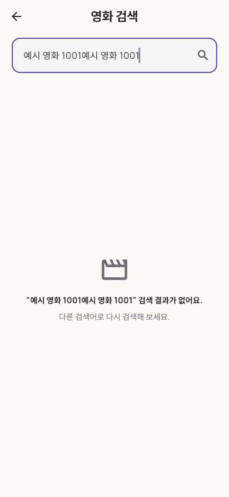 | 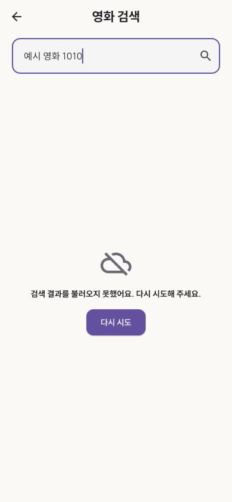 | 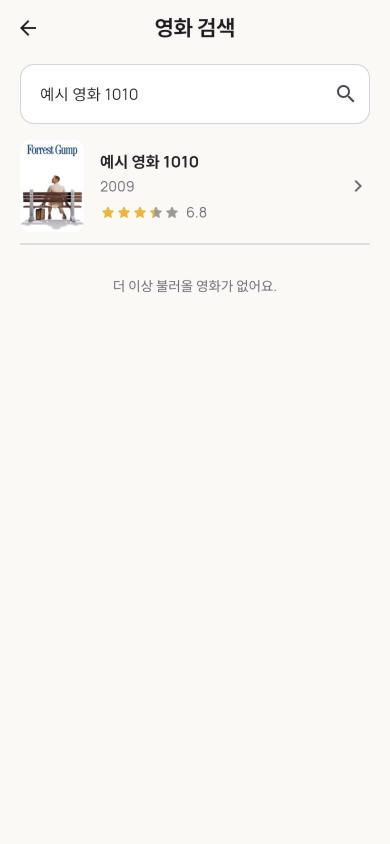 | 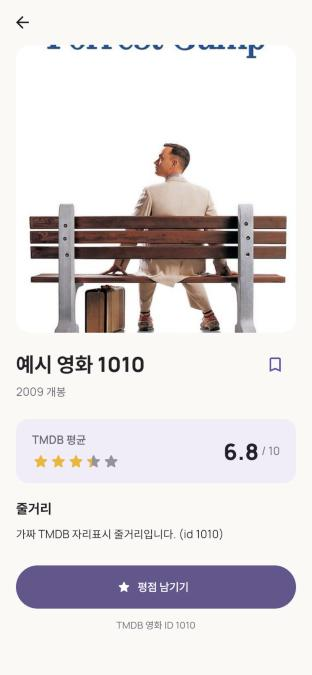 |

- 이전 검색어의 느린 응답이 새 결과를 덮지 않는지는 아래 Challenge A의 ㉗~㉙에서 확인했다(같은 흐름이다).
- ⑮는 내가 입력칸에 글자를 잘못 이어 붙여 만들어진 "결과 없는 검색어"로 찍은 것이다(없는 영화 제목을 검색한 것과 같은 화면이다).

### 세션·보안(Required D)

| ⑲ 무효 토큰(`AUTH401_3`) → 자동 로그아웃 + 안내 | ⑳ 만료 토큰(`AUTH401_4`) → 로그인 화면 |
| --- | --- |
| 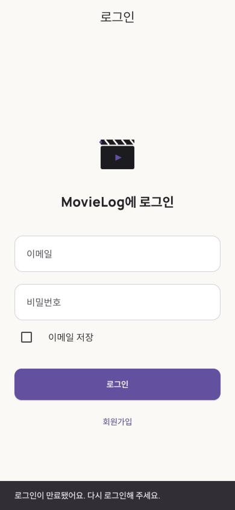 | 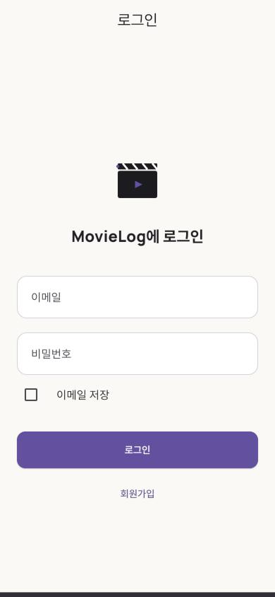 |

- 서버를 **다른 키로 다시 띄워서** 기존 토큰을 무효로 만든 뒤 내 즐겨찾기를 열었다. `GET /favorites`가 401 한 번을 받았고 앱은 로그인 화면으로 이동해 "로그인이 만료됐어요. 다시 로그인해 주세요."를 한 번 보였다. 요청이 반복되지 않았다.
- 토큰 유효시간을 3초로 띄운 서버에 로그인한 뒤 몇 초 지나 내 즐겨찾기를 열어도 같은 곳(로그인 화면)으로 이동했고 `GET /favorites`는 401 한 번이었다(⑳, 안내 Snackbar는 캡처 시점에 이미 사라져 이 실행에서는 확인하지 못했다). 같은 조건에서 서버가 주는 코드를 따로 확인했다: 키가 바뀐 토큰은 `AUTH401_3`, 만료된 토큰은 `AUTH401_4`다(둘 다 401). 앱 코드는 `AUTH401_2/3/4`를 같은 만료 처리로 본다.
- **403·네트워크 실패는 로그아웃하지 않는다**: ⑧(403 주입)에서 확인했다.
- 요청 헤더 검사: 프록시가 기록한 47건 중 보호 경로 41건은 모두 Authorization이 있었고 공개 경로 6건은 모두 없었다. TMDB 47건에는 TMDB 전용 값만 갔다([logs/check-auth-log.txt](logs/check-auth-log.txt)). 앱 콘솔 로그에는 `Authorization: Bearer ***`, `accessToken: ***`로 가려져 나온다([logs/console-log-check.txt](logs/console-log-check.txt)).
- 저장소: 토큰은 `localStorage`의 `FlutterSecureStorage.movielog.access_token`에 있고 JWT 모양으로 보이지 않았다(웹의 암호화 저장소). **모바일 Keychain·Keystore는 확인하지 못했다**([logs/storage-check.txt](logs/storage-check.txt)).

### 즐겨찾기 요청이 실패·지연될 때

| ㉒ 해제 요청이 5초 넘게 걸림(스피너) | ㉓ 시간 초과 안내 + 북마크 그대로 | ㉔ 서버는 지웠는데 앱은 시간 초과 → 북마크가 예전 값 | ㉕ 목록으로 돌아오니 서버 값으로 맞춰짐 |
| --- | --- | --- | --- |
| 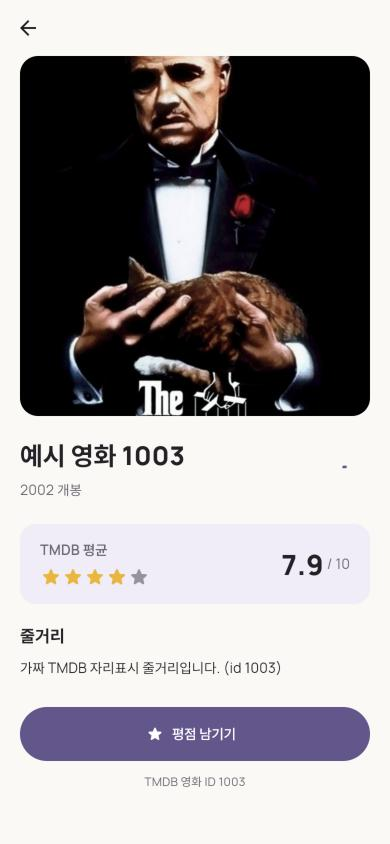 | 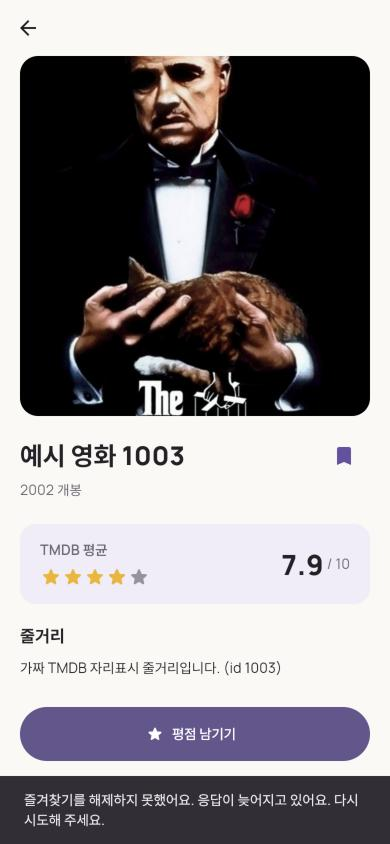 |  | 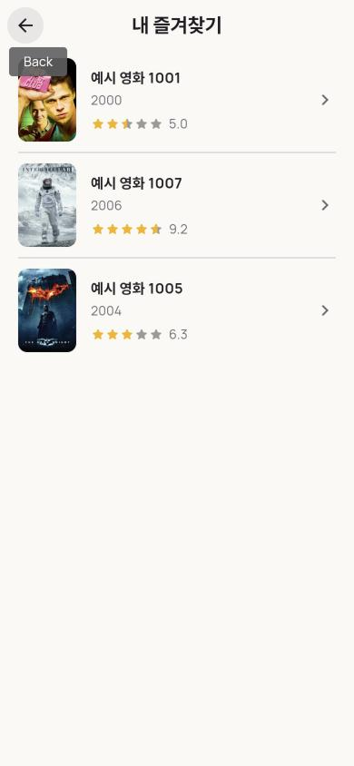 |

- ㉒·㉓: 프록시가 `DELETE`를 8초 붙잡게 했다. 약 5초 뒤 "즐겨찾기를 해제하지 못했어요. 응답이 늦어지고 있어요. 다시 시도해 주세요."가 나왔고 북마크는 그대로다(요청 기록에는 `aborted`).
- ㉔: 이번에는 **서버가 먼저 처리한 뒤** 응답만 붙잡았다(기록: `upstreamStatus 200`, 앱은 `aborted`). 서버에서는 해제됐는데 앱의 북마크는 "등록됨"으로 남았다. 같은 요청을 자동으로 다시 보내지 않는 것이 설계이고, ㉕처럼 목록으로 돌아와 `GET /favorites`를 다시 받으면 서버 값(해제됨)으로 맞춰진다. **한 화면 안에서 즉시 맞춰지지는 않는다**(아래 "관찰했지만 고치지 않은 것").

### Challenge A — 검색 debounce

| ㉖ 10글자를 입력했는데 요청은 한 번 | ㉗ "예시"(4초 지연) → 이어서 "예시 영화 1001" | ㉘ 새 검색어 결과가 먼저 보임 | ㉙ 4초 뒤 느린 응답이 와도 그대로 |
| --- | --- | --- | --- |
|  | 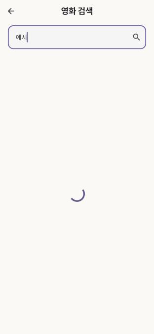 | 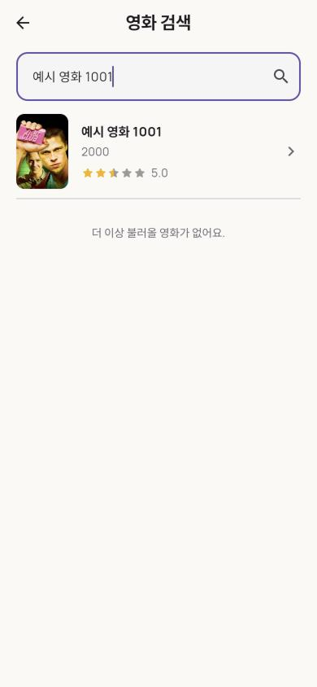 |  |

- ㉖: `예시 영화 1001`(10글자)을 입력하는 동안 `GET /search/movie`는 **한 번**(검색어 `예시 영화 1001`)만 나갔다(TMDB 기록 seq 32).
- ㉗~㉙: `query=예시`만 4초 늦추고 "예시"를 입력한 뒤 이어서 " 영화 1001"을 입력했다. 기록: `예시 영화 1001`이 0ms로 먼저 끝나고(seq 35) `예시`는 4002ms 뒤(seq 36)에 끝났는데, 화면은 `예시 영화 1001`의 결과 1건 그대로였다.

### Challenge B — 무한 스크롤

| ㉚ 스크롤로 page 2가 자동으로 이어 붙음(모험 34편) | ㉛ 끝 | ㉜ 다음 page 실패(503) — 요청은 한 번뿐 | ㉝ 다시 시도 → 40편 |
| --- | --- | --- | --- |
| 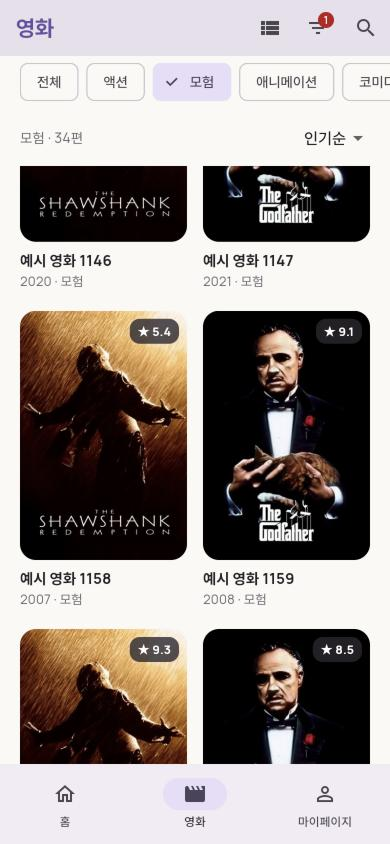 | 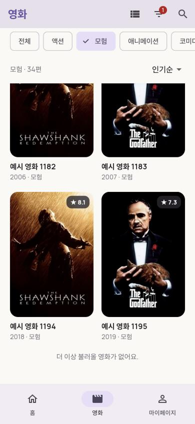 | 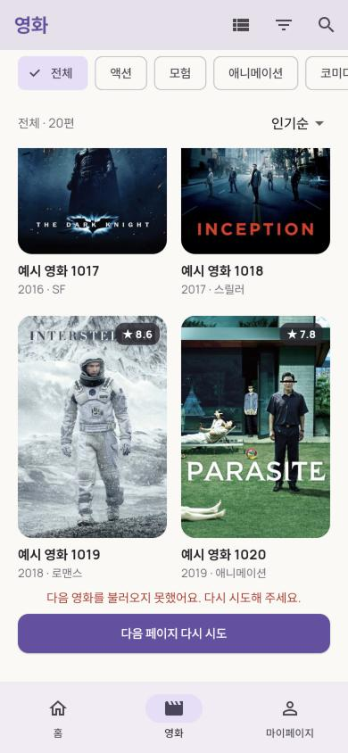 | 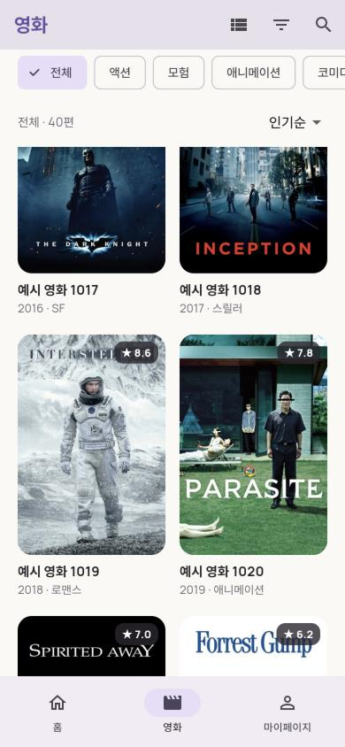 |

- 스크롤이 끝에 가까워지면(`extentAfter ≤ 300`) 다음 page를 자동으로 불러온다. 8번 연속 스크롤해도 page 2 요청은 한 번이었다(중복 요청 방지).
- ㉜: page 2에 503을 **5번까지** 걸어 두고 맨 아래에서 계속 머물렀는데, 규칙이 적용된 횟수는 **1번**이었다. 실패한 뒤 스스로 계속 재요청하지 않는다(사용자가 "다음 페이지 다시 시도"를 누른다).

### Challenge C — 평점·즐겨찾기 통합 저장

| ㉞ 아직 즐겨찾기 안 한 영화의 Dialog(체크박스) | ㉟ 별 4개 + 체크 | ㊱ 저장 → `POST /movie-records` 201, 북마크가 채워짐 |
| --- | --- | --- |
| 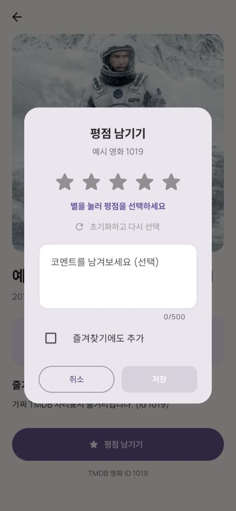 | 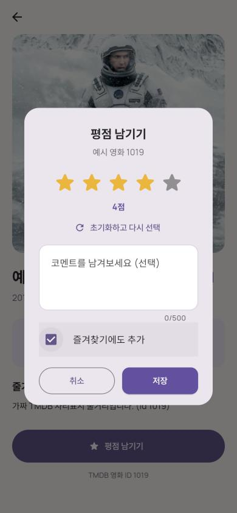 | 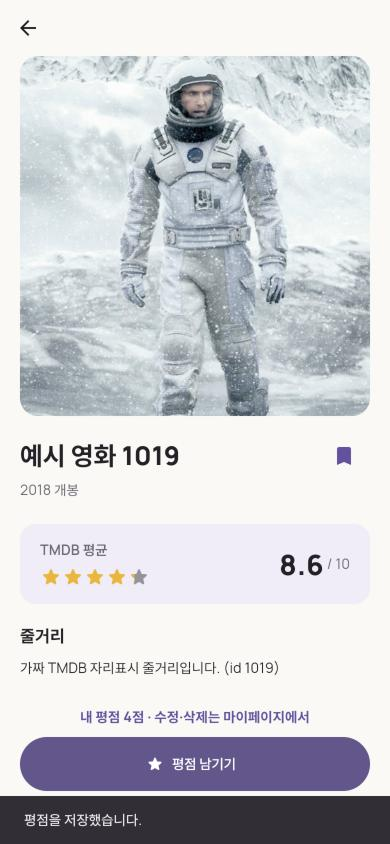 |

- 요청 기록: `GET /favorites/1019`(여부 확인) → `POST /movie-records` 201 → `GET /favorites/1019`(북마크를 서버 값으로 다시 맞춤). 서버에서 확인: 평점 4점(1019)과 즐겨찾기 1019가 **한 번의 요청으로** 함께 생겼다.
- 이미 즐겨찾기한 영화에서는 체크박스가 보이지 않고 기존 `POST /ratings`를 쓴다(테스트로 확인).

| ㊲ 저장이 503으로 실패 — Dialog가 열려 있고 별점·체크 유지 | ㊳ 같은 Dialog에서 다시 저장 → 성공 |
| --- | --- |
| 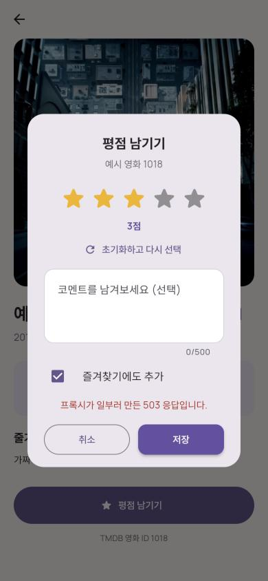 | 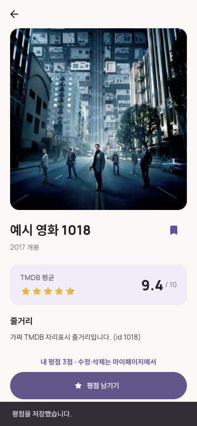 |

- ㊲: `POST /movie-records`를 503으로 한 번 막았다(**일부러 만든 실패**, 서버에는 도달하지 않았다). 안내 문구는 프록시가 만든 503 본문의 메시지가 그대로 보인다. 다시 저장하니 201이었고 평점은 **한 건만** 생겼다(ratingId 3).
- 한 가지 확인하지 못한 것: 같은 요청을 8초 붙잡았을 때([35](images/35-movie-records-saving-spinner-8s-delay.jpg)·[36](images/36-movie-records-8s-delay-still-succeeded.jpg)) 앱은 5초 제한에 걸리지 않고 8초 뒤의 201을 받아 정상 저장으로 처리했다. 같은 보호 Client의 `DELETE`는 5초에 끊겼는데(㉒) 본문이 있는 `POST`는 끊기지 않았다. 웹 어댑터의 제한 시간 동작 차이로 보이지만 **원인은 확인하지 않았다**. 그래서 POST의 timeout 안내(`COMMON400`·네트워크·timeout 때 Dialog 유지)는 **테스트로만** 확인했다.

## 제출 양식

```
PR 링크: {{FE_PR}}
영화 상세 즐겨찾기 등록·해제 영상: 영상은 없다. 정지 화면 ①②③(images/01~03)과 요청 기록(DELETE 200 → POST 201)
마이페이지 → 내 즐겨찾기 → 상세 해제 → 뒤로가기 갱신 영상: 영상은 없다. 정지 화면 ⑦(images/39, 40)과 요청 기록(DELETE 200 → GET /favorites)
내 즐겨찾기 빈 목록·조회 오류·영화 정보 일부 실패 화면: ⑦(빈 목록), ⑧(조회 오류), ⑤⑥(한 건 실패·재조회)
영화 목록 더 보기와 다음 page 조회 실패 후 재시도 영상: 영상은 없다. 정지 화면 ⑩⑪⑫와 요청 기록(page 2 503 → page 2 200)
영화 검색 결과·결과 없음·오류 화면: ⑱ ⑮ ⑯
장르·검색어 변경 시 이전 응답이 섞이지 않는 확인: ⑬⑭(장르 4002ms 늦은 응답), ㉗~㉙(검색어 4002ms 늦은 응답)
로그아웃·계정 전환 후 이전 계정 즐겨찾기 비노출 확인: ⑨(계정 B에 B의 1건만), 이전 세션의 늦은 응답은 테스트로
401/409 처리(세션 만료, FAVORITE409_1, FAVORITE404_1): 401(AUTH401_3·4)은 ⑲⑳ 실제 화면. 409·404(FAVORITE409_1·404_1)는 테스트로만(실제 화면에서 만들지 않았다)
토큰/비밀번호 비노출 확인: 콘솔 로그 Bearer ***, 요청 기록에 토큰·비밀번호 없음, 헤더 검사 위반 없음(logs/)
선택한 Challenge Mission과 증거: A(검색 debounce ㉖~㉙) · B(무한 스크롤 ㉚~㉝) · C(통합 저장 ㉞~㊳)
트러블슈팅: 아래 "트러블슈팅" 5건
```

## 스터디 인증 — 새로 학습한 문법을 한 문장씩

- **Map**: key(`movieId`)로 value(영화 정보)를 찾는 자료 구조다. 이번에는 내 즐겨찾기 목록의 `movieId`로 TMDB 영화 정보를 찾아 한 카드로 합치는 데 썼다.
- **Future.wait**: 여러 비동기 작업이 모두 끝날 때까지 기다렸다가 결과를 같은 순서로 돌려준다. 다만 모든 요청을 한꺼번에 보내서, 즐겨찾기가 많을 때를 위해 한 번에 5개만 처리하는 `mapBounded`를 만들어 썼다.
- **record**: 값 여러 개에 이름을 붙여 한 번에 돌려주는 Dart 3 문법이다. `({List<int>? genreIds, String query})`로 "현재 조건"을 하나로 들고 다닌다.
- **interface**: "반드시 제공해야 하는 메서드 목록"이다. Dart는 모든 클래스가 interface가 되어서, 테스트에서 `implements FavoriteApiService`로 가짜를 만들어 바꿔 끼웠다.
- **mixin**: 여러 클래스에 같은 기능을 `with`로 붙인다. dispose 뒤 `notifyListeners()`를 막는 `SafeNotify`를 모든 ViewModel에 붙였다.
- **ValueKey**: key 값이 바뀌면 Flutter가 다른 위젯으로 보고 기존 상태를 버린다. `ValueKey('이메일:세션번호')`로 계정이 바뀌면 이전 계정의 ViewModel이 남지 않게 했다.
- **요청 generation**: 요청마다 번호를 올리고, 응답이 왔을 때 번호가 현재와 같을 때만 반영해 늦게 온 이전 응답을 버린다.

## Guided Practice · Required · Challenge

| | 상태 | 확인한 방법 |
| --- | --- | --- |
| Guided A 영화 상세 즐겨찾기 | 완료 | 실서버 ①②③ + 테스트 |
| Guided B 내 즐겨찾기 | 완료 | 실서버 ④~⑨ + 테스트 |
| Required A 마이페이지의 내 즐겨찾기 | 완료 | 실서버 ④~⑨, 하단 NavigationBar 없음 확인 |
| Required B 영화 목록 더 보기 | 완료 | 실서버 ⑩~⑭ + 테스트 |
| Required C 영화 검색 | 완료 | 실서버 ⑮~⑱ + 테스트 |
| Required D 세션과 보안 | 완료 | 실서버 ⑨ ⑧ ⑲ ⑳ + 테스트 |
| Challenge A debounce | 완료 | 실서버 ㉖~㉙ + 테스트 |
| Challenge B 무한 스크롤 | 완료 | 실서버 ㉚~㉝ + 테스트 |
| Challenge C 통합 저장 | 완료 | 실서버 ㉞~㊲ + 테스트(timeout 경로는 테스트만) |

## 최종 체크리스트

- [x] 영화 상세 화면의 즐겨찾기 등록/해제·빈 결과·실패·재조회가 `movieId` 기준으로 동작한다.
- [x] 내 즐겨찾기 진입/복귀 갱신·뒤로가기·하단 탭 경계가 화면과 코드에 일치한다. (`/my/favorites`는 하단 NavigationBar를 가린다)
- [x] 인기 영화 5개 API(홈 화면)는 그대로이고, 영화 목록은 30개 제한 없이 더 보기가 동작한다.
- [x] 초기/추가/빈/오류/끝 상태가 구분되고, 실패한 다음 page를 그대로 재시도한다.
- [x] 검색·장르 변경/화면 이탈/로그아웃/계정 전환에서 늦은 응답을 무시한다. (장르·검색어 변경은 실서버 화면으로, 화면 이탈·로그아웃·이전 세션의 늦은 응답은 **테스트로만** 확인했다)
- [x] TMDB 보충 조회 1건 실패로 목록 전체가 비지 않는다.
- [x] 토큰을 다른 호스트·로그·캡처에 보내지 않는다. (MovieLog 보호 요청에만 JWT, TMDB 요청에는 TMDB 값만, 로그는 `***`. TMDB는 가짜 서버로 대신했으므로 실제 TMDB 호스트로 간 요청은 보지 못했다)
- [x] `flutter analyze` 0건, 테스트 592개 통과(3개는 실서버용이라 건너뜀), Required 수동검증을 기록했다.

## 진행 과정과 검증

### 테스트 · 분석

- `flutter analyze`: **No issues found.**
- `flutter test`: **592개 통과, 3개 건너뜀, 실패 0**(최종 커밋 `a8af17a`). 건너뛴 3개는 `test/live/` 아래 실서버·실제 TMDB용 테스트다. 파일별 통과 수는 저장소의 `evidence/week09/flutter-test.txt`에 있다. 모두 가짜 서비스 기반이다.
- 구현을 맡긴 작업자의 보고만 믿지 않고, 최종 커밋을 `git archive`로 따로 풀어 `flutter analyze`와 `flutter test`를 **다시 돌려** 같은 숫자(0건, 592 통과·3 건너뜀)를 확인했다. `.env`는 비어 있는 예시 파일을 복사해 썼다.

### 일부러 망가뜨려 보기 (변이 검사)

코드를 한 곳씩 일부러 망가뜨리고 테스트가 잡는지 봤다. **26가지, 29회 실행**이다(매번 원래대로 되돌린 뒤 작업 트리가 시작 상태와 같고 테스트 개수가 기준선과 같은지 확인했다).

| 망가뜨린 곳 | 실패한 테스트 수 |
| --- | --- |
| 서버 응답 전에 북마크부터 바꿈(optimistic) | 4 |
| 409에서 확인 GET을 건너뜀 / 같은 POST를 다시 보냄 | 4 / 6 |
| timeout에서 POST 자동 재시도 | 3 |
| 보호 경로 `/favorites`·`/movie-records`·접두사 `/favorites/` 제거 | 각 2 |
| 모든 요청에 Bearer 부착 | 6 |
| `nextPage`를 요청 전에 올림 | 5 |
| append할 때 `movieId` 중복 제거 삭제 | 1 |
| 요청 generation 비교 제거 | 4 |
| 조건이 바뀌어도 `isLoadingMore`·`loadMoreError`를 안 지움 | 3 |
| 빈 검색어를 서버로 전송 | 3 |
| `/movies/search` Route를 `:movieId` 뒤로 이동 | 24 |
| TMDB 한 건 실패를 전체 실패로 처리 | 5 |
| `mapBounded` 동시 한도 제거 | 2 |
| 내 즐겨찾기 Route의 `ValueKey` 제거 | 1 |
| debounce를 0ms로 | 12 |
| 통합 저장 실패 때 입력 유지 안 함 | 6 |
| 무한 스크롤이 오류 뒤에도 자동 재요청 | 1 |
| `FAVORITE409_1`·`RATING409_1`에서 Dialog를 닫지 않음 | 8 |
| 이미 즐겨찾기한 영화에도 체크박스 노출 | 3 |

- **처음에는 못 잡은 것이 3개**였다(실패 0개로 통과). 영화 상세 Route의 `ValueKey` 제거(M14b), 같은 이메일로 다시 로그인했을 때 새 세션으로 보지 않는 변경(M17, `sessionVersion` 무시), 이전 세션의 늦은 401이 새 세션을 정리하게 두는 변경(M18, `forVersion` 무시)이다. 각각 잡는 테스트를 추가했고 다시 돌리자 모두 실패(= 검출)했다. 같은 `forVersion` 검사를 내 즐겨찾기 ViewModel에도 해 보려고 M18b를 2회차에 더했고, 이를 잡는 테스트를 넣어 1개 검출했다(1회차에는 돌리지 않아 보강 전 결과는 모른다). 이 4개 테스트가 588개 → 592개로 늘어난 몫이다.
- 직접 다시 확인한 것: **영화 상세 Route의 `ValueKey` 제거**는 해당 테스트 파일에서 1개 실패, **요청 generation 비교 제거**는 4개 실패였다(보고와 같다).
- 이 표는 내가 고른 변이의 결과일 뿐이다. 변이 점수 같은 포괄 수치는 없다.

### 서버 쪽 확인

이 앱이 호출한 NestJS는 같은 주에 만든 백엔드 `brownglasses/week09`(커밋 `8621ceb`)다. 즐겨찾기 6개·평점·`/movie-records` 통합 테스트는 [백엔드 9주차 문서](../../Backend/chapter09/mission.md)에 있다.

## 트러블슈팅

### ⚡ No.1 연결 끊기를 주입했는데 요청이 한 번 더 나가 성공했다

- **문제 상황**: 프록시로 `GET /favorites`, `DELETE /favorites/{id}`, `POST /favorites`의 **연결을 끊게** 했는데(실패 화면을 보려고) 앱에는 실패 안내가 뜨지 않고 정상 처리됐다.
- **확인한 로그**: 프록시 기록에서 끊긴 요청(`outcome: drop`) 바로 뒤에 **같은 요청이 한 번 더** 나가 200·201을 받았다(seq 18→19, 21→22, 23→24). 앱 코드를 검색해 보니 자동 재시도 로직이 없고(`POST` 자동 재시도는 변이 검사 M3으로 막혀 있다), 두 요청의 간격이 몇 ms다.
- **원인**: 브라우저 네트워크 계층이 끊긴 연결에서 같은 요청을 다시 보낸 것으로 **추정**한다. 브라우저 내부를 직접 확인하지는 않았다. 앱 버그가 아니라 검증 방법의 한계다.
- **조치**: 연결 끊기 대신 **5xx 응답 주입**과 **응답 지연(제한 시간 초과)** 으로 실패를 만들었다(⑧, ㉒~㉔, ㊲). 그래서 "연결이 끊긴 경우(`connectionError`)"는 실제 화면으로 확인하지 못했고 테스트로만 확인했다.

### ⚡ No.2 변이 검사에서 3개가 살아남았다 (테스트 공백)

- **문제 상황**: 일부러 망가뜨린 26가지 중 3개는 테스트가 하나도 실패하지 않았다.
- **재현**: 영화 상세 Route에서 `ValueKey`를 지움 / `sessionVersion` 변화를 무시 / `forVersion` 확인을 지움.
- **기대/실제**: 기대는 "계정 전환·이전 세션의 늦은 401을 지키는 테스트가 실패"이고, 실제는 모두 통과였다. 즉 **이 보호 장치들이 실제로는 테스트에 걸려 있지 않았다.**
- **원인 / 수정**: 내 즐겨찾기 Route에만 계정 전환 테스트가 있었고, 상세 Route의 `ValueKey`·`sessionVersion`·상세 ViewModel의 `forVersion` 경로는 테스트에 걸려 있지 않았다. 이 셋과, 같은 검사를 더한 내 즐겨찾기 ViewModel의 `forVersion`(M18b)을 잡는 테스트 4개를 추가했다(`favorite_button`·`favorite_detail_view_model`·`favorites_view_model`·`session_and_utils`).
- **재검증**: 같은 변이를 다시 적용하자 모두 실패했다. 영화 상세 Route `ValueKey` 제거는 내가 직접 다시 확인했다(1개 실패).

### ⚡ No.3 무한 스크롤 테스트가 기대한 요청 수와 달랐다

- **문제 상황**: 스크롤하면 요청이 한 번 나가야 한다는 테스트가 요청이 더 나가거나 footer를 찾지 못해 실패했다.
- **원인**: `fling`이 추가 스크롤을 만들어 요청이 더 나갔고, footer는 화면에 가까워질 때에야 만들어지는 lazy 위젯이었다. 테스트의 기대값이 틀렸다(앱 버그가 아니다).
- **수정**: `jumpTo`로 정확한 위치로 이동하고 footer가 보일 때까지 스크롤하는 방식으로 테스트를 고쳤다. 같은 문제로 가짜 타이머를 `await`해 테스트가 멈춘 적도 있어 `unawaited` + `pump`로 바꿨다.

### ⚡ No.4 입력칸을 비우려고 `cmd+a` → Delete를 눌렀더니 글자가 남았다 (검증 과정)

- **문제 상황**: 검색 입력칸의 글자를 지우려고 전체 선택 후 삭제를 눌렀는데 지워지지 않았고, 이어서 입력한 글자가 **뒤에 붙었다**("예시 영화 1001예시 영화 1001").
- **원인**: Flutter Web 입력칸에서 이 도구의 전체 선택이 듣지 않았다(앱 버그로 보지 않는다).
- **조치**: BackSpace를 여러 번 눌러 비웠다. 이 실수로 찍힌 "결과 없는 검색어" 화면을 ⑮로 썼다(위에 그렇게 적었다).

### ⚡ No.5 영화 상세가 로그인 직후에 열릴 때 내 정보가 없는 문제를 막으려고 `MemberSessionGate`를 더했다 (설계 판단)

- 로그인 직후 상세 Route가 열리면 `AuthViewModel.member`가 아직 없을 수 있다. 이때 `SessionGuard`가 "현재 계정"을 모르면 즐겨찾기 요청이 모두 무시되어 **로딩만 계속되는** 상태가 될 수 있다. 실제로 이 상태를 만난 것은 아니고, 워크북의 "로딩만 계속 돌리지 않는다" 요구와 계정 일치 확인을 위해 한 곳(`MemberSessionGate`)에서 처리하도록 설계했다.
- 확인한 것: 내 정보를 못 받으면 로딩 대신 오류와 다시 시도 버튼이 나온다(테스트로 확인).

### 관찰했지만 고치지 않은 것

- **시간 초과 뒤 상세의 북마크가 예전 값으로 남는다**: 서버는 처리했는데 응답만 늦은 경우(㉔), 같은 화면에서는 북마크가 예전 값이다. 목록으로 돌아가거나 상세에 다시 들어와야 서버 값으로 맞춰진다. 같은 POST를 자동으로 다시 보내지 않는 설계(서버가 이미 처리했을 수 있음)의 결과다.
- **POST의 제한 시간**: `POST /movie-records`를 8초 붙잡았을 때 앱이 5초에 끊지 않았다(위 Challenge C). 웹에서 `receiveTimeout`이 본문 있는 요청에 적용되지 않는 것으로 보이지만 확인하지 않았다.
- **검색창을 비워도 이전 결과가 남는다**: 글자를 모두 지워도 "빈 검색어는 요청하지 않는다"는 규칙 때문에 마지막 결과(또는 결과 없음 화면)가 그대로다. 워크북은 빈 검색어를 서버로 보내지 말라고만 했고, 비웠을 때 어떤 화면을 보일지는 정하지 않았다.
- **당겨서 새로고침은 전체를 초기화한다**: 실패하면 전체 오류 화면이 뜬다(설계).
- 장르 칩이 로딩 중에도 눌리는 것은 의도다(늦은 응답은 generation으로 버린다).

## 확인하지 못한 것

- 실제 TMDB 서버·실제 TMDB 응답(모두 로컬 가짜 서버로 대신했다).
- iOS·Android 실기기·시뮬레이터, Keychain·Keystore.
- 영상(정지 화면과 요청 기록만 있다), 스크롤 임계값(300px)의 체감.
- 연결 끊김(`connectionError`)을 실제 화면에서 본 것, 그리고 `POST`의 제한 시간 초과(`/movie-records`)를 실제 화면에서 본 것.
- `FAVORITE409_1`·`FAVORITE404_1`·`MEMBER404_1`·`RATING409_1`을 **실제 화면에서** 만든 것(테스트로만 확인했다. 서버 쪽 응답 코드 자체는 백엔드 통합 테스트에서 확인했다).

## 9주차 회고

- 목록을 "그리는 일"보다 **"늦게 온 응답을 버리는 일"** 이 더 큰 일이었다. 같은 화면에서 장르·검색어·계정·세션이 각각 다른 이유로 응답을 무효로 만든다. 요청 generation, `SessionGuard`, `ValueKey`가 서로 다른 층에서 같은 문제를 막고 있다는 것을 변이 검사로 확인했다.
- "테스트가 있다"와 "테스트가 그 장치를 지킨다"는 다르다. 일부러 망가뜨렸을 때 아무 테스트도 실패하지 않는 장치가 3개나 있었다.
- 느린 응답·실패·마지막 page를 **눈으로 만들어 보는 도구**(가짜 TMDB + 프록시) 덕분에 화면과 요청 기록을 맞춰 볼 수 있었다. 다만 그 도구가 만든 상황일 뿐이어서, 문서에는 항상 "일부러 만든 실패"라고 적었다.
